# C4 Diagram Overlay — Registry-Driven C1 Portfolio and C2 Overlays

**Status:** PROPOSED documentation overlay on ACC Final-v3; Mermaid source only. The registry and source documents are authoritative. This file does not change system membership or ownership.

**C1 scope note:** The portfolio diagram below uses the registered system nodes directly. It is a landscape view, not an approval of a new ownership or transport relationship. The separate focal-system context sections are intentionally partial views of their named system and must be read with their cited source records.

## Evidence and modeling notes

- Canonical IDs come from `registry/elements.json`; registered systems, containers, and components are not inferred from folder names.
- `SYS-ACCECOSYSTEM` is the portfolio/landscape boundary; the six named operational ACC systems are shown as separate C1 boundaries.
- ACCore is institution-controlled and owns ERP/inventory master data. ACCSystem owns marketplace records and projections/snapshots only.
- Logical relationships are labeled only where the source views/specifications document them; concrete transport is left unspecified unless documented.
- A relationship shown as `logical integration` is not a synchronous or deployment guarantee.

> [!NOTE]
> **Arrow convention:** Arrows show the **logical interaction initiator**. An arrow from A to B means A initiates the request or message to B; it does not specify physical network-connection initiation. Response data, callbacks, and events may flow in either direction and are not separately depicted unless explicitly labelled. Transport mode is governed separately by ADR-015 and institution policy. This is the reversible technical baseline in ADR-020, not stakeholder approval; owner review remains open.

## C1 — System Landscape

### C1-PORTFOLIO — ACC Ecosystem Portfolio

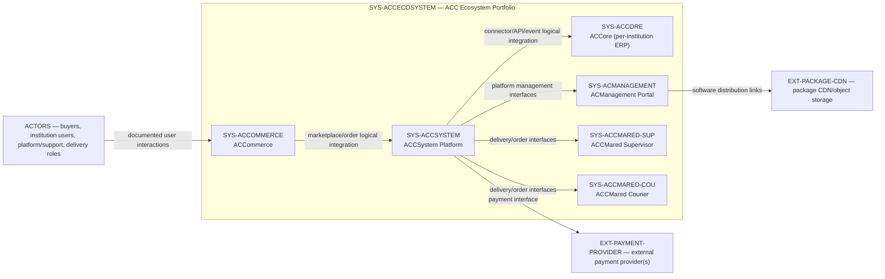

**Sources:** `registry/elements.json`, `registry/decomposition-map.json`, `decisions/ADR-001.md`, `ADR-002.md`, `ADR-004.md`, `ADR-005.md`, `ADR-008.md`, `ADR-009.md`, `supporting-views/interface-contracts.md`.

### C1-SYS-ACCECOSYSTEM — ACC Ecosystem Portfolio context

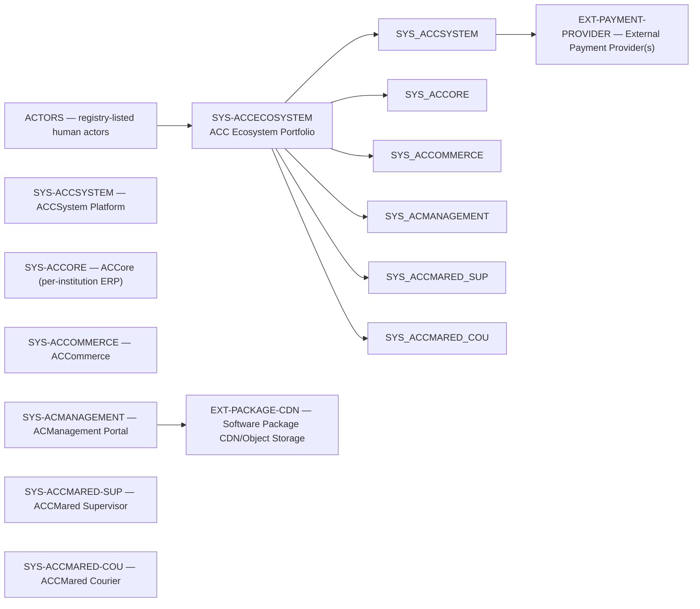
**System:** `SYS-ACCECOSYSTEM` — `ACC Ecosystem Portfolio`. **Status:** `PRESENT-INCOMPLETE` (literal coverage only; semantic/owner review remains open). **Source:** `00-discovery/discovery-report.md`.

### C1-SYS-ACCSYSTEM — ACCSystem Platform context
The canonical single-system context is [`context-diagram.md`](context-diagram.md). This section links to that black-box view rather than maintaining a second C1 diagram. The boundary, actor, and external-system records remain in [`systems/SYS-ACCSYSTEM.md`](systems/SYS-ACCSYSTEM.md). **Status:** scope and registry coverage are recorded; owner review of arrow semantics remains open.

### C1-SYS-ACCORE — ACCore (per-institution ERP) context

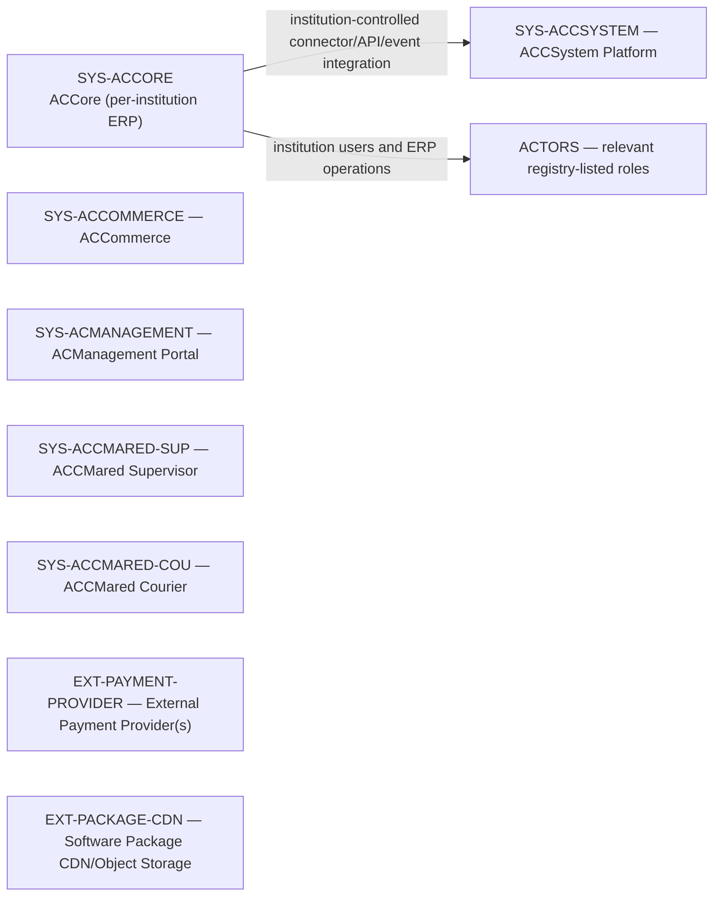
**System:** `SYS-ACCORE` — `ACCore (per-institution ERP)`. **Status:** `PRESENT-INCOMPLETE` (literal coverage only; semantic/owner review remains open). **Source:** `c1-context/systems/SYS-ACCORE.md`.

### C1-SYS-ACCOMMERCE — ACCommerce context

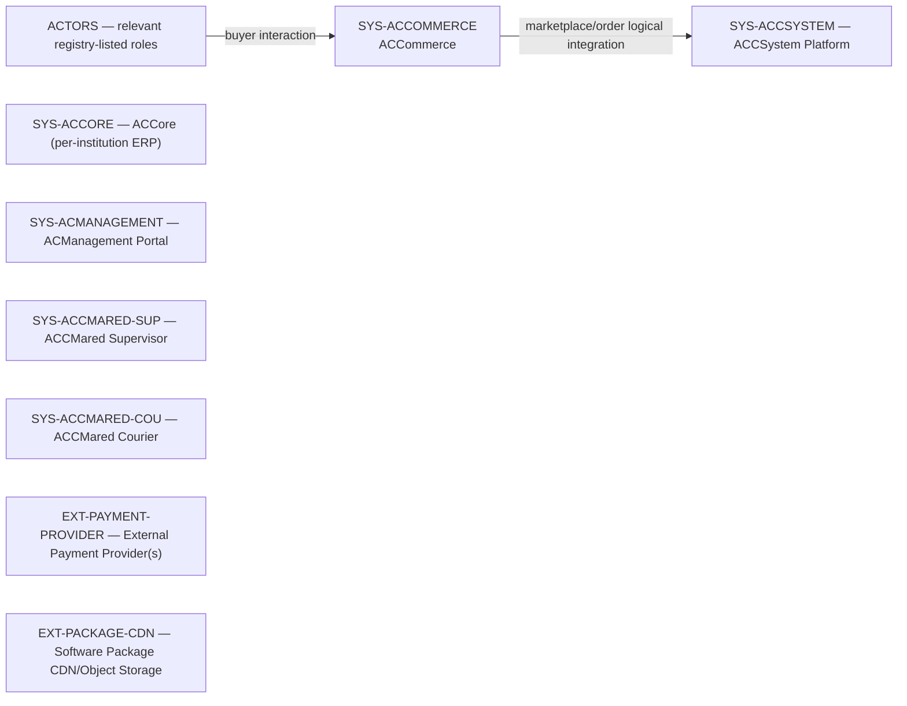
**System:** `SYS-ACCOMMERCE` — `ACCommerce`. **Status:** `PRESENT-INCOMPLETE` (literal coverage only; semantic/owner review remains open). **Source:** `c1-context/systems/SYS-ACCOMMERCE.md`.

### C1-SYS-ACMANAGEMENT — ACManagement Portal context

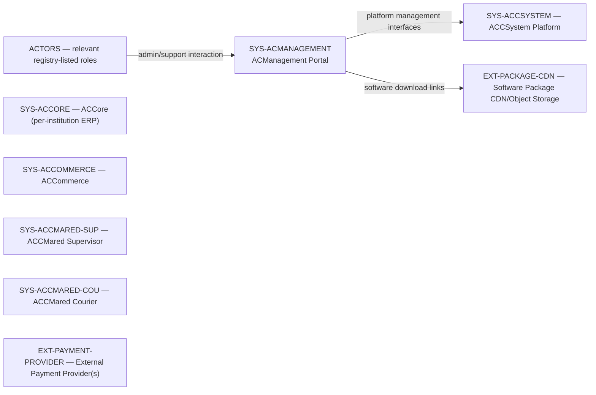
**System:** `SYS-ACMANAGEMENT` — `ACManagement Portal`. **Status:** `PRESENT-INCOMPLETE` (literal coverage only; semantic/owner review remains open). **Source:** `c1-context/systems/SYS-ACMANAGEMENT.md`.

### C1-SYS-ACCMARED-SUP — ACCMared Supervisor context

**System:** `SYS-ACCMARED-SUP` — `ACCMared Supervisor`. **Status:** `PRESENT-INCOMPLETE` (literal coverage only; semantic/owner review remains open). **Source:** `c1-context/systems/SYS-ACCMARED-SUP.md`.

### C1-SYS-ACCMARED-COU — ACCMared Courier context

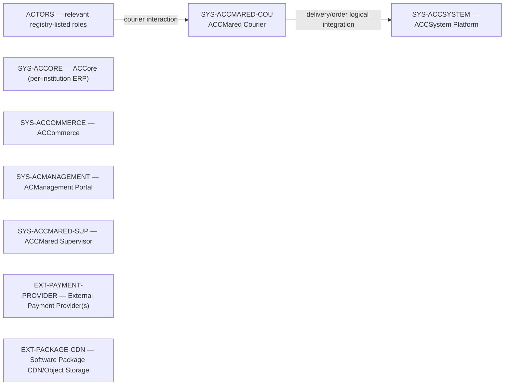
**System:** `SYS-ACCMARED-COU` — `ACCMared Courier`. **Status:** `PRESENT-INCOMPLETE` (literal coverage only; semantic/owner review remains open). **Source:** `c1-context/systems/SYS-ACCMARED-COU.md`.

## C2 — Container views

Each view is registry-derived. Containers are shown inside the owning system boundary; a co-deployment or shared platform does not imply shared data ownership.
### C2-SYS-ACCSYSTEM — containers of ACCSystem Platform

This overlay is a **registry-derived cross-check**, not a competing canonical graph. It shows the 17 registered ACCSystem containers and a limited set of source-supported logical interactions. The canonical ACCSystem C2 container graph, including its original relationships and supporting external/client context, is [`../c2-containers/accsystem/container-diagram.md`](../c2-containers/accsystem/container-diagram.md). The overlay's narrower relationship selection is not a claim that omitted interactions do not exist; source container records remain authoritative for detailed collaborators. Owner review of relationship semantics remains open.

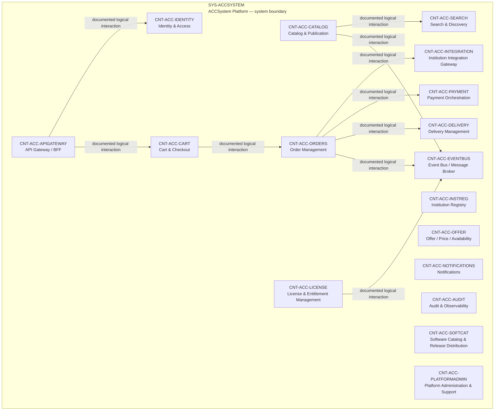
**Scope:** `SYS-ACCSYSTEM`. **Registry containers:** 17. **Source basis:** each container `doc` in `registry/elements.json`; relationships are limited to documented logical interactions.

### C2-SYS-ACCORE — containers of ACCore (per-institution ERP)

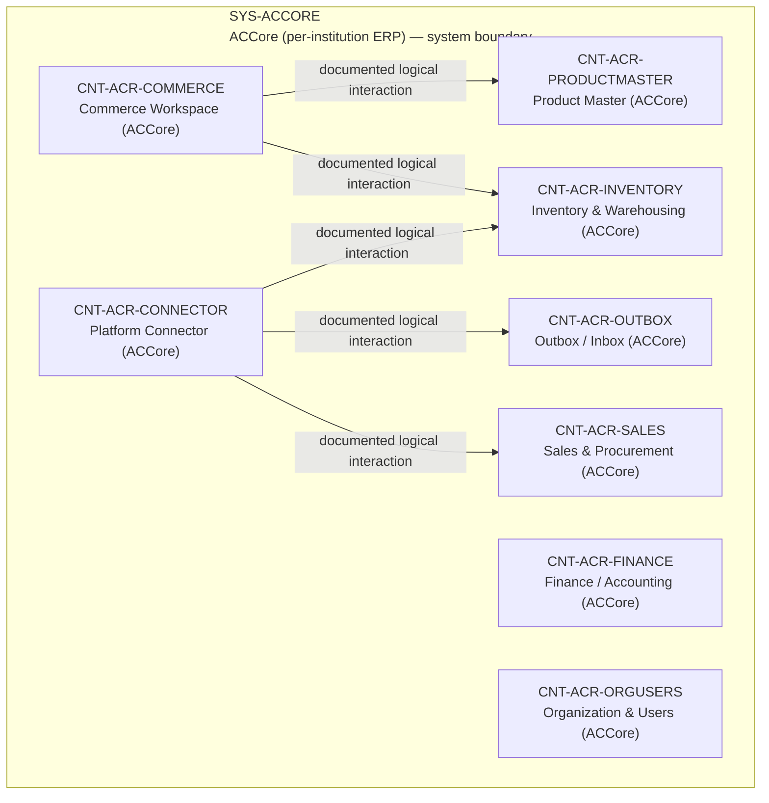
**Scope:** `SYS-ACCORE`. **Registry containers:** 8. **Source basis:** each container `doc` in `registry/elements.json`; relationships are limited to documented logical interactions.

### C2-SYS-ACCOMMERCE — containers of ACCommerce

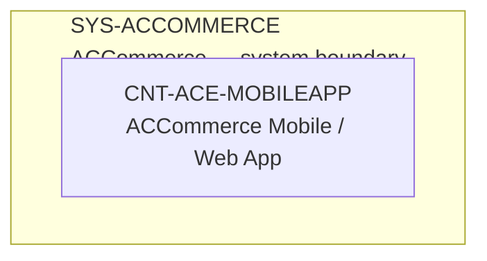
**Scope:** `SYS-ACCOMMERCE`. **Registry containers:** 1. **Source basis:** each container `doc` in `registry/elements.json`; relationships are limited to documented logical interactions.

### C2-SYS-ACMANAGEMENT — containers of ACManagement Portal

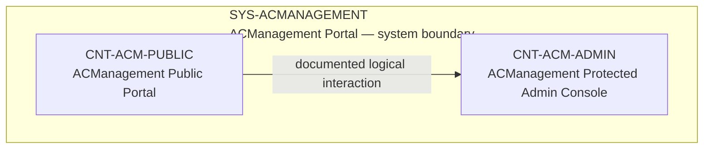
**Scope:** `SYS-ACMANAGEMENT`. **Registry containers:** 2. **Source basis:** each container `doc` in `registry/elements.json`; relationships are limited to documented logical interactions.

### C2-SYS-ACCMARED-SUP — containers of ACCMared Supervisor

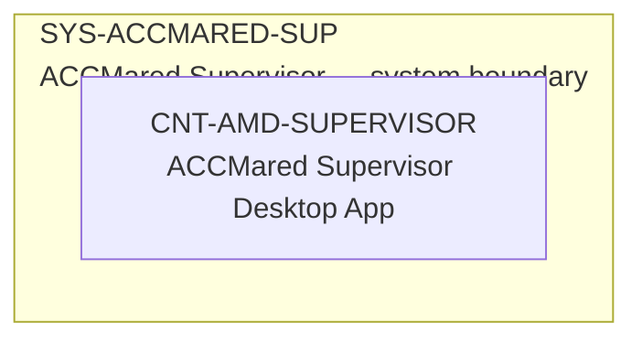
**Scope:** `SYS-ACCMARED-SUP`. **Registry containers:** 1. **Source basis:** each container `doc` in `registry/elements.json`; relationships are limited to documented logical interactions.

### C2-SYS-ACCMARED-COU — containers of ACCMared Courier

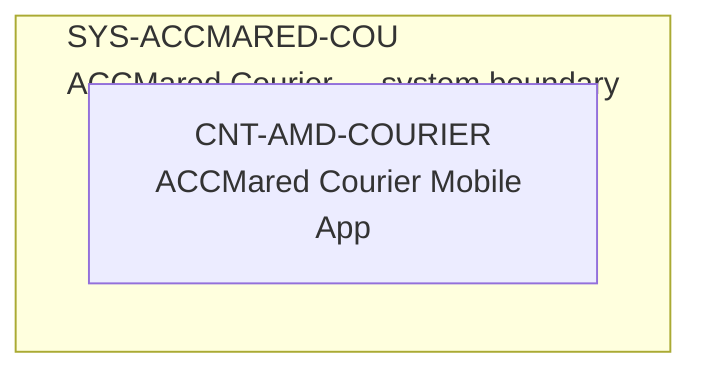
**Scope:** `SYS-ACCMARED-COU`. **Registry containers:** 1. **Source basis:** each container `doc` in `registry/elements.json`; relationships are limited to documented logical interactions.

## Registry and source links

- Registry: `registry/elements.json`, `registry/decomposition-map.json`, `registry/architecture-manifest.json`.
- Ownership and boundaries: `decisions/ADR-001.md`, `ADR-002.md`, `ADR-004.md`, `ADR-008.md`, `ADR-009.md`.
- Commerce invariants: `functions/specs/FN-ORD-CHECKOUT.md`, `FN-ORD-RESERVE.md`, `FN-PAY-AUTHORIZE.md`, `supporting-views/dynamic-purchase-flow.md`.
- Existing C3 views remain in their canonical paths under `c3-components/`; their IDs are checked in the coverage matrix.
