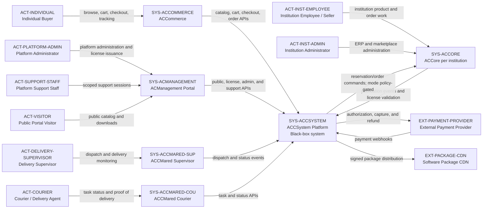

# C1 System Context — ACCSystem Platform

**System:** `SYS-ACCSYSTEM` — ACCSystem Platform
**Viewpoint:** C1 — System Context
**Canonical view:** This is the single canonical C1 context diagram for ACCSystem.

> ACCSystem is shown as one black-box software system. This C1 view shows its people, client systems, and external providers; it does not expose any internal containers or C3 components. The system boundary and direct relationships are drawn from [`SYS-ACCSYSTEM.md`](systems/SYS-ACCSYSTEM.md). The internal container decomposition belongs in [the canonical C2 diagram](../c2-containers/accsystem/container-diagram.md).

> **Arrow convention and approval:** This drawing follows the reversible technical convention recorded in ADR-020 (arrows indicate the interaction initiator, not exclusive data flow). ADR-020 remains `OWNER-REVIEW-REQUIRED` and `NOT STAKEHOLDER-APPROVED`; this diagram does not imply approval. ACCore connectivity mode remains policy-gated under ADR-015.

**Coverage at this level:** one ACCSystem black-box system, eight people/actor nodes, and seven external system/service nodes. There are no `CNT-*` containers or `CMP-*` components in this C1 diagram.
