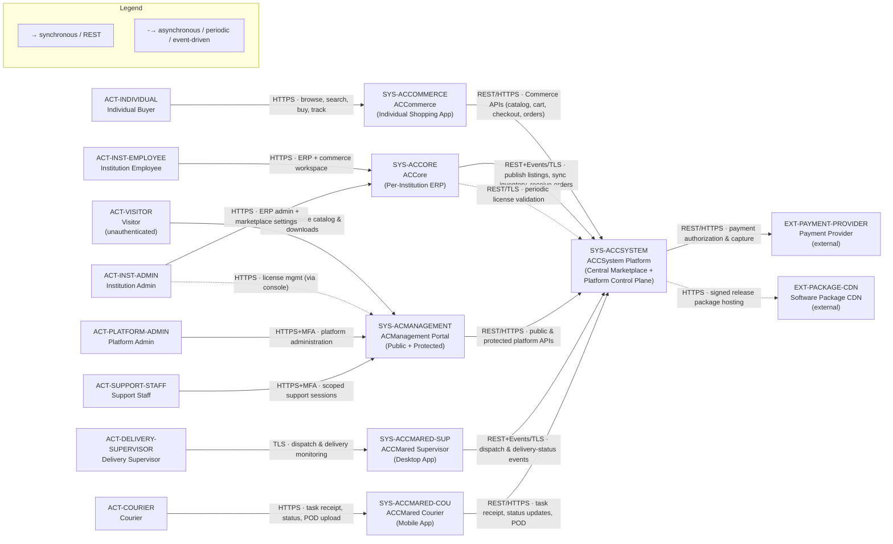

# ACC Ecosystem — System Landscape View

**Viewpoint:** Portfolio landscape — all systems, actors, and external dependencies  
**Audience:** Architects and stakeholders  
**Label convention:** `CONFIRMED` = sourced from idea.md | `ASSUMPTION` = inferred, not stated | `PROPOSAL` = recommended but not decided | `UNKNOWN` = open question

---

## 1. System Landscape Diagram

> [!NOTE]
> Dashed arrows (`-.->`) represent asynchronous, periodic, or event-driven interactions.
> Solid arrows (`-->`) represent synchronous REST/HTTPS interactions.

---

## 2. System Registry

| ID | Name | Type | Owner | Primary Responsibility | Trust Boundary |
|----|------|------|-------|----------------------|----------------|
| SYS-ACCSYSTEM | ACCSystem Platform | Central backend platform | Platform operator | Central marketplace, shared commerce services, institution integration, fulfilment, platform management control plane | CONFIRMED — idea.md §0, §3 |
| SYS-ACCORE | ACCore | Per-institution ERP + marketplace client | Institution-owned (deployed per institution) | Institution ERP (product master, inventory, sales, finance, org/users), Commerce Workspace, Platform Connector | CONFIRMED — idea.md §4 |
| SYS-ACCOMMERCE | ACCommerce | Individual shopping client app | Platform operator | Individual buyer experience: browse, search, cart, checkout, order tracking | CONFIRMED — idea.md §0, §2.1 |
| SYS-ACMANAGEMENT | ACManagement Portal | Web portal (public + protected admin console) | Platform operator | Public: ACC product catalog, releases, download links. Protected: license management, platform user admin, support sessions | CONFIRMED — idea.md §2.1.1 |
| SYS-ACCMARED-SUP | ACCMared Supervisor | Flutter desktop app | Platform operator | Delivery supervisor UI: dispatch, team management, delivery-status monitoring | CONFIRMED — idea.md §2.1 |
| SYS-ACCMARED-COU | ACCMared Courier | Mobile app | Platform operator | Courier UI: task receipt, status updates, proof-of-delivery upload | CONFIRMED — idea.md §2.1 |
| EXT-PAYMENT-PROVIDER | External Payment Provider | External SaaS | Third-party | Payment authorization, capture, refund — tokenized; no card data stored in ACCSystem | CONFIRMED — idea.md §3.1, §9 |
| EXT-PACKAGE-CDN | Software Package CDN | External CDN / Object Storage | Third-party / platform-configured | Hosting signed software installation packages for secure download | CONFIRMED — idea.md §2.1.1, §3.1 |

> [!IMPORTANT]
> **Key architectural principle (CONFIRMED — idea.md §0):**
> - **ACCSystem** = central marketplace + Platform Management Control Plane. It is NOT a monolithic ERP.
> - **ACCore** = one independent instance per institution, with its own backend and DB. No shared ERP database across institutions.
> - **ACManagement** = platform management client (web portal). It calls ACCSystem services; it is NOT a data owner and does NOT bypass Identity & Access.

---

## 3. Actor Registry

| ID | Name | Type | Trust Level | Authentication Method | Systems Accessed | Data Sensitivity |
|----|------|------|------------|----------------------|-----------------|-----------------|
| ACT-INDIVIDUAL | Individual Buyer | Human — end consumer | Low (public internet) | Platform account (CONFIRMED — idea.md §9) | SYS-ACCOMMERCE → SYS-ACCSYSTEM | Personal data, order history, payment tokens |
| ACT-INST-EMPLOYEE | Institution Employee | Human — institution staff | Medium (institution-scoped) | ACCore local auth + optional platform membership (CONFIRMED — idea.md §4.1) | SYS-ACCORE | Institution ERP data (product, inventory, sales) |
| ACT-INST-ADMIN | Institution Admin | Human — institution administrator | Medium-High (institution-scoped) | ACCore local auth; platform membership for license console (CONFIRMED — idea.md §2.1.1) | SYS-ACCORE; SYS-ACMANAGEMENT (license console) | Institution ERP + license entitlements |
| ACT-PLATFORM-ADMIN | Platform Administrator | Human — platform operator staff | High (platform-level) | ACCSystem identity + MFA (CONFIRMED — idea.md §9) | SYS-ACMANAGEMENT → SYS-ACCSYSTEM | Full platform admin scope; least-privilege enforced |
| ACT-SUPPORT-STAFF | Support Staff | Human — platform operator staff | High (platform-level, session-scoped) | ACCSystem identity + MFA; just-in-time scoped access (CONFIRMED — idea.md §9) | SYS-ACMANAGEMENT → SYS-ACCSYSTEM | Scoped to institution + purpose + time window |
| ACT-DELIVERY-SUPERVISOR | Delivery Supervisor | Human — delivery operations staff | Medium (platform-authenticated) | ACCSystem identity (CONFIRMED — idea.md §2.1) | SYS-ACCMARED-SUP → SYS-ACCSYSTEM | Delivery tasks, shipment state, courier assignments |
| ACT-COURIER | Courier / Delivery Agent | Human — delivery field agent | Medium (platform-authenticated) | ACCSystem identity; short-lived tokens (CONFIRMED — idea.md §9) | SYS-ACCMARED-COU → SYS-ACCSYSTEM | Assigned delivery tasks, POD data |
| ACT-VISITOR | Visitor | Human — unauthenticated public user | None / Public | None (unauthenticated) | SYS-ACMANAGEMENT (public portal only) | None — read-only public catalog |

---

## 4. Key Architectural Principles

| Principle | Meaning | Source |
|-----------|---------|--------|
| ACCSystem = marketplace hub | Shared commerce services, integration, fulfilment, platform control plane. Not a unified ERP. | CONFIRMED — idea.md §0, ADR-001 |
| ACCore = institution independence | One ACCore instance per institution, own DB, own ERP logic. No cross-institution DB sharing. | CONFIRMED — idea.md §4, ADR-002 |
| ACManagement = platform management client | Calls ACCSystem services (Software Catalog, License & Entitlement, Platform Admin & Support, Identity & Access). Does not own a database or bypass auth. | CONFIRMED — idea.md §2.1.1, ADR-009 |
| Marketplace copy, not source | ACCSystem holds a published market projection of product data; source of truth stays in ACCore. | CONFIRMED — idea.md §5, ADR-004 |
| No direct DB access across systems | Integration exclusively via documented APIs and events (Outbox/Inbox, Idempotency). | CONFIRMED — idea.md §1.2, §4.3, ADR-005 |
| License ≠ User permission | License & Entitlement determines what a product/module may run; Identity & Access determines what a user may do. | CONFIRMED — idea.md §1.1, §3.1.1, ADR-010 |

---

## 5. Source Evidence

| Claim | idea.md Reference |
|-------|-------------------|
| System responsibility table | §0 (Executive Summary boundary table) |
| ACManagement zones and non-responsibilities | §2.1.1 |
| ACCore independence and DB isolation | §4, §4.2 |
| ACCSystem bounded contexts | §3, §3.1 |
| Security controls: MFA, short-lived tokens, WAF | §9 |
| ADR registry | §14 |
| Deployment layers | §10.1 |
