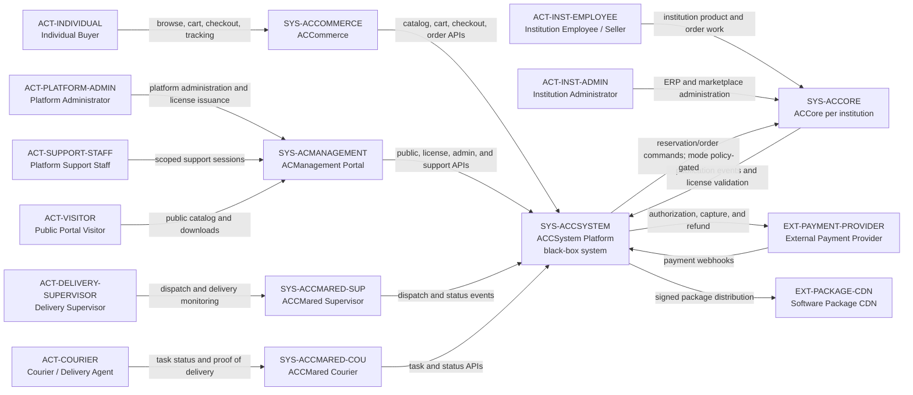

# SYS-ACCSYSTEM — ACCSystem Platform

**Viewpoint:** C1 System Context
**Level:** C1 — System
**Label convention:** `CONFIRMED (idea.md §X.X)` | `ASSUMPTION` | `PROPOSAL` | `UNKNOWN`

---

## 1. Identity

| Field | Value |
|-------|-------|
| **ID** | SYS-ACCSYSTEM |
| **Name** | ACCSystem Platform |
| **Role in ecosystem** | Central marketplace + Platform Management Control Plane |
| **Scope boundary** | Owns and operates: shared marketplace commerce services (catalog, search, cart, checkout, orders), institution integration gateway, fulfilment (payment, delivery, notifications), and the Platform Management Control Plane (software catalog, license & entitlement management, platform administration & support). Does **NOT** own: institution ERP data, ACCore internal databases, local employee/role management within institutions, card-sensitive payment data. |

> [!IMPORTANT]
> **CONFIRMED (idea.md §0, §3):** ACCSystem is a central marketplace and integration platform, **not** a unified ERP. Each institution's operational data remains in its own ACCore instance.

---

## 2. Actors and Users of This System

| Actor ID | Name | Interaction | Label |
|----------|------|-------------|-------|
| ACT-INDIVIDUAL | Individual Buyer | Browses, searches, carts, checks out, tracks orders via ACCommerce → ACCSystem Commerce APIs | CONFIRMED (idea.md §2.1) |
| ACT-INST-EMPLOYEE | Institution Employee / Seller | Publishes products, checks inventory availability, receives order events via ACCore → ACCSystem Integration APIs | CONFIRMED (idea.md §4.1) |
| ACT-INST-ADMIN | Institution Administrator | Manages listings, monitors order status, manages licenses via ACManagement → ACCSystem Platform APIs | CONFIRMED (idea.md §2.1.1) |
| ACT-PLATFORM-ADMIN | Platform Administrator | Manages platform users, issues licenses, grants admin privileges via ACManagement Protected Console → ACCSystem | CONFIRMED (idea.md §9) |
| ACT-SUPPORT-STAFF | Platform Support Staff | Performs scoped, time-limited support sessions via ACManagement → ACCSystem Platform Administration APIs | CONFIRMED (idea.md §9) |
| ACT-DELIVERY-SUPERVISOR | Delivery Supervisor | Receives dispatch commands, monitors delivery status via ACCMared Supervisor → ACCSystem Delivery APIs | CONFIRMED (idea.md §2.1) |
| ACT-COURIER | Courier / Delivery Agent | Receives task assignments, updates delivery status, uploads proof-of-delivery via ACCMared Courier → ACCSystem Delivery APIs | CONFIRMED (idea.md §2.1) |
| ACT-VISITOR | Public Portal Visitor | Browses ACC software catalog, downloads release packages via ACManagement Public Portal → ACCSystem Software Catalog APIs (unauthenticated public endpoints) | CONFIRMED (idea.md §2.1.1) |

---

## 3. External Systems Consumed

| External System ID | Name | Purpose | Protocol | Label |
|-------------------|------|---------|----------|-------|
| EXT-PAYMENT-PROVIDER | External Payment Provider(s) | Payment authorization, capture, refund via tokenized integration; no card data stored in ACCSystem | REST/HTTPS + Webhook callbacks | CONFIRMED (idea.md §3.1, §9) |
| EXT-PACKAGE-CDN | Software Package CDN / Object Storage | Hosting signed software installation packages; ACCSystem issues signed/time-limited download URLs | HTTPS + signed URLs | CONFIRMED (idea.md §2.1.1, §3.1) |

---

## 3A. C1 System Context Diagram
This is the C4 system-context view for `SYS-ACCSYSTEM`. ACCSystem is intentionally shown as a black-box system; internal containers belong only in the C2 view at [`c1-context/landscape.md`](../landscape.md).

> [!NOTE]
> C1 arrows show the control/data-flow initiator. Responses, callbacks, and events are shown only where they affect the system-context relationship. This view does not claim a selected ACCore deployment mode; ADR-015 remains policy-gated.

---

## 4. Connections to Other Platform Systems

| System ID | Direction | Protocol | Purpose | Label |
|-----------|-----------|----------|---------|-------|
| SYS-ACCOMMERCE | Inbound | REST/HTTPS | Commerce APIs: catalog query, cart, checkout, order creation & tracking | CONFIRMED (idea.md §2.1) |
| SYS-ACCORE | Logical bidirectional integration; transport is outbound-initiated by default, with optional protected inbound/polling per ADR-015 | REST+Events / TLS; exact mode is policy-gated | Product publication events, reservation requests/responses, order events, license validation requests | Capability CONFIRMED (idea.md §4.3, §6.2, §6.3); transport direction/mode PROPOSED/approval-required |
| SYS-ACMANAGEMENT | Inbound | REST/HTTPS | Public software catalog & download APIs; protected license management, platform admin, support session APIs | CONFIRMED (idea.md §2.1.1, §3.1.1) |
| SYS-ACCMARED-SUP | Inbound | REST+Events / TLS | Delivery dispatch commands, delivery status events | CONFIRMED (idea.md §2.1, ADR-008) |
| SYS-ACCMARED-COU | Inbound | REST/HTTPS | Task assignment retrieval, status updates, proof-of-delivery upload | CONFIRMED (idea.md §2.1, ADR-008) |
| EXT-PAYMENT-PROVIDER | Outbound | REST/HTTPS + Webhook | Payment auth/capture/refund requests; receives payment result webhooks | CONFIRMED (idea.md §3.1) |
| EXT-PACKAGE-CDN | Outbound | HTTPS | Publishes/stores signed release packages; generates signed download URLs | CONFIRMED (idea.md §3.1, §10.1) |

---

## 5. Key Responsibilities

### What ACCSystem OWNS
- `CONFIRMED (idea.md §3.1)` Marketplace-projected copy of product listings (not the original ACCore product master)
- `CONFIRMED (idea.md §3.1)` Cart and checkout sessions
- `CONFIRMED (idea.md §3.1)` Central order records (parent orders, seller orders, order state machine)
- `CONFIRMED (idea.md §3.1)` Payment transaction records and payment provider reference IDs
- `CONFIRMED (idea.md §3.1)` Delivery shipments, task assignments, proof-of-delivery records
- `CONFIRMED (idea.md §3.1)` Notification templates and delivery state
- `CONFIRMED (idea.md §3.1)` Audit event log and observability data
- `CONFIRMED (idea.md §3.1)` Software release catalog metadata, version records, file checksums
- `CONFIRMED (idea.md §3.1)` License and entitlement records (license state, activations, usage, validity)
- `CONFIRMED (idea.md §3.1)` Platform account management workflows, admin roles, support session records
- `CONFIRMED (idea.md §3.1)` Integration sync state, message records, institution connector configuration

### What ACCSystem does NOT OWN
- `CONFIRMED (idea.md §4, §5)` Original product master data, operational inventory, internal financial records — owned by ACCore per institution
- `CONFIRMED (idea.md §9)` Card-sensitive payment data — tokenized at payment provider
- `CONFIRMED (idea.md §4.1)` Institution employee profiles, local ERP roles, ACCore-internal user management
- `CONFIRMED (idea.md §3.1)` Software installation package binaries — stored in EXT-PACKAGE-CDN object storage

---

## 6. Technology Stack / Hosting Form

| Aspect | Value | Label |
|--------|-------|-------|
| Hosting form | Cloud-hosted, platform-operated | UNKNOWN — hosting provider and cloud platform not specified in idea.md |
| Service style | Bounded-context microservices (17 containers) | CONFIRMED (idea.md §3, §3.2, ADR-012) |
| Communication patterns | Synchronous REST/HTTPS for query/commands; Asynchronous events (Event Bus) for integration workflows | CONFIRMED (idea.md §6.1, ADR-005) |
| Idempotency / reliability | Transactional Outbox, Inbox/Processed Message Store, DLQ, retry with back-off | CONFIRMED (idea.md §6.5) |
| Security | TLS in transit, encryption at rest for sensitive data, RBAC/ABAC, MFA for admin, WAF + rate limiting on public edge | CONFIRMED (idea.md §9) |
| Specific tech stack | UNKNOWN — no technology choices (language, framework, database engine, message broker product) confirmed in idea.md |

> [!NOTE]
> Technology stack selection is an open pre-implementation decision. UNKNOWN items do not block architecture design but must be resolved before implementation planning.

---

## 7. Open Decisions Affecting This System

Sourced from idea.md §12 — Open Decisions:

| Decision | Consequence if Unresolved | Recommended Resolution | Owner | Revisit Trigger |
|----------|--------------------------|----------------------|-------|-----------------|
| Multi-seller cart in MVP | Required owner direction | ParentOrder + SellerOrders; independent seller reservations; all required reservations before payment authorization | ACCEPTED-OWNER / ADR-016 | MVP checkout design |
| Payment model (auth + capture) | Determines when funds are committed; affects order state machine transitions | Auth-then-capture per payment provider capability | OWNER_UNASSIGNED | Before Phase 3 (Payment) design start |
| Financial record commitment point | Determines when ACCore registers the sale/purchase — affects ERP reconciliation | Define agreed states (e.g., OrderConfirmed or Shipped) as ERP trigger points | OWNER_UNASSIGNED | Before Phase 2/5 B2B design start |
| Settlement / commissions | Whether ACCSystem acts as a payment intermediary requires a separate Settlement domain | Define platform role: passthrough or intermediary; scope Settlement domain if needed | OWNER_UNASSIGNED | Before Phase 3 finalization |
| Returns / disputes | Cancellation and return domain must be scoped before commercial scale | Treat Returns/Disputes as a first-class domain capability; scope in Phase 6 | OWNER_UNASSIGNED | Before Phase 6 (Scale & Operations) |
| ACCSystem offline behavior (impact on ACCore) | Undefined offline behavior creates unacceptable promises | Define what ACCore can do locally vs. what blocks on ACCSystem connectivity | OWNER_UNASSIGNED | Before Phase 1 integration design |
| Multi-currency / tax | Price display and accounting require a consistent currency/tax model | Confirm single currency for MVP; design multi-currency/tax model for Phase 6 | OWNER_UNASSIGNED | Before Phase 2 checkout design |
| Delivery provider scope | Whether ACCMared manages platform-only fleet or external providers changes delivery model | Define scope; affects CNT-ACC-DELIVERY adapter design | OWNER_UNASSIGNED | Before Phase 4 (Delivery) design start |
| License model types | Entitlement data shape, validation logic, and ACCore integration depend on license model definition | Define license types (per-institution, per-install, per-module, per-seat, capacity-based) | OWNER_UNASSIGNED | Before Phase 1 License & Entitlement implementation |
| Support session policy | Scope and approval model for support access affects CNT-ACC-PLATFORMADMIN design | Define: per-session consent vs. pre-authorization; max duration, data masking rules | OWNER_UNASSIGNED | Before Phase 1 Platform Admin baseline implementation |

---

## 8. C2 Disposition — Containers

ACCSystem is decomposed into **17 containers** in the C2 layer. The canonical relationship diagram is [`c1-context/landscape.md`](../landscape.md); the table below maps each container to its individual record.

| Container ID | Name | C2 Doc | Decomposition Status |
|-------------|------|--------|---------------------|
| CNT-ACC-APIGATEWAY | API Gateway / BFF | `c2-containers/accsystem/CNT-ACC-APIGATEWAY.md` | EXCEPTION |
| CNT-ACC-IDENTITY | Identity & Access | `c2-containers/accsystem/CNT-ACC-IDENTITY.md` | IN_PROGRESS |
| CNT-ACC-INSTREG | Institution Registry | `c2-containers/accsystem/CNT-ACC-INSTREG.md` | EXCEPTION |
| CNT-ACC-INTEGRATION | Institution Integration Gateway | `c2-containers/accsystem/CNT-ACC-INTEGRATION.md` | IN_PROGRESS |
| CNT-ACC-CATALOG | Catalog & Publication | `c2-containers/accsystem/CNT-ACC-CATALOG.md` | IN_PROGRESS |
| CNT-ACC-SEARCH | Search & Discovery | `c2-containers/accsystem/CNT-ACC-SEARCH.md` | EXCEPTION |
| CNT-ACC-OFFER | Offer / Price / Availability | `c2-containers/accsystem/CNT-ACC-OFFER.md` | EXCEPTION |
| CNT-ACC-CART | Cart & Checkout | `c2-containers/accsystem/CNT-ACC-CART.md` | EXCEPTION |
| CNT-ACC-ORDERS | Order Management | `c2-containers/accsystem/CNT-ACC-ORDERS.md` | IN_PROGRESS |
| CNT-ACC-PAYMENT | Payment Orchestration | `c2-containers/accsystem/CNT-ACC-PAYMENT.md` | IN_PROGRESS |
| CNT-ACC-DELIVERY | Delivery Management | `c2-containers/accsystem/CNT-ACC-DELIVERY.md` | EXCEPTION |
| CNT-ACC-NOTIFICATIONS | Notifications | `c2-containers/accsystem/CNT-ACC-NOTIFICATIONS.md` | EXCEPTION |
| CNT-ACC-AUDIT | Audit & Observability | `c2-containers/accsystem/CNT-ACC-AUDIT.md` | EXCEPTION |
| CNT-ACC-SOFTCAT | Software Catalog & Release Distribution | `c2-containers/accsystem/CNT-ACC-SOFTCAT.md` | EXCEPTION |
| CNT-ACC-LICENSE | License & Entitlement Management | `c2-containers/accsystem/CNT-ACC-LICENSE.md` | IN_PROGRESS |
| CNT-ACC-PLATFORMADMIN | Platform Administration & Support | `c2-containers/accsystem/CNT-ACC-PLATFORMADMIN.md` | EXCEPTION |
| CNT-ACC-EVENTBUS | Event Bus / Message Broker | `c2-containers/accsystem/CNT-ACC-EVENTBUS.md` | EXCEPTION |

> [!NOTE]
> This document does not claim 100% completeness, stakeholder approval, or production readiness. All assertions are labeled per governance rules.

---

*Last updated: 2026-11-15 | Source: idea.md v1.1*
