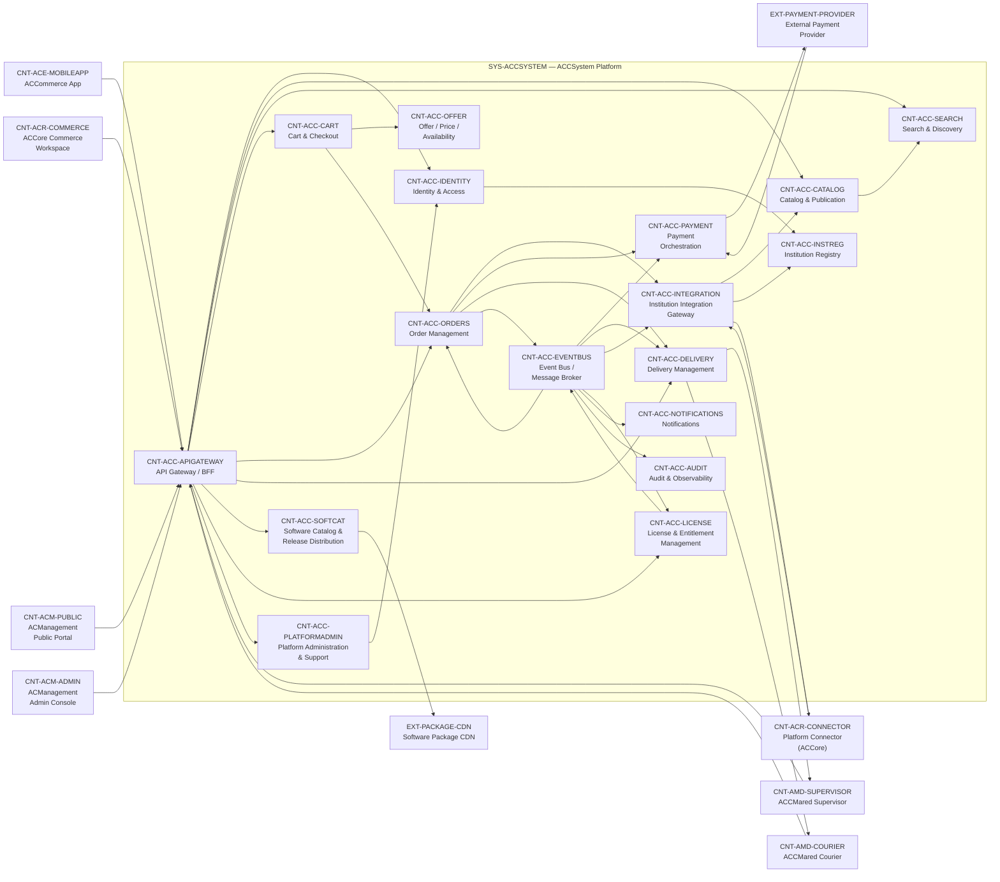

# ACCSystem — Container Diagram
**Viewpoint:** C2 — ACCSystem Platform internal containers and their primary relationships
**Canonical location:** `c2-containers/accsystem/container-diagram.md` — ACCSystem C2 container view.
**Audience:** Architects and developers
**Label convention:** `CONFIRMED` = sourced from idea.md | `ASSUMPTION` = inferred | `UNKNOWN` = open

> [!NOTE]
> **C2 scope:** This is the internal container decomposition of `SYS-ACCSYSTEM`. Selected client and external-system nodes are shown only to make container entry/exit relationships readable; this is not the C1 black-box context view. The C1 black-box context is the separate canonical [`c1-context/context-diagram.md`](../../c1-context/context-diagram.md).

> [!NOTE]
> **Arrow convention:** Arrows show the control/data-flow initiator direction. Responses, callbacks, and events may flow in either direction and are shown only when explicitly labelled. This remains a reversible technical baseline; ADR-020 owner review is required and stakeholder approval has not been recorded.

## Container Diagram

## Container inventory
The diagram covers the 17 registered ACCSystem containers. Individual `CNT-*` records remain the source for each container's responsibility, collaborators, ownership, and decomposition status.

| Container ID | Name | C3 status |
|---|---|---|
| CNT-ACC-APIGATEWAY | API Gateway / BFF | EXCEPTION |
| CNT-ACC-IDENTITY | Identity & Access | SELECTED |
| CNT-ACC-INSTREG | Institution Registry | EXCEPTION |
| CNT-ACC-INTEGRATION | Institution Integration Gateway | SELECTED |
| CNT-ACC-CATALOG | Catalog & Publication | SELECTED |
| CNT-ACC-SEARCH | Search & Discovery | EXCEPTION |
| CNT-ACC-OFFER | Offer / Price / Availability | EXCEPTION |
| CNT-ACC-CART | Cart & Checkout | EXCEPTION |
| CNT-ACC-ORDERS | Order Management | SELECTED |
| CNT-ACC-PAYMENT | Payment Orchestration | SELECTED |
| CNT-ACC-DELIVERY | Delivery Management | EXCEPTION |
| CNT-ACC-NOTIFICATIONS | Notifications | EXCEPTION |
| CNT-ACC-AUDIT | Audit & Observability | EXCEPTION |
| CNT-ACC-SOFTCAT | Software Catalog & Release Distribution | EXCEPTION |
| CNT-ACC-LICENSE | License & Entitlement Management | SELECTED |
| CNT-ACC-PLATFORMADMIN | Platform Administration & Support | EXCEPTION |
| CNT-ACC-EVENTBUS | Event Bus / Message Broker | EXCEPTION |

## Notes and evidence limits
- All client connections to ACCSystem pass through `CNT-ACC-APIGATEWAY`.
- `CNT-ACC-IDENTITY` validates tokens on authenticated requests; repeated request-level edges are omitted for readability.
- `CNT-ACC-EVENTBUS` is the shared asynchronous backbone; services publish/subscribe through the documented Outbox/Inbox patterns.
- ACCore integration is bidirectional at the capability level; concrete transport and authentication mode remain policy-gated under ADR-015.
- This diagram represents logical relationships, not deployment topology or implementation readiness.

**Sources:** `registry/decomposition-map.json`, `c1-context/systems/SYS-ACCSYSTEM.md`, individual `c2-containers/accsystem/CNT-*.md` records, ADR-005, ADR-012, ADR-015, and ADR-020.
