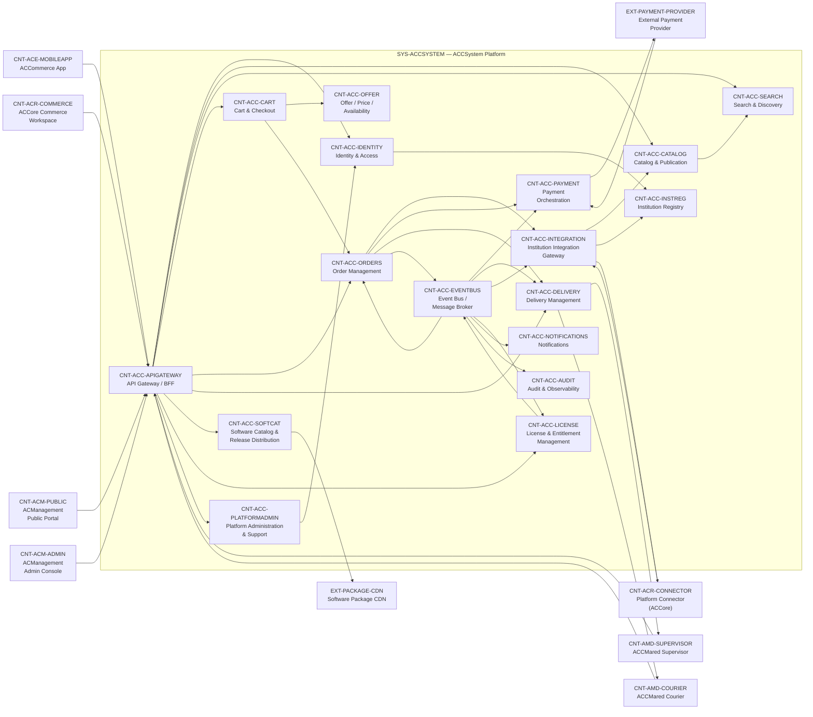

# ACCSystem Container Diagram

**Viewpoint:** C2 — ACCSystem Platform internal containers and their primary relationships  
**Audience:** Architects and developers  
**Label convention:** `CONFIRMED` = sourced from idea.md | `ASSUMPTION` = inferred | `UNKNOWN` = open

**Relationship to the registry overlay:** This is the separate detailed C2 view for ACCSystem. It adds selected client/system and external context around the internal containers and shows a broader set of primary relationships. The registry-derived [overlay view](../../c1-context/c4-context-and-container-overlays.md#c2-sys-accsystem--containers-of-accsystem-platform) is retained separately; neither view is declared authoritative over the other, and the choice between complementary views or an accepted reconciliation remains an owner/architecture gate.

---

## Container Diagram

---

## Notes

- All client connections to ACCSystem pass through CNT-ACC-APIGATEWAY (HTTPS/TLS)
- CNT-ACC-IDENTITY validates tokens on every authenticated request (not shown on every arrow for clarity)
- CNT-ACC-AUDIT receives observability signals from all services (not shown for clarity)
- CNT-ACC-EVENTBUS is the shared async backbone; services publish/subscribe via Outbox/Inbox pattern
- ACCore integration is bidirectional: ACCore publishes product events; ACCSystem sends reservation requests and order confirmations

**Technology:** UNKNOWN — container orchestration platform not selected. OWNER_UNASSIGNED.

> [!NOTE]
> This diagram shows logical relationships, not deployment topology. Deployment topology in `supporting-views/deployment-view.md`.
