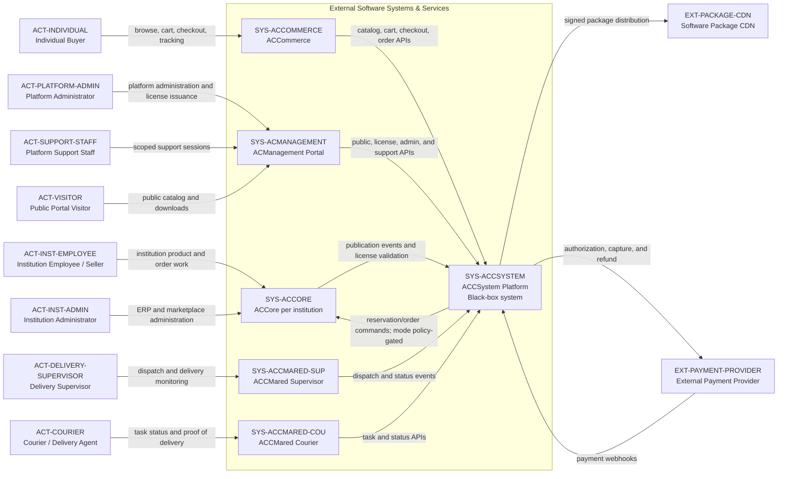

# C2 System container  — ACCSystem Platform

**System:** `SYS-ACCSYSTEM` — ACCSystem Platform
**Viewpoint:** C2 — System container 
**Canonical view:** This is the single canonical C2 context diagram for ACCSystem.

> ACCSystem is shown as one black-box software system. This C2 view shows its people, client systems, and external providers; it does not expose any internal containers or C3 components. The system boundary and direct relationships are drawn from [`SYS-ACCSYSTEM.md`](systems/SYS-ACCSYSTEM.md). The internal container decomposition belongs in [the canonical C2 diagram](../c2-containers/accsystem/container-diagram.md).

> **Arrow convention and approval:** This drawing follows the reversible technical baseline recorded in ADR-020: arrows indicate the **logical interaction initiator**, not exclusive data flow or physical network-connection initiation. Responses/callbacks may flow back; ACCore transport remains separately policy-gated under ADR-015 (outbound-initiated default for firewalled institutions, protected inbound optional). ADR-020 remains `OWNER-REVIEW-REQUIRED` and `NOT STAKEHOLDER-APPROVED`; this diagram does not imply approval.

**Coverage at this level:** one ACCSystem black-box system, eight people/actor nodes, and seven external system/service nodes. There are no `CNT-*` containers or `CMP-*` components in this C2 diagram.
