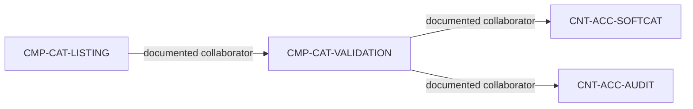

# CMP-CAT-VALIDATION — Publication Validator

**Component ID:** CMP-CAT-VALIDATION  
**Container:** CNT-ACC-CATALOG  
**System:** SYS-ACCSYSTEM  
**C4 Level:** C3 — Component  
**Status:** DRAFT | Evidence: idea.md §3.1, §4

---

## 1. Identity

| Field | Value |
|---|---|
| **ID** | CMP-CAT-VALIDATION |
| **Name** | Publication Validator |
| **Container** | CNT-ACC-CATALOG |
| **Responsibility** | Validates incoming product publication payloads against platform content policy before a listing is created or updated. Returns a verdict (PASS/FAIL + reasons). |

---

## 2. Collaborators

| Collaborator | Direction | Interface / Event | Purpose |
|---|---|---|---|
| CMP-CAT-LISTING | Inbound call | Internal sync call | Receives publication payload; returns PASS or FAIL + rejection reasons |
| CNT-ACC-SOFTCAT | Outbound query | Internal API | Validates product category is listed in Software Catalog (for software products) |
| CNT-ACC-AUDIT | Outbound | Audit entry | Records validation outcome with rule IDs |
| Policy Rule Store | Read | Config / DB | Loads active content policy rules |

---

## Component Relationship Diagram
> Derived only from the collaborator/interface references in this document; no relationship is added here beyond the source text.

## 3. Data Owned

**No persistent entities owned.** Stateless per-request validation.

**Policy Rule (config, not operational data):**
```
rule_id         string (e.g., "RULE-TITLE-MIN-LEN")
rule_type       enum {FORMAT, COMPLETENESS, CONTENT, CATEGORY}
severity        enum {ERROR, WARNING}
parameters      JSON (e.g., {"min_length": 10})
active          boolean
```

**Validation Report (transient, not persisted):**
```
result          enum {PASS, FAIL}
violations      list of {rule_id, field, message}
warnings        list of {rule_id, field, message}
```

---

## 4. Behavior / Rules / State

### Validation Categories

| Category | Rules (PARTIAL — exact policy UNKNOWN) |
|---|---|
| **Completeness** | title non-empty, description non-empty, price > 0, at least one media_ref present |
| **Format** | title length ≤ 500 chars, description length ≤ 5000 chars (ASSUMPTION), price is valid decimal |
| **Content** | No prohibited keywords (UNKNOWN — policy list not defined in idea.md §12). OWNER_UNASSIGNED |
| **Category** | For software products: `category_id` must exist in CNT-ACC-SOFTCAT (ASSUMPTION) |

> [!WARNING]  
> **UNKNOWN — Content Policy:** idea.md §12 does not define exact content policy rules. This component's behavior depends on a policy definition that must be provided by platform operations team. Until defined, only format/completeness checks are implementable. Owner: OWNER_UNASSIGNED. Revisit trigger: Content policy specification.

### Processing Logic
1. Load active rules from Policy Rule Store (cache TTL is a controlled, unapproved Operations/Product policy)
2. For each rule: evaluate against payload field
3. If any `ERROR`-severity rule fails → result = FAIL
4. If only `WARNING`-severity failures → result = PASS (warnings recorded)
5. Return `{result, violations, warnings}` to CMP-CAT-LISTING
6. Write audit entry regardless of result

---

## 5. Failure Modes

| Failure | Detection | Mitigation |
|---|---|---|
| Policy rule store unavailable | Connection timeout | Fail-open (PASS with warning) or fail-closed (FAIL with SYSTEM_ERROR) — UNKNOWN: policy not decided; ASSUMPTION: fail-closed for safety |
| Software Catalog unavailable | Query timeout | Fail-closed on category check; leave listing in PENDING_REVIEW |
| Rule evaluation exception | Exception per rule | Skip that rule; log; treat as WARNING — do not block publication for rule engine bug |
| Infinite retry on FAIL | No loop possible | FAIL results do not trigger retry — seller must re-submit corrected publication |

---

## 6. Security

| Concern | Control |
|---|---|
| Input sanitization | All text fields sanitized (HTML/script stripping) before rule evaluation |
| Privilege | No external callers — only CMP-CAT-LISTING can invoke; enforced by internal service boundary |
| Policy update access | Policy rules updated only by platform admin via CNT-ACC-PLATFORMADMIN; not writable by institutions |

---

## 7. Operational Concerns

| Concern | Note |
|---|---|
| Rule cache invalidation | On policy update, cache must be invalidated; ASSUMPTION: event-driven invalidation on policy change |
| Validation latency | Synchronous handler target requires workload evidence and Operations/Product approval; no value established |
| Observability | Emit metrics: validations/min, FAIL rate by rule_id, institution_id — enables policy tuning |

---

## 8. Traceability

| Claim | Evidence |
|---|---|
| Content validation before listing | PROPOSAL — logical requirement for a marketplace; not explicitly detailed in idea.md §4 |
| Content policy rules undefined | UNKNOWN (idea.md §12 — open decisions) |
| Software Catalog as category authority | ASSUMPTION — consistent with idea.md §7 (Software Catalog service) |

---

*Generated: 2026-11-15 | Not stakeholder-approved | Not production-ready*


---

## 8. Verification and Tests

### 8.1 Acceptance Test Scenarios

| Scenario | Input / Precondition | Expected Verification Outcome |
|---|---|---|
| Valid listing schema | Listing conforms to JSON schema rules | Validation passes; control returns to Listing manager |
| Missing mandatory field | Listing payload missing required `price` or `title` | Validation fails with field-specific error codes; rejection logged |
| Malformed price | Negative or zero price submitted | Rejection with `INVALID_PRICE_VALUE`; transaction aborted |
