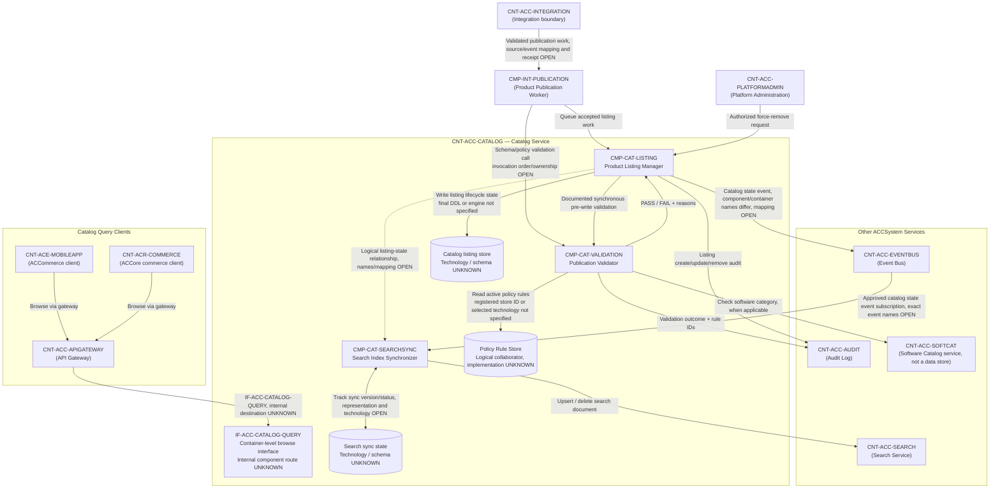

# C3 Component Diagram — CNT-ACC-CATALOG (Catalog Service)

**Container:** CNT-ACC-CATALOG  
**System:** SYS-ACCSYSTEM  
**Status:** DRAFT | Evidence: component records, CNT-ACC-CATALOG container record, IF-ACC-CATALOG-QUERY, ADR-004/005

---

## Component Interaction Diagram

`IF-ACC-CATALOG-QUERY` is a registered container-level interface. Its consumers are documented, but no source assigns it to a particular C3 component; the internal route remains **UNKNOWN**. The diagram therefore connects the gateway to the interface boundary, not to `CMP-CAT-LISTING` or `CMP-CAT-SEARCHSYNC`. API field examples in the interface-contracts view are assumptions/proposals, not an approved OpenAPI schema.

The component records assign validation calls to both `CMP-INT-PUBLICATION` and `CMP-CAT-LISTING`. This view shows both documented logical relationships, but does not settle whether validation occurs once or twice, which component owns the invocation, or the exact ordering. `Policy Rule Store` is named in the validator record but has no registered component ID, implementation, schema, or selected technology; it is shown only as a logical data collaborator.

The Catalog component record describes SQL access, while the C2 container record leaves the data store as relational-or-document and **UNKNOWN**. No database engine, DDL, or final data schema is established; the store labels above intentionally remain technology/schema-neutral. Component records also use inconsistent listing-event names (`ListingApproved` / `ListingUpdated` / `ListingRemoved`, while the container record says `ListingApproved` / `ListingUpdated` / `ListingWithdrawn`). The dashed Listing-to-SearchSync edge is a logical collaborator relation; the EventBus subscription is the separately documented delivery path. Final event vocabulary, source-withdrawal mapping, and publication/receipt contract remain **OPEN**. `CNT-ACC-SOFTCAT` is a separate service and does not store package binaries; package storage/distribution is associated with `EXT-PACKAGE-CDN`.

---

## Component Summary

| Component | ID | Role |
|---|---|---|
| Product Listing Manager | CMP-CAT-LISTING | Owns the marketplace Listing projection and lifecycle; not the product master |
| Publication Validator | CMP-CAT-VALIDATION | Returns validation verdicts; policy rules and caller ordering remain open |
| Search Index Synchronizer | CMP-CAT-SEARCHSYNC | Projects approved Catalog state into CNT-ACC-SEARCH; exact event mapping remains open |

---

## Key Flows

### Flow 1 — Product Publication
1. `CMP-INT-GATEWAY` routes a validated publication request to **CMP-INT-PUBLICATION**.
2. The worker records accepted delivery intent and forwards the publication work to Catalog; the exact receipt/`listing_id` allocation timing remains open.
3. The component records describe validation before a listing write, but differ on whether the Publication Worker, Listing Manager, or both invoke **CMP-CAT-VALIDATION**. The invocation order and duplicate-validation behavior remain open.
4. **CMP-CAT-LISTING** owns the marketplace projection write after the applicable admission/moderation rules are satisfied.
5. The Catalog state is published through the documented durable event path; event names and mapping from source events remain open.
6. **CMP-CAT-SEARCHSYNC** consumes the approved Catalog state and updates search. Search completion may lag publication acceptance.

### Flow 2 — Listing Update
1. Integration delivers a higher listing version under the approved publication contract.
2. LISTING applies the documented business-version guard and updates the projection.
3. The corresponding Catalog event is published; SEARCHSYNC updates the search document after an approved state event is received.

### Flow 3 — Listing Withdrawal / Removal
1. Integration may deliver `ProductListingWithdrawn`; an authorized administrator may also request force removal.
2. The mapping from `ProductListingWithdrawn` to the Catalog removal state/event remains **UNKNOWN/OPEN**. It must not be treated as a wire synonym for `ProductRetracted`, `WITHDRAWN`, `ListingRemoved`, or `ListingWithdrawn` without approval.
3. Search deletion follows a confirmed Catalog removal state event; the source-to-Catalog event mapping remains open.

---

## Traceability and Open Items

| Concern | Evidence / status |
|---|---|
| Projection pattern (not source of truth) | CONFIRMED (ADR-004 and component/container records) |
| Catalog query interface | IF-ACC-CATALOG-QUERY is registered; internal C3 route and anonymous access UNKNOWN |
| Catalog listing store | Technology/schema UNKNOWN at container level; component-record SQL wording is not a selected database decision |
| Policy Rule Store | Named by validator record; implementation, schema, registry ID, and technology UNKNOWN |
| Search sync state | Logical state is documented; store technology/schema UNKNOWN |
| Product price/stock snapshot freshness | CONFIRMED as an open decision |
| Validation invocation owner/order | OPEN; Publication Worker and Listing Manager records both describe calls |
| Catalog lifecycle event names and source withdrawal mapping | OPEN; current component/container names conflict |
| Event-driven search sync | PROPOSAL — consistent with ADR-005, not stakeholder-approved |

---

*Updated: 2026-11-21 | Not stakeholder-approved | Not production-ready*
