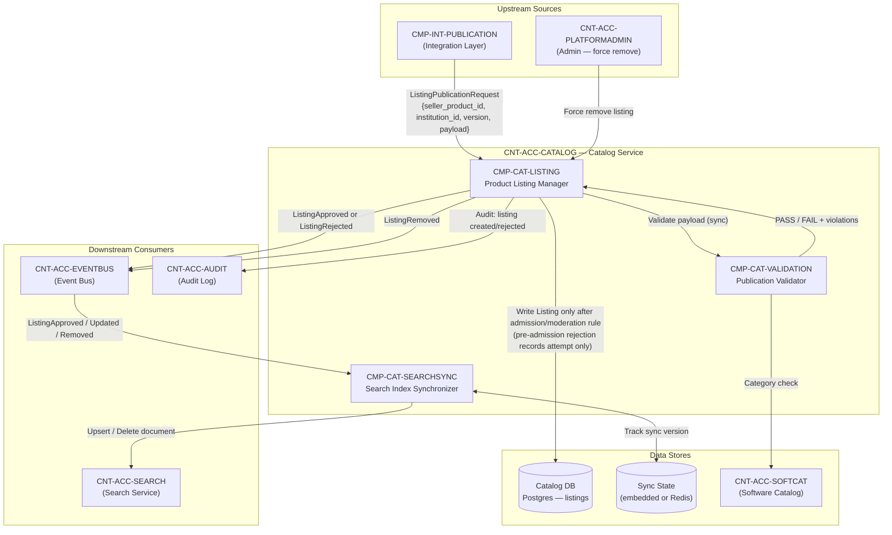

# C3 Component Diagram — CNT-ACC-CATALOG (Catalog Service)

**Container:** CNT-ACC-CATALOG  
**System:** SYS-ACCSYSTEM  
**Status:** DRAFT | Evidence: idea.md §3.1, §4, ADR-004

---

## Component Interaction Diagram

---

## Component Summary

| Component | ID | Role |
|---|---|---|
| Product Listing Manager | CMP-CAT-LISTING | Owns Listing entity; handles create/update/remove; enforces version idempotency |
| Publication Validator | CMP-CAT-VALIDATION | Stateless policy validator; returns PASS/FAIL verdict before write |
| Search Index Synchronizer | CMP-CAT-SEARCHSYNC | Subscribes to listing events; keeps CNT-ACC-SEARCH in sync with retry/backoff |

---

## Key Flows

### Flow 1 — New Product Publication
1. **CMP-INT-PUBLICATION** delivers `ListingPublicationRequest`
2. **CMP-CAT-LISTING** calls **CMP-CAT-VALIDATION** synchronously
3. VALIDATION checks format, completeness, category → returns verdict
4. If PASS: LISTING writes `Listing{status=ACTIVE}` → publishes `ListingApproved`
5. If validation fails before admission: record the rejected attempt and audit reason; do not persist a Listing as `REJECTED`. A persisted moderation `REJECTED` state and `ListingRejected` event apply only after admission.
6. **CMP-CAT-SEARCHSYNC** consumes `ListingApproved` → upserts search document

### Flow 2 — Listing Update (new version from ACCore)
1. Same as Flow 1 but with higher `version` number
2. LISTING checks `version > last_version` → replaces snapshot fields
3. If ACTIVE → publishes `ListingUpdated` → SEARCHSYNC updates search document

### Flow 3 — Listing Removal
1. `ProductRetracted` from integration layer OR admin force-remove
2. LISTING sets `status=REMOVED` → publishes `ListingRemoved`
3. SEARCHSYNC deletes search document

---

## Traceability

| Concern | Evidence |
|---|---|
| Projection pattern (not source of truth) | CONFIRMED (ADR-004, idea.md §4.1) |
| Price/stock snapshot staleness | CONFIRMED as open decision (idea.md §12) |
| Validation pre-write | PROPOSAL — separation of concerns |
| Event-driven search sync | PROPOSAL — consistent with ADR-005 |

---

*Generated: 2026-11-15 | Not stakeholder-approved | Not production-ready*
