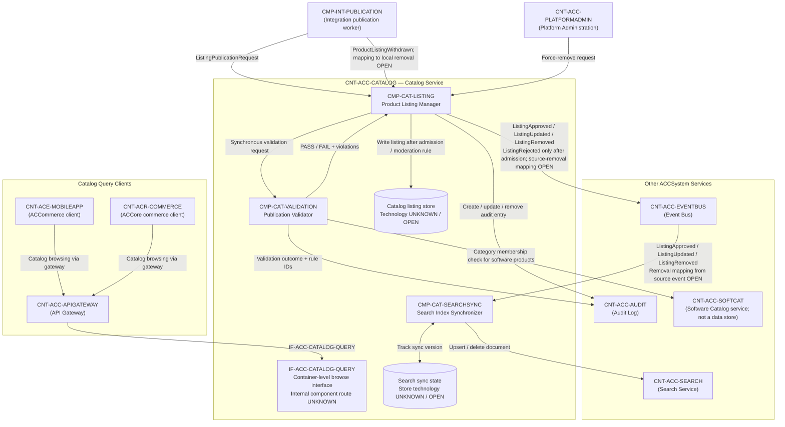

# C3 Component Diagram — CNT-ACC-CATALOG (Catalog Service)

**Container:** CNT-ACC-CATALOG  
**System:** SYS-ACCSYSTEM  
**Status:** DRAFT | Evidence: CNT-ACC-CATALOG.md, component records, IF-ACC-CATALOG-QUERY, ADR-004

---

## Component Interaction Diagram

`IF-ACC-CATALOG-QUERY` is shown as a registered container-level interface. The source documents identify its consumers, but do not assign the request to a particular C3 component; the internal route is therefore left UNKNOWN rather than inferred. Anonymous access is also UNKNOWN. `CNT-ACC-SOFTCAT` is a separate service and does not store package binaries; package storage/distribution is associated with `EXT-PACKAGE-CDN`.

---

## Component Summary

| Component | ID | Role |
|---|---|---|
| Product Listing Manager | CMP-CAT-LISTING | Owns the Listing entity; handles create/update/remove and version idempotency |
| Publication Validator | CMP-CAT-VALIDATION | Stateless policy validator; returns PASS/FAIL before a write |
| Search Index Synchronizer | CMP-CAT-SEARCHSYNC | Consumes listing events and keeps CNT-ACC-SEARCH in sync with retry/backoff |

---

## Key Flows

### Flow 1 — New Product Publication
1. **CMP-INT-PUBLICATION** delivers a `ListingPublicationRequest`.
2. **CMP-CAT-LISTING** calls **CMP-CAT-VALIDATION** synchronously.
3. Validation checks format, completeness and category, then returns a verdict and reasons.
4. If admitted, LISTING writes the listing and emits the applicable lifecycle event; the event-driven search update remains a documented proposal.
5. A rejection before admission records the attempt and audit reason; it does not persist a `REJECTED` Listing. A moderation `REJECTED` state/event applies only after admission.
6. **CMP-CAT-SEARCHSYNC** consumes the applicable listing event and updates search.

### Flow 2 — Listing Update
1. Integration delivers a higher listing version.
2. LISTING checks `version > last_version` and replaces the documented projection fields.
3. An admitted active listing emits `ListingUpdated`; SEARCHSYNC updates the search document.

### Flow 3 — Listing Withdrawal / Removal (Mapping OPEN)
1. Integration may deliver `ProductListingWithdrawn`; an authorized administrator may also request force removal.
2. The mapping from `ProductListingWithdrawn` to the catalog's removal state/event remains UNKNOWN/OPEN. The source event must not be treated as a wire synonym for `ProductRetracted`, `WITHDRAWN`, or `ListingRemoved` without approval.
3. Search deletion follows a confirmed catalog removal event; exact source-to-catalog event mapping remains open.

---

## Traceability and Open Items

| Concern | Evidence / status |
|---|---|
| Projection pattern (not source of truth) | CONFIRMED (ADR-004 and component record) |
| Catalog query interface | IF-ACC-CATALOG-QUERY is registered; internal route and anonymous access UNKNOWN |
| Catalog listing store technology | UNKNOWN / OWNER_UNASSIGNED; no PostgreSQL claim |
| Search sync state technology | UNKNOWN / OPEN; embedded store vs Redis is not decided |
| Product price/stock snapshot freshness | CONFIRMED as an open decision |
| Source withdrawal to catalog removal mapping | UNKNOWN / OPEN; event names are not interchangeable |
| Validation pre-write | PROPOSAL — separation of concerns |
| Event-driven search sync | PROPOSAL — consistent with ADR-005, not stakeholder-approved |

---

*Generated: 2026-11-21 | Not stakeholder-approved | Not production-ready*
