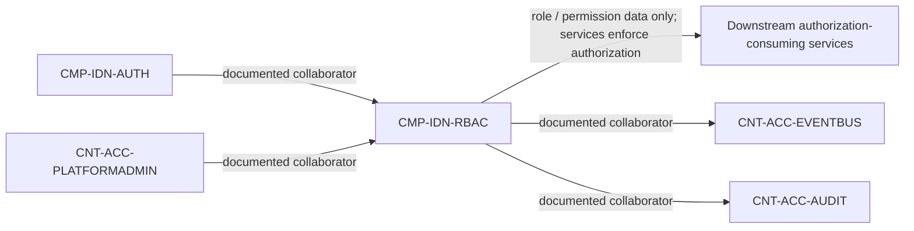

# CMP-IDN-RBAC — Role & Permission Manager

## 1. Identity

| Field | Value |
|---|---|
| **Component ID** | CMP-IDN-RBAC |
| **Parent Container** | CNT-ACC-IDENTITY |
| **Purpose** | Manages role assignments and resolves role/permission data for token issuance and downstream services. The API Gateway validates tokens and does not make authorization decisions. |
| **Scope Boundary** | Role definition, assignment, and permission resolution. Does NOT enforce permissions (each service enforces its own authorization). |

---

## 2. Collaborators

| Collaborator | Direction | Role |
|---|---|---|
| CMP-IDN-AUTH | Inbound | Fetches role claims during token issuance |
| CNT-ACC-PLATFORMADMIN | Inbound | Submits role grant/revoke requests after approval |
| Downstream authorization-consuming services (generic caller set) | Outbound data | Resolves role/permission context; each target service enforces its own policy |
| CNT-ACC-EVENTBUS | Outbound | Publishes PlatformRoleGranted/Revoked events |
| CNT-ACC-AUDIT | Outbound | Logs all role changes |

The earlier route-level API Gateway lookup claim conflicted with the Gateway container record and security view, which explicitly assign token validation to the Gateway and authorization decisions to downstream services. That claim is not treated as a current collaborator or approved route.

---

## Component Relationship Diagram
> Derived only from the collaborator/interface references in this document; no relationship is added here beyond the source text.

## 3. Behavior, Rules, and State

**Roles defined (CONFIRMED idea.md §9):**
- INDIVIDUAL_BUYER (ACT-INDIVIDUAL)
- INST_EMPLOYEE (ACT-INST-EMPLOYEE)
- INST_ADMIN (ACT-INST-ADMIN)
- PLATFORM_ADMIN (ACT-PLATFORM-ADMIN)
- SUPPORT_STAFF (ACT-SUPPORT-STAFF)
- DELIVERY_SUPERVISOR (ACT-DELIVERY-SUPERVISOR)
- COURIER (ACT-COURIER)

**Rules:**
- RBAC with ABAC contextual conditions (institution_id, branch, operation scope) — CONFIRMED (idea.md §9)
- Role changes require approval flow via CNT-ACC-PLATFORMADMIN — CONFIRMED (idea.md §9): least-privilege + pre-approval
- Role grants for PLATFORM_ADMIN and SUPPORT_STAFF subject to strict approval — CONFIRMED (idea.md §14, ADR-011)
- Institution-scoped roles carry platform_institution_id as context attribute

---

## 4. Data and Side Effects

| Data | Owned |
|---|---|
| Role assignments: `{user_id, role, institution_id (if applicable), granted_at, granted_by}` | CMP-IDN-RBAC |
| Permission matrix: role → allowed operations | CMP-IDN-RBAC |

---

## 5. Failure Modes

| Failure | Response |
|---|---|
| RBAC store unavailable | Cannot issue tokens with role claims; logins fail; cached role data may serve existing sessions (policy UNKNOWN) |
| Unauthorized role grant attempted | Rejected; audit log entry; security alert |

---

## 6. Security

- CONFIRMED (idea.md §11): "PlatformRoleGranted/Revoked" events audited
- CONFIRMED (idea.md §9): RBAC/ABAC with contextual conditions (institution_id, operation scope)
- Role separation: license entitlement ≠ platform permission — CONFIRMED (idea.md §1.1)

---

## 7. Operational Concerns

| Concern | Note |
|---|---|
| SLI | Role lookup latency (cacheable); role grant approval turnaround. Targets: UNKNOWN |

---

## 8. Verification and Tests

### 8.1 Acceptance Test Scenarios

| Scenario | Input / Precondition | Expected Verification Outcome |
|---|---|---|
| Authorized permission data | User holds `ORDER_CANCEL` role; target service requests role context | RBAC returns applicable role/permission data; the target service independently evaluates its policy; RBAC emits no central `ALLOW` result |
| Privilege escalation attempt | Standard buyer attempts platform administration operation | RBAC returns role data only; the target service denies under its own policy and raises any required security alert |
| Dynamic role change | User role updated in Identity DB | Subsequent permission evaluation reflects updated role within token TTL |
