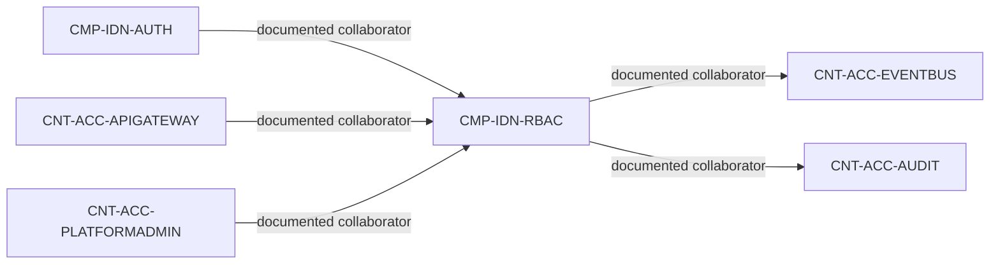

# CMP-IDN-RBAC — Role & Permission Manager

## 1. Identity

| Field | Value |
|---|---|
| **Component ID** | CMP-IDN-RBAC |
| **Parent Container** | CNT-ACC-IDENTITY |
| **Purpose** | Manages role assignments and permission resolution for all platform actors. Provides authorization data to API Gateway and downstream services for access control decisions. |
| **Scope Boundary** | Role definition, assignment, and permission resolution. Does NOT enforce permissions (each service enforces its own authorization). |

---

## 2. Collaborators

| Collaborator | Direction | Role |
|---|---|---|
| CMP-IDN-AUTH | Inbound | Fetches role claims during token issuance |
| CNT-ACC-APIGATEWAY | Inbound | Requests role/permission lookup for route-level authorization |
| CNT-ACC-PLATFORMADMIN | Inbound | Submits role grant/revoke requests after approval |
| CNT-ACC-EVENTBUS | Outbound | Publishes PlatformRoleGranted/Revoked events |
| CNT-ACC-AUDIT | Outbound | Logs all role changes |

---

## Component Relationship Diagram
> Derived only from the collaborator/interface references in this document; no relationship is added here beyond the source text.

## 3. Behavior, Rules, and State

**Roles defined (CONFIRMED idea.md §9):**
- INDIVIDUAL_BUYER (ACT-INDIVIDUAL)
- INST_EMPLOYEE (ACT-INST-EMPLOYEE)
- INST_ADMIN (ACT-INST-ADMIN)
- PLATFORM_ADMIN (ACT-PLATFORM-ADMIN)
- SUPPORT_STAFF (ACT-SUPPORT-STAFF)
- DELIVERY_SUPERVISOR (ACT-DELIVERY-SUPERVISOR)
- COURIER (ACT-COURIER)

**Rules:**
- RBAC with ABAC contextual conditions (institution_id, branch, operation scope) — CONFIRMED (idea.md §9)
- Role changes require approval flow via CNT-ACC-PLATFORMADMIN — CONFIRMED (idea.md §9): least-privilege + pre-approval
- Role grants for PLATFORM_ADMIN and SUPPORT_STAFF subject to strict approval — CONFIRMED (idea.md §14, ADR-011)
- Institution-scoped roles carry platform_institution_id as context attribute

---

## 4. Data and Side Effects

| Data | Owned |
|---|---|
| Role assignments: `{user_id, role, institution_id (if applicable), granted_at, granted_by}` | CMP-IDN-RBAC |
| Permission matrix: role → allowed operations | CMP-IDN-RBAC |

---

## 5. Failure Modes

| Failure | Response |
|---|---|
| RBAC store unavailable | Cannot issue tokens with role claims; logins fail; cached role data may serve existing sessions (policy UNKNOWN) |
| Unauthorized role grant attempted | Rejected; audit log entry; security alert |

---

## 6. Security

- CONFIRMED (idea.md §11): "PlatformRoleGranted/Revoked" events audited
- CONFIRMED (idea.md §9): RBAC/ABAC with contextual conditions (institution_id, operation scope)
- Role separation: license entitlement ≠ platform permission — CONFIRMED (idea.md §1.1)

---

## 7. Operational Concerns

| Concern | Note |
|---|---|
| SLI | Role lookup latency (cacheable); role grant approval turnaround. Targets: UNKNOWN |

---

## 8. Verification and Tests

### 8.1 Acceptance Test Scenarios

| Scenario | Input / Precondition | Expected Verification Outcome |
|---|---|---|
| Authorized permission check | User holds `ORDER_CANCEL` role attempting cancel | Permission check evaluates to `ALLOW`; audit record written |
| Privilege escalation attempt | Standard buyer attempts platform administration operation | Permission check evaluates to `DENY`; security alert raised |
| Dynamic role change | User role updated in Identity DB | Subsequent permission evaluation reflects updated role within token TTL |
