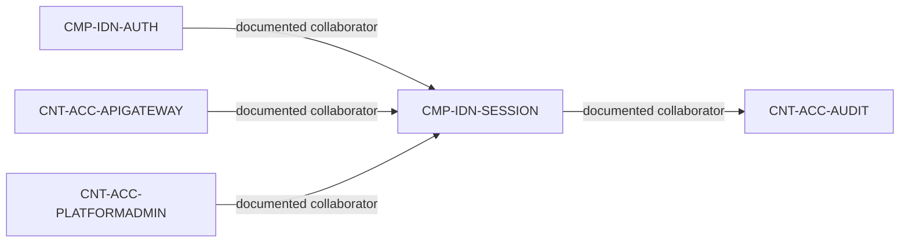

# CMP-IDN-SESSION — Session & Token Manager

## 1. Identity

| Field | Value |
|---|---|
| **Component ID** | CMP-IDN-SESSION |
| **Parent Container** | CNT-ACC-IDENTITY |
| **Purpose** | Manages token lifecycle — refresh token rotation, access token renewal, session revocation, and token blacklisting on logout or security events. |
| **Scope Boundary** | Session and token lifecycle only. Does NOT handle initial authentication (CMP-IDN-AUTH) or role resolution (CMP-IDN-RBAC). |

---

## 2. Collaborators

| Collaborator | Direction | Role |
|---|---|---|
| CMP-IDN-AUTH | Inbound | Registers new session on successful login |
| CNT-ACC-APIGATEWAY | Inbound | Requests token validation on every authenticated request |
| CNT-ACC-PLATFORMADMIN | Inbound | May force session revocation for security incidents |
| CNT-ACC-AUDIT | Outbound | Logs session creation, refresh, revocation events |

---

## Component Relationship Diagram
> Derived only from the collaborator/interface references in this document; no relationship is added here beyond the source text.

## 3. Behavior, Rules, and State

**Token refresh flow:**
1. Client presents refresh token
2. Verify refresh token is valid, not revoked, not expired
3. Rotate: invalidate old refresh token, issue new access + refresh token pair
4. Update session record

**Revocation flow:**
1. On logout/security event: add token to blacklist
2. API Gateway checks blacklist on every request (or uses short-lived tokens to limit window)

**Rules:**
- Refresh token rotation (each refresh invalidates old token) — ASSUMPTION: recommended security practice
- Token blacklist checked on validation — CONFIRMED (idea.md §9): session revocation required
- Session TTL: UNKNOWN. OWNER_UNASSIGNED.

---

## 4. Data

| Data | Owned |
|---|---|
| Session records: `{session_id, user_id, refresh_token_hash, created_at, last_used_at, expires_at, revoked}` | CMP-IDN-SESSION |
| Token blacklist (revoked token IDs, until natural expiry) | CMP-IDN-SESSION |

---

## 5. Failure Modes

| Failure | Response |
|---|---|
| Session store unavailable | Token validation fails; all authenticated requests rejected (fail-closed) |
| Blacklist store unavailable | Cannot verify revocation; security risk — fail-closed policy PROPOSAL |

---

## 6. Security

- CONFIRMED (idea.md §9): Session revocation enforced; short token TTL reduces revocation window
- CONFIRMED (idea.md §9): Secure token storage in client apps; no session secrets in app binary

---

## 7. Operational Concerns

| Concern | Note |
|---|---|
| SLI | Token validation latency (hot path — every request). Must be sub-millisecond with caching. Targets: UNKNOWN |
| Risk | Session store is single point of failure for all authenticated access; must be highly available |

---

## 8. Verification and Tests

### 8.1 Acceptance Test Scenarios

| Scenario | Input / Precondition | Expected Verification Outcome |
|---|---|---|
| Session creation on login | Successful authentication | Session token issued with configured TTL; persisted in session cache |
| Session validation | Request presented with valid Bearer token | Validated successfully; claims extracted and injected into request context |
| Expired session rejection | Request presented with token past expiry | Rejection with HTTP 401 `SESSION_EXPIRED`; request terminated |
| Explicit logout revocation | Logout endpoint invoked | Token added to distributed revocation blocklist; subsequent calls rejected |
