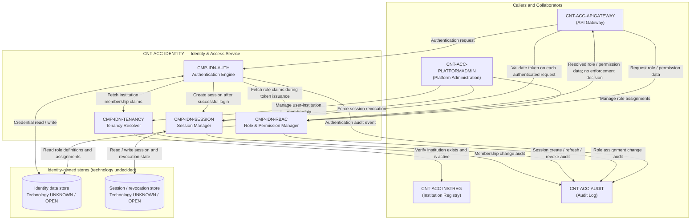

# C3 Component Diagram — CNT-ACC-IDENTITY (Identity & Access Service)

**Container:** CNT-ACC-IDENTITY  
**System:** SYS-ACCSYSTEM  
**Status:** DRAFT | Evidence: component records, CNT-ACC-IDENTITY container record, ADR-010/011/012

---

## Component Interaction Diagram

`CMP-IDN-RBAC` resolves role assignments and permission data; it does **not** enforce permissions. Each target service enforces its own authorization. Token format (JWT or opaque) and the identity/session store technologies remain UNKNOWN/OPEN. No session subscription to CNT-ACC-EVENTBUS is asserted.

---

## Component Summary

| Component | ID | Role |
|---|---|---|
| Authentication Engine | CMP-IDN-AUTH | Validates credentials and coordinates authentication/session creation; token format remains UNKNOWN |
| Role & Permission Manager | CMP-IDN-RBAC | Manages assignments and resolves permission data; does not enforce access |
| Session Manager | CMP-IDN-SESSION | Manages token/session lifecycle, refresh, revocation and expiry |
| Tenancy Resolver | CMP-IDN-TENANCY | Resolves user-institution membership and verifies institution context via the registry |

---

## Key Flows

### Flow 1 — Login
1. API Gateway forwards the authentication request to **CMP-IDN-AUTH**.
2. AUTH requests institution membership claims from **CMP-IDN-TENANCY**; TENANCY verifies the institution with **CNT-ACC-INSTREG**.
3. AUTH fetches role claims from **CMP-IDN-RBAC** and creates a session through **CMP-IDN-SESSION**.
4. AUTH records the authentication event in **CNT-ACC-AUDIT**. Credential/token format is UNKNOWN; no JWT or specific store technology is asserted.

### Flow 2 — Authenticated API Request
1. API Gateway requests token/session validation from **CMP-IDN-SESSION** for each authenticated request.
2. The relevant gateway or target service may retrieve role/permission data from **CMP-IDN-RBAC**.
3. The target service enforces its own authorization. RBAC does not return a central ALLOW/DENY enforcement result.

### Flow 3 — Administrative Session Revocation
1. **CNT-ACC-PLATFORMADMIN** requests session revocation through **CMP-IDN-SESSION**.
2. SESSION updates the session/revocation store and records the action in **CNT-ACC-AUDIT**.
3. Event Bus publication or session-event subscription is not established by the current component sources and is not depicted.

---

## Traceability and Open Items

| Concern | Evidence / status |
|---|---|
| Multi-tenant isolation | CONFIRMED; institution context and memberships are resolved separately from local ERP roles |
| Least-privilege for admin/support | CONFIRMED as a policy baseline; detailed approval remains subject to ADR review |
| Access-token format | UNKNOWN (JWT or opaque); JWT signing remains PROPOSED |
| Identity data store technology | UNKNOWN / OPEN |
| Session and revocation store technology | UNKNOWN / OPEN; no Redis claim |
| Session TTL, token TTL and lockout threshold | UNKNOWN |
| Event Bus session subscription/events | UNKNOWN / PROPOSED; not shown as a confirmed relation |
| Audit storage and tamper-evidence details | ASSUMPTION / PROPOSED; implementation not established |

---

*Generated: 2026-11-21 | Not stakeholder-approved | Not production-ready*
