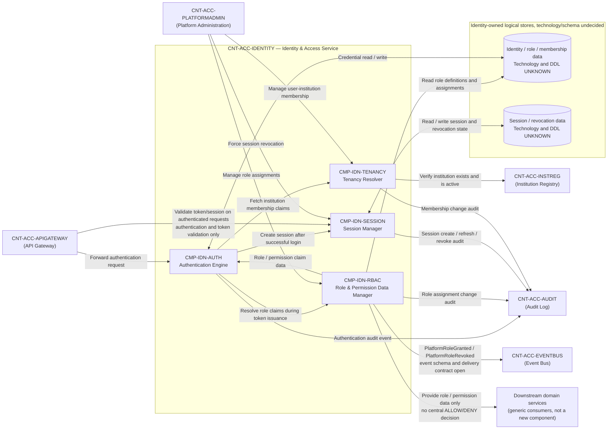

# C3 Component Diagram — CNT-ACC-IDENTITY (Identity & Access Service)

**Container:** CNT-ACC-IDENTITY  
**System:** SYS-ACCSYSTEM  
**Status:** DRAFT | Evidence: component records, CNT-ACC-IDENTITY container record, API Gateway record, security view, ADR-010/011/012

---

## Component Interaction Diagram

The API Gateway validates the token/session and passes authenticated identity context; it does **not** make the authorization decision. `CMP-IDN-RBAC` resolves role and permission data, but does not enforce it or return a central `ALLOW` / `DENY` result. Each target service applies its own authorization and tenant-isolation checks. `Downstream domain services` is a generic consumer grouping, not a registered C3 component or an exhaustive caller inventory. No Event Bus session subscription is asserted; the documented role-grant/revocation event path is shown separately.

Token format (JWT or opaque), identity/session store technology, DDL, session TTL, and event wire schemas remain **UNKNOWN/OPEN**. Field shapes in component records are logical documentation, not a finalized database schema.

---

## Component Summary

| Component | ID | Role |
|---|---|---|
| Authentication Engine | CMP-IDN-AUTH | Validates credentials, coordinates authentication/session creation, and resolves claims; token format remains UNKNOWN |
| Role & Permission Manager | CMP-IDN-RBAC | Manages assignments and resolves permission data; does not enforce access or decide ALLOW/DENY |
| Session Manager | CMP-IDN-SESSION | Manages token/session lifecycle, refresh, revocation, and expiry |
| Tenancy Resolver | CMP-IDN-TENANCY | Resolves user-institution membership and verifies institution context via the registry |

---

## Key Flows

### Flow 1 — Login
1. API Gateway forwards the authentication request to **CMP-IDN-AUTH**.
2. AUTH requests institution membership claims from **CMP-IDN-TENANCY**; TENANCY verifies the institution with **CNT-ACC-INSTREG**.
3. AUTH resolves role data from **CMP-IDN-RBAC** and creates a session through **CMP-IDN-SESSION**.
4. AUTH records the authentication event in **CNT-ACC-AUDIT**. Credential/token format and the store technologies remain UNKNOWN.

### Flow 2 — Authenticated API Request
1. API Gateway requests token/session validation from **CMP-IDN-SESSION**.
2. The verified identity context is passed to the target domain service.
3. RBAC may provide role/permission data to a target service; the target service performs its own authorization and institution-scope enforcement. RBAC does not return a central ALLOW/DENY enforcement result, and no Gateway authorization decision is implied.

### Flow 3 — Administrative Session Revocation
1. **CNT-ACC-PLATFORMADMIN** requests session revocation through **CMP-IDN-SESSION**.
2. SESSION updates the logical session/revocation data and records the action in **CNT-ACC-AUDIT**.
3. Role grant/revocation events are emitted by RBAC; a session-event publication or subscription is not established by the current component sources.

---

## Traceability and Open Items

| Concern | Evidence / status |
|---|---|
| Multi-tenant isolation | CONFIRMED; target services enforce tenant scope using verified identity context |
| RBAC enforcement boundary | Role/permission data is resolved in Identity; each target service enforces its own authorization |
| Gateway responsibility | Token/session validation and request routing; no authorization decision |
| Access-token format | UNKNOWN (JWT or opaque); JWT signing remains PROPOSED |
| Identity data store / DDL | UNKNOWN / OPEN |
| Session and revocation store / DDL | UNKNOWN / OPEN; no Redis claim |
| Session TTL, token TTL, and lockout threshold | UNKNOWN |
| Role-change Event Bus path | Documented publisher relationship; exact event schema/implementation remains OPEN |
| Session Event Bus subscription/events | UNKNOWN / PROPOSED; not shown as a confirmed relation |
| Audit storage and tamper-evidence details | ASSUMPTION / PROPOSED; implementation not established |

---

*Updated: 2026-11-21 | Not stakeholder-approved | Not production-ready*
