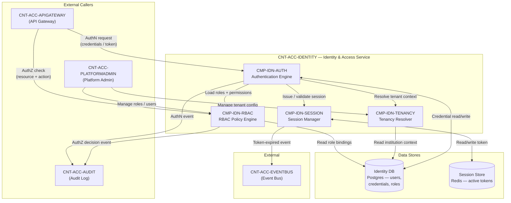

# C3 Component Diagram — CNT-ACC-IDENTITY (Identity & Access Service)

**Container:** CNT-ACC-IDENTITY  
**System:** SYS-ACCSYSTEM  
**Status:** DRAFT | Evidence: idea.md §3.1, §5, §6

---

## Component Interaction Diagram

---

## Component Summary

| Component | ID | Role |
|---|---|---|
| Authentication Engine | CMP-IDN-AUTH | Validates credentials, issues JWTs, MFA |
| RBAC Policy Engine | CMP-IDN-RBAC | Evaluates role-permission bindings per request |
| Session Manager | CMP-IDN-SESSION | Token lifecycle: issue, refresh, revoke, expire |
| Tenancy Resolver | CMP-IDN-TENANCY | Maps requests to institution context; isolates data scope |

---

## Key Flows

### Flow 1 — Login
1. API Gateway forwards credential/token → **CMP-IDN-AUTH**
2. AUTH resolves tenant via **CMP-IDN-TENANCY**
3. AUTH verifies credential → creates session via **CMP-IDN-SESSION** (writes to Redis)
4. AUTH returns signed JWT; logs AuthN event to **CNT-ACC-AUDIT**

### Flow 2 — Authenticated API Request
1. API Gateway intercepts request → **CMP-IDN-RBAC** evaluates `{actor_role, resource, action}`
2. RBAC reads role bindings from Identity DB → returns ALLOW/DENY
3. DENY → 403; ALLOW → request forwarded to target container

### Flow 3 — Session Revocation (Admin)
1. **CNT-ACC-PLATFORMADMIN** calls revoke
2. **CMP-IDN-SESSION** removes token from Redis (immediate invalidation)
3. Session-revoked event published to event bus → downstream containers may cache-bust

---

## Traceability

| Concern | Evidence |
|---|---|
| Multi-tenant isolation | CONFIRMED (idea.md §5.1 — per-institution ACCore, shared ACCSystem identity) |
| Least-privilege for admin/support | CONFIRMED (idea.md §6, §14 → ADR-011) |
| Session store (Redis) | ASSUMPTION — fast revocation requires in-memory store |
| MFA requirement | ASSUMPTION — not explicitly stated in idea.md §5; noted as UNKNOWN |

---

*Generated: 2026-11-15 | Not stakeholder-approved | Not production-ready*
