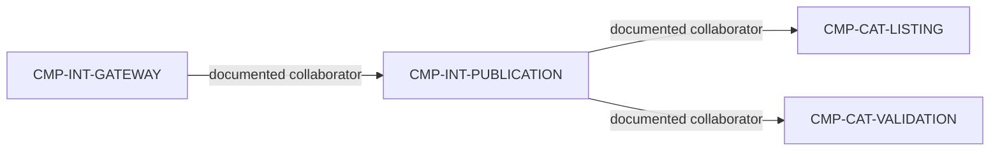

# CMP-INT-PUBLICATION — Product Publication Worker

## 1. Identity

| Field | Value |
|---|---|
| **Component ID** | CMP-INT-PUBLICATION |
| **Parent Container** | CNT-ACC-INTEGRATION (Institution Integration Domain — ACCSystem) |
| **Purpose** | Receives product publication events from ACCore instances (via CMP-INT-GATEWAY) and routes them to CNT-ACC-CATALOG for listing creation, update, or withdrawal. Uses at-least-once processing/delivery with Inbox/Outbox deduplication and idempotent effects; duplicate deliveries may occur but must not duplicate side effects. |
| **Scope Boundary** | Owns event deduplication and routing to Catalog. Does NOT own listing business logic (CMP-CAT-LISTING owns that) or schema validation (CMP-CAT-VALIDATION owns that). |

---

## 2. Collaborators and Dependencies

| Collaborator | Direction | Role |
|---|---|---|
| CMP-INT-GATEWAY | Inbound (called by) | Delivers validated product events after gateway routing |
| Inbox Store (DB) | Read/Write | Deduplication by `event_id` |
| CMP-CAT-LISTING | Outbound (calls) | Create / update / withdraw listing |
| CMP-CAT-VALIDATION | Outbound (calls) | Validate schema + policy before listing write |
| Outbox Table | Write | Supports at-least-once delivery attempts to Catalog with possible duplicates; retry exhaustion and reconciliation remain policy-gated |
| Event Bus | Outbound | Publishes `ProductPublicationProcessed` events |

---

## Component Relationship Diagram
> Derived only from the collaborator/interface references in this document; no relationship is added here beyond the source text.

## 3. Behavior, Rules, and State

### 3.1 Processing Steps

1. Receive event from CMP-INT-GATEWAY: `{event_id, event_type, institution_id, data}`.
2. **Inbox check:** identify the source `event_id` and scoped institution/product/version business key. A completed duplicate may return its recorded outcome; an in-progress, uncertain or failed record must retain/recover progress under the approved receipt/retry contract, not manufacture a final result.
3. Validate schema, permission and policy. A definitive pre-admission rejection records the rejected attempt and returns a structured non-success; do not create/mutate a Catalog listing or enqueue catalog work.
4. For accepted work, persist Integration's Inbox state and local Outbox delivery intent atomically in its own local transaction; coordinate concurrent claims safely. Exact receipt and claim states require API/Integration approval.
5. Relay the durable intent to Catalog; Catalog owns its listing write and business-version guard. Track completion or failure separately, and recover queued/incomplete work after crashes or lost acknowledgments.
6. The existing interface requires a stable Catalog-assigned `listing_id` in an acceptance receipt, but its availability before queued Catalog processing is not established. API Governance, Integration and Catalog must resolve the allocation/receipt or later-result mechanism with compatibility before implementation; neither a distributed transaction nor a final listing effect follows merely from acceptance.

### 3.2 Event Type Mapping

| Received Event | Action on CMP-CAT-LISTING |
|---|---|
| `ProductListingPublished` | Create new listing or publish new version |
| `ProductListingUpdated` | Update existing listing fields |
| `ProductListingWithdrawn` | Mark listing as withdrawn/inactive |

### 3.3 Business Rules

- **Idempotency:** Stable source `event_id` identifies redelivery; the institution/product/version key separately guards the business operation. Return a stored result only when available and contract-valid; reconcile conflicts and incomplete work without duplicating listing effects.
- Ordering is required per institution/product where supported by the chosen broker and consumer; retain Catalog version guards for delayed or replayed messages. The precise key and mechanism remain open.
- A withdrawn listing is **not deleted** — it is marked inactive; historical record preserved.
- Definitive malformed/unauthorized validation failure is returned as a structured error and is not retried; validation dependency unavailability remains recoverable pending work under the approved retry/reconciliation policy.

---

## 4. Data and Side Effects

| Data Item | Owned By | Description |
|---|---|---|
| Inbox record | CMP-INT-PUBLICATION | `{event_id, institution_id, event_type, status, processed_at}` |
| Outbox entry | CMP-INT-PUBLICATION | Payload to be delivered to CMP-CAT-LISTING |
| `ProductPublicationProcessed` event | Event Bus | Published on successful processing |

- **Transaction boundary:** accepted Integration Inbox state and its delivery intent share an Integration-local transaction. A rejection records its outcome without Catalog work; Catalog writes belong to its own boundary. No cross-container atomic transaction is established.

---

## 5. Failure, Security, and Operations

### 5.1 Failure Modes

| Failure | Response |
|---|---|
| Validation fails | Structured error returned; Inbox entry marked `rejected`; no Outbox entry |
| CMP-CAT-LISTING unavailable | Outbox retries delivery with backoff |
| Duplicate event received | Completed: return recorded outcome if available; in progress/unknown: approved status or safe retry/recovery, not a fabricated completion |
| DB fails during Inbox/Outbox write | Transaction rolls back; event not marked processed; ACCore retries |

### 5.2 Security

- Processes only events that passed CMP-INT-GATEWAY validation (institution_id confirmed from token).
- Does not accept direct calls — always receives via gateway.

### 5.3 Audit Events

| Event | Trigger |
|---|---|
| `ProductPublicationReceived` | Event received from gateway |
| `ProductPublicationRejected` | Validation fails |
| `ProductPublicationProcessed` | Successfully delivered to Catalog |

---

## 6. Verification and Tests

| Scenario | Expected Outcome |
|---|---|
| New product published | Inbox written; Outbox entry created; Catalog listing created |
| Same event_id received twice | Completed duplicate returns an available contract-valid outcome; in-progress duplicate is recoverable; no duplicate listing/version effect |
| Validation fails (missing required field) | Structured error returned; no Outbox entry |
| CMP-CAT-LISTING temporarily down | Outbox retains recoverable work; configured retries and DLQ/reconciliation handle exhaustion |
| Withdrawal event | Listing marked inactive; historical record intact |

---

## 7. Unknowns, Traceability, and ADR References

| Item | Status |
|---|---|
| Ordering guarantee mechanism: Kafka partition key or DB-level ordering? | UNKNOWN — depends on message broker choice |
| Max Outbox retry count before DLQ | UNKNOWN — config decision |
| ID availability and receipt/in-progress duplicate semantics | UNKNOWN — API Governance, Integration and Catalog must resolve without dropping existing listing-ID requirement |

**ADR References:** ADR-004, ADR-005

**Requirement References:** §6.3 (business events), §6.5 (integration constraints), §7.1 (product publication flow)
