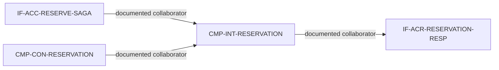

# CMP-INT-RESERVATION — Reservation Relay

**Purpose:** Relay reservation/release commands between the Parent Saga Coordinator and seller ACCore instances. Their concrete version/schema mapping is intended to follow ADR-021 and API Governance; it is not preassigned here. The relay does not own inventory decisions.

## Contract and state
Commands carry parent/seller order and seller scope, applicable items and price/currency snapshot reference, correlation ID, and a stable request/idempotency key before dispatch. `reservation_id` is used when known; its creator and mapping are an institution/API contract gate (see `FN-ORD-RESERVE` and interface §9). The relay persists `REQUESTED`, `ACCEPTED`, `REJECTED`, `UNKNOWN`, `RELEASE_REQUESTED`, `RELEASED`, `EXPIRED`, and `CONSUMED/COMMITTED` states.

## Behavior
The relay writes an Outbox entry before sending. Responses are Inbox-deduplicated. A timeout, interruption, circuit-open result after possible dispatch, or lost response is `UNKNOWN`; reconcile using the stable request key or known reservation ID through an agreed query/response channel. A circuit-open result may be locally non-dispatched only with durable evidence that no command was sent. Query availability is not established; if unavailable, wait safely and escalate. Never emit `REJECTED` or release merely because time elapsed. Definitive rejection or `EXPIRED` requires authoritative evidence. Release is a separate idempotent command, guarded by ADR-018 and reservation state, with unknown outcomes reconciled before repetition.

## Failure handling
| Condition | Result |
|---|---|
| ACCore accepted | Persist `ACCEPTED`; notify parent saga. |
| ACCore definitively rejected | Persist `REJECTED`; notify parent saga. |
| Timeout/disconnection | Persist `UNKNOWN`; retry/query/reconcile; payment remains blocked. |
| Accepted hold, known payment/order failure | Request release only when the hold is eligible, not consumed or linked to a confirmed order, and the conservative UNKNOWN/financial guards are satisfied. |
| Authoritative expiry | Record `EXPIRED`; notify saga and reconcile any unknown concurrent payment or reservation effect before closure. |
| Release timeout | Persist release `UNKNOWN`; query/reconcile; do not repeat blindly. |
| Duplicate command/event | Return a valid stored result when available; reconcile incomplete or uncertain work, preserving the same key and avoiding repeated effect. |

Authentication uses the method selected by ADR-015 policy. Numeric retry, timeout, hold, and deduplication values are deployment configuration owned by operations and must be consistent with reconciliation coverage.

## Interfaces and collaborators
- Consumes `IF-ACC-RESERVE-SAGA` from the Order Saga and relays to ACCore through `CMP-CON-RESERVATION`.
- Returns outcomes through `IF-ACR-RESERVATION-RESP`; exact delivery modality remains open under ADR-015.

## Component Relationship Diagram
> Derived only from the collaborator/interface references in this document; no relationship is added here beyond the source text.

## Verification references
Existing acceptance scenarios in `FN-ORD-RESERVE` and `validation/acceptance-test-plan.md` cover accepted/rejected/unknown outcomes, query-before-retry, and idempotent release. These are documented scenarios, not executed-test results.
