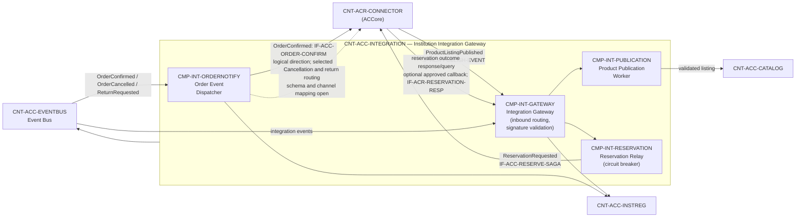

# CNT-ACC-INTEGRATION — Institution Integration Gateway — Component Diagram

**Viewpoint:** C3 — Internal components of CNT-ACC-INTEGRATION

> [!NOTE]
> CMP-INT-GATEWAY validates inbound event signatures and routes to appropriate worker. Reservation status covers ACCEPTED, REJECTED, UNKNOWN and authoritative EXPIRED; response/query and optional approved callback are not claims that status values are registered event types. CMP-INT-RESERVATION applies circuit breaker and UNKNOWN-safe recovery to ACCore calls.
