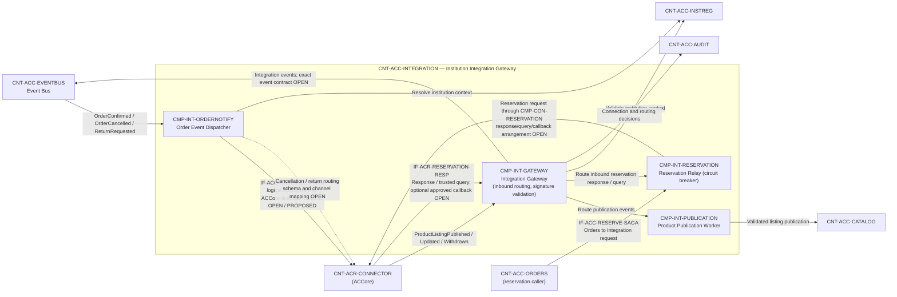

# CNT-ACC-INTEGRATION — Institution Integration Gateway — Component Diagram

**Viewpoint:** C3 — Internal components of CNT-ACC-INTEGRATION
**Status:** DRAFT | Relationships are limited to documented collaborator/interface evidence.

> CMP-INT-GATEWAY validates inbound event signatures and routes to the appropriate worker. Reservation status covers ACCEPTED, REJECTED, UNKNOWN and authoritative EXPIRED; response/query and optional approved callback are not claims that status values are registered event types. `IF-ACC-RESERVE-SAGA` is the request from Orders to Integration; it is not the outgoing Integration-to-ACCore interface. The documented Event Bus subscription is to CMP-INT-ORDERNOTIFY; no Event Bus-to-Gateway subscription is asserted. The exact reservation response arrangement and order-confirmation channel remain open.
