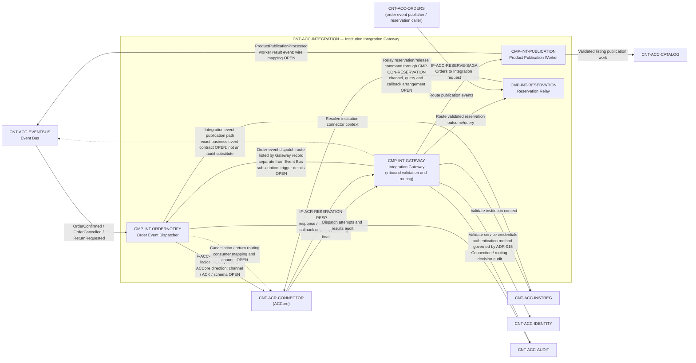

# CNT-ACC-INTEGRATION — Institution Integration Gateway — Component Diagram

**Viewpoint:** C3 — Internal components of CNT-ACC-INTEGRATION
**Status:** DRAFT | Relationships are limited to documented collaborator/interface evidence; transport and event contracts remain open where noted.

`CMP-INT-GATEWAY` validates inbound credentials, institution context and payloads, then routes to workers; it does not make reservation or publication business decisions. The `Gateway → OrderNotify` routing relationship is shown separately from the documented `EventBus → OrderNotify` subscription. The gateway audit relationship is also separate from the open Integration-to-EventBus business-event path; audit events are not implicitly treated as business events.

`IF-ACC-RESERVE-SAGA` is the request from Orders to Integration, not an outgoing Integration-to-ACCore interface. `CMP-INT-RESERVATION` relays that request to `CMP-CON-RESERVATION`; the exact outgoing channel and schema remain open. Reservation statuses include `ACCEPTED`, `REJECTED`, `UNKNOWN` and authoritative `EXPIRED`; status values are not asserted as literal callback event types. The optional callback mode requires explicit institution approval under ADR-015.

`IF-ACC-ORDER-CONFIRM` expresses the logical ACCSystem-to-ACCore handoff. Outbound-initiated polling/persistent channels and optional protected inbound connectivity remain available alternatives; this diagram does not select one or finalize ACK semantics. `ProductPublicationProcessed` is a worker-level event named in its record; its final wire mapping remains open.

---

## Component Summary

| Component | ID | Responsibility |
|---|---|---|
| Integration Gateway | CMP-INT-GATEWAY | Validates inbound institution/service context and routes requests to the applicable worker |
| Product Publication Worker | CMP-INT-PUBLICATION | Maintains recoverable publication processing and routes accepted work to Catalog |
| Reservation Relay | CMP-INT-RESERVATION | Relays scoped reserve/release operations and reconciles uncertain outcomes |
| Order Event Dispatcher | CMP-INT-ORDERNOTIFY | Subscribes to order events and dispatches recipient-scoped handoffs |

---

## Traceability and Open Items

| Concern | Status |
|---|---|
| Institution identity and service credential validation | Documented; credential method is policy-selected under ADR-015 |
| Gateway to OrderNotify routing vs. EventBus subscription | Separate relationships shown; exact trigger/dispatch route remains OPEN |
| Gateway audit vs. Integration business events | Distinct relations shown; event publication contract remains OPEN |
| Reservation command leg to ACCore | Relayed by CMP-INT-RESERVATION; exact channel/schema OPEN |
| Reservation response/query/callback arrangement | Synchronous response is baseline; query/optional callback details are institution/API approval gates |
| Order confirmation channel, ACK and schema | PROPOSED / OPEN; do not infer transport from logical direction |
| Publication worker result event mapping | OPEN; no final schema asserted |

---

*Updated: 2026-11-21 | Not stakeholder-approved | Not production-ready*
