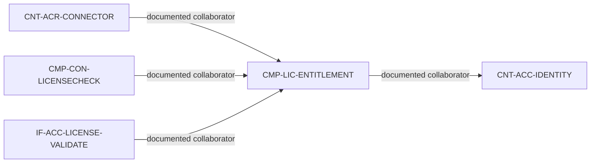

# CMP-LIC-ENTITLEMENT — Entitlement Evaluator

## 1. Identity

| Field | Value |
|---|---|
| **Component ID** | CMP-LIC-ENTITLEMENT |
| **Parent Container** | CNT-ACC-LICENSE |
| **Purpose** | Answers online license validation queries: given an institutional {institution_id + product_code} or marketplace {buyer_id + product_id/license_id} request, returns whether the entitlement is valid, what units/modules are licensed, and the license state. |
| **Scope Boundary** | Read-only entitlement evaluation. Does NOT modify license state (CMP-LIC-LIFECYCLE). |

---

## 2. Collaborators

| Collaborator | Direction | Role |
|---|---|---|
| CNT-ACR-CONNECTOR / CMP-CON-LICENSECHECK; ACCommerce client | Inbound | Institutional validation and proposed marketplace validation via IF-ACC-LICENSE-VALIDATE; marketplace mapping pending governance |
| License record store | Inbound | Reads license state |
| CNT-ACC-IDENTITY | Outbound | Validates requesting service identity |

---

## Component Relationship Diagram
> Derived only from the collaborator/interface references in this document; no relationship is added here beyond the source text.

## 3. Behavior, Rules, and State

**Validation flow:**
1. Receive validation request `{institution_id + product_code, modules_requested} for institutional validation OR {buyer_id + product_id/license_id, modules_requested} for marketplace validation`
2. Authorize the workflow-specific scope; find matching candidates including negative states.
3. Evaluate each candidate's status, effective validity and requested modules/units/capacity before selecting; apply configured, approved grace only where applicable.
4. Select among eligible candidates deterministically as proposed in FN-LIC-VALIDATE; multiple-entitlement combination and negative-result precedence remain OPEN.
5. Return the relevant contract status and evaluation result without conflating them; over-capacity mapping remains a policy/contract decision.

**Rules:**
- Suspended license → valid=false
- Grace after expiry permits operation only if an applicable policy is approved; otherwise preserve the restrictive path. Status timing and duration remain OPEN.
- Usage/seat capacity exceeded → valid=false with capacity_exceeded flag

---

## 4. Data

Read-only consumer of License records owned by CMP-LIC-ISSUANCE and CMP-LIC-LIFECYCLE.

---

## 5. Failure Modes

| Failure | Response |
|---|---|
| License DB unavailable (online path) | Return error; ACCore falls back to cached offline token (ADR-014) |
| License not found | Return valid=false |
| Ambiguous query | Apply the workflow-specific selection order: institutional `valid_from`, marketplace `issued_at`; use a deterministic identifier tie-break only after eligibility; log ambiguity. |

---

## 6. Security

- IF-ACC-LICENSE-VALIDATE requires authentication and authorization for the selected institutional or proposed marketplace caller and its own scope; by-ID access is not an authorization bypass.
- CONFIRMED (idea.md §4.3): Validation does not expose ERP data

---

## 7. Operational Concerns

| Concern | Note |
|---|---|
| SLI | CONFIRMED (idea.md §11): "زمن استجابة خدمة الترخيص" and "محاولات استخدام وحدات غير مرخصة" monitored |

---

## 8. Verification and Tests

### 8.1 Acceptance Test Scenarios

| Scenario | Input / Precondition | Expected Verification Outcome |
|---|---|---|
| Active license evaluation | Query with valid `institution_id` and active `product_code` | Entitlement evaluates to `VALID`; feature flags and seat limit returned |
| Expired license evaluation | Query for license past validity date and grace period | Entitlement evaluates to `EXPIRED`; restricted modules gated |
| Offline token verification | Signed offline JWT validated against public key | Signature and claims verified locally without network call |
