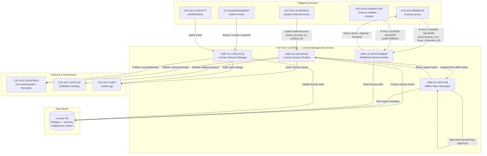

# C3 Component Diagram — CNT-ACC-LICENSE (License Management Service)

**Container:** CNT-ACC-LICENSE  
**System:** SYS-ACCSYSTEM  
**Status:** DRAFT | Evidence: idea.md §3.1, §7, §14

---

## Component Interaction Diagram

---

## Component Summary

| Component | ID | Role |
|---|---|---|
| License Issuance Engine | CMP-LIC-ISSUANCE | Consumes OrderConfirmed; creates License records; idempotent on order_id+product_id |
| Entitlement Query Handler | CMP-LIC-ENTITLEMENT | Answers online validation queries (IF-ACC-LICENSE-VALIDATE) |
| License Lifecycle Manager | CMP-LIC-LIFECYCLE | Admin-driven state transitions: renew, suspend, revoke |
| Offline Token Generator | CMP-LIC-OFFLINE | Produces short-lived signed entitlement tokens for offline use (ADR-014) |

---

## Key Flows

### Flow 1 — License Activation (post-purchase)
1. `OrderConfirmed` event consumed by **CMP-LIC-ISSUANCE**
2. ISSUANCE validates product exists in CNT-ACC-SOFTCAT
3. ISSUANCE writes License (`ACTIVE`, bound to buyer_id + product_id + order_id)
4. ISSUANCE calls **CMP-LIC-OFFLINE** to generate first signed entitlement token
5. `LicenseActivated` event published; audit entry written

### Flow 2 — Online Entitlement Check
1. Client calls `IF-ACC-LICENSE-VALIDATE` → **CMP-LIC-ENTITLEMENT**
2. ENTITLEMENT reads License from DB → returns `{status, expiry, product_scope}`
3. Caller caches result per TTL (ASSUMPTION — TTL duration: UNKNOWN)

### Flow 3 — Offline Token Consumption
1. ACCore's **CMP-CON-LICENSECHECK** holds a signed token from previous online session
2. Token validated locally: signature (platform public key), expiry, product_id match
3. If token expired and network available → fallback to online (Flow 2)

### Flow 4 — Admin Revocation
1. Admin via ACManagement calls LIFECYCLE with `{license_id, action=revoke}`
2. LIFECYCLE verifies admin permission via CNT-ACC-IDENTITY
3. LIFECYCLE sets License state → `REVOKED`; publishes `LicenseRevoked`
4. Existing offline tokens remain valid until expiry (ADR-014 trade-off — OPEN RISK)

---

## Open Decisions / Unknowns

| Item | Status | Consequence | Revisit Trigger |
|---|---|---|---|
| Offline token TTL | UNKNOWN | Long TTL = revocation delay; short TTL = connectivity requirement | License model decision (§12) |
| License model types (subscription vs perpetual) | UNKNOWN (idea.md §12) | Lifecycle rules differ significantly | Stakeholder decision required |
| Token refresh mechanism (push vs pull) | UNKNOWN | Offline duration limit | License model decision |

---

## Traceability

| Claim | Evidence |
|---|---|
| Software licensing as separate service | CONFIRMED (idea.md §3.1, §7 — License Management module) |
| Offline validation via signed token | CONFIRMED (idea.md §14 → ADR-014) |
| Issuance triggered by OrderConfirmed | CONFIRMED (idea.md §7.3 — post-purchase activation) |
| Token signing key management | ASSUMPTION — platform holds private key; ACCore receives public key at setup |

---

*Generated: 2026-11-15 | Not stakeholder-approved | Not production-ready*
