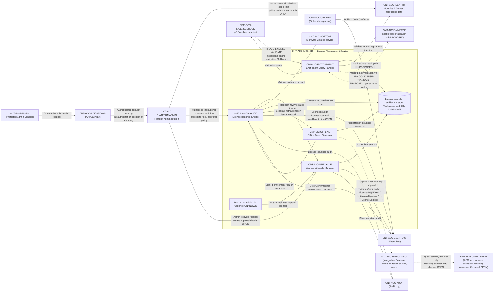

# C3 Component Diagram — CNT-ACC-LICENSE (License Management Service)

**Container:** CNT-ACC-LICENSE  
**System:** SYS-ACCSYSTEM  
**Status:** DRAFT | Evidence: license component/container records, interface registry, ADR-014, dynamic-license-flow

---

## Component Interaction Diagram

The administration path is shown through ACManagement, the API Gateway and Platform Administration before the licensing operation. The Gateway validates/routs authenticated requests but does not decide authorization. Platform Administration obtains role/institution context from Identity; the operation-specific role matrix and approval policy remain open. No direct `API Gateway → CMP-LIC-ISSUANCE` or `API Gateway → CMP-LIC-LIFECYCLE` business-operation edge is asserted. No direct `CMP-LIC-LIFECYCLE → CNT-ACC-IDENTITY` edge is established.

`OrderConfirmed` originates in Orders and reaches the issuance component through the Event Bus. Institutional issuance and marketplace issuance remain distinct: institutional licenses use the documented `ISSUED → ACTIVATED → ACTIVE` path; marketplace software issuance may create `ACTIVE` directly. The sequence of license events, token readiness and buyer notification remains open.

The dotted token-delivery path is only the logical candidate described in the proposed dynamic flow. The receiving component, interface, transport, ACK/receipt semantics, retry ownership and activation correlation are not finalized. It must not be read as an approved integration contract. The license store technology and DDL remain unknown; logical fields in component records are not an implemented schema.

---

## Component Summary

| Component | ID | Role |
|---|---|---|
| License Issuance Engine | CMP-LIC-ISSUANCE | Institutional issuance and marketplace `OrderConfirmed` issuance; sequencing remains open |
| Entitlement Query Handler | CMP-LIC-ENTITLEMENT | Answers online validation queries; marketplace mapping remains proposed |
| License Lifecycle Manager | CMP-LIC-LIFECYCLE | Handles renewal, suspension, revocation, expiry and scheduled checks |
| Offline Token Generator | CMP-LIC-OFFLINE | Produces signed entitlement tokens for offline use; token/key choices remain open |

---

## Key Flows

### Flow 1 — Institutional License Issuance
1. `CNT-ACM-ADMIN` sends an authenticated request through `CNT-ACC-APIGATEWAY` to `CNT-ACC-PLATFORMADMIN`.
2. Platform Administration resolves role and institution-scope data through Identity and applies the applicable workflow/approval policy; exact authorization and approval rules remain open.
3. **CMP-LIC-ISSUANCE** creates the institutional license in `ISSUED` state and records the action.
4. The documented activation transition is `ISSUED → ACTIVATED → ACTIVE`; timing of events, token readiness, delivery and ACK remains open.
5. Offline token issuance is separately retriable and does not itself define activation state.

### Flow 2 — Marketplace Issuance
1. **CMP-LIC-ISSUANCE** consumes `OrderConfirmed` from CNT-ACC-EVENTBUS; Orders is the documented publisher.
2. It validates the software product against CNT-ACC-SOFTCAT and may create an `ACTIVE` license directly for the marketplace path.
3. Event sequencing and buyer-notification timing remain owner decisions.

### Flow 3 — Online Entitlement Check and Offline Validation
1. **CMP-CON-LICENSECHECK** validates a previously issued token locally using the configured public key.
2. If online fallback is required, it calls **CMP-LIC-ENTITLEMENT** through `IF-ACC-LICENSE-VALIDATE`.
3. ENTITLEMENT reads license state and validates the requesting service identity. Marketplace validation through ACCommerce remains PROPOSED / governance pending.

### Flow 4 — Lifecycle Changes and Expiry
1. An authorized admin request reaches **CMP-LIC-LIFECYCLE** through the administration workflow; the detailed route/approval contract is open.
2. LIFECYCLE updates license state and writes audit evidence.
3. It publishes `LicenseRenewed`, `LicenseSuspended`, `LicenseRevoked` or `LicenseExpired` as applicable. Expiry timing and grace policy remain open.

---

## Open Decisions / Unknowns

| Item | Status | Consequence | Revisit trigger |
|---|---|---|---|
| License store technology / DDL | UNKNOWN / OPEN | Do not claim PostgreSQL or another database | Owner architecture decision |
| Offline token TTL and post-expiry grace | UNKNOWN | Revocation delay vs. connectivity requirement | License model and security review |
| License model types | UNKNOWN | Subscription/perpetual rules differ | Stakeholder decision |
| Token refresh mechanism | UNKNOWN | Offline duration limit | License model decision |
| Marketplace validation mapping | PROPOSED / governance pending | Caller, route and mapping may change | API governance |
| Event/token/buyer-readiness sequencing | OPEN | Do not imply ordering not established by sources | Owner decision |
| Token handoff, receiver, channel, ACK and recovery | OPEN / PROPOSED | Activation must not be inferred from missing delivery result | API / Integration / License owners |
| Signing key management and algorithm | UNKNOWN / OPEN | No production key-management claim | Security design review |

---

*Updated: 2026-11-21 | Not stakeholder-approved | Not production-ready*
