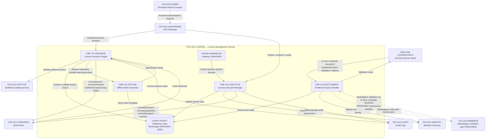

# C3 Component Diagram — CNT-ACC-LICENSE (License Management Service)

**Container:** CNT-ACC-LICENSE  
**System:** SYS-ACCSYSTEM  
**Status:** DRAFT | Evidence: license component/container records, interface registry and ADR-014

---

## Component Interaction Diagram

The diagram distinguishes institutional issuance from the marketplace flow. Institutional issuance follows the documented ISSUED → ACTIVATED → ACTIVE lifecycle; marketplace `OrderConfirmed` issuance may create ACTIVE directly. The exact sequencing of `LicenseIssued`, `LicenseActivated`, token readiness and buyer notification remains an owner decision. The `CMP-CON-LICENSECHECK` component is shown as a caller; the licensing check itself is performed locally with a previously issued token, with an online call only for the documented fallback. No direct client-to-offline-generator request is asserted.

---

## Component Summary

| Component | ID | Role |
|---|---|---|
| License Issuance Engine | CMP-LIC-ISSUANCE | Institutional issuance and marketplace `OrderConfirmed` issuance; key sufficiency and sequencing remain open |
| Entitlement Query Handler | CMP-LIC-ENTITLEMENT | Answers online validation queries; marketplace mapping remains proposed |
| License Lifecycle Manager | CMP-LIC-LIFECYCLE | Handles renewal, suspension, revocation, expiry, and internal scheduled checks |
| Offline Token Generator | CMP-LIC-OFFLINE | Produces signed entitlement tokens for offline use; token/key choices remain open |

---

## Key Flows

### Flow 1 — Institutional License Issuance
1. `CNT-ACM-ADMIN` reaches the license service through `CNT-ACC-APIGATEWAY`.
2. **CMP-LIC-ISSUANCE** creates the institutional license in `ISSUED` state and records the action.
3. The documented institutional activation transition is `ISSUED → ACTIVATED → ACTIVE`; the precise timing of the corresponding events and token readiness remains open.
4. Offline token generation is separately retriable and does not define the activation state.

### Flow 2 — Marketplace Issuance
1. **CMP-LIC-ISSUANCE** consumes `OrderConfirmed` from CNT-ACC-EVENTBUS.
2. It validates the software product against CNT-ACC-SOFTCAT and may create an `ACTIVE` license directly for the marketplace path.
3. The publication/activation event sequence and buyer notification timing remain an owner decision.

### Flow 3 — Online Entitlement Check and Offline Validation
1. **CMP-CON-LICENSECHECK** validates a previously issued token locally using the configured public key.
2. If online fallback is required, it calls **CMP-LIC-ENTITLEMENT** through `IF-ACC-LICENSE-VALIDATE`.
3. ENTITLEMENT reads license state and validates the requesting service identity. Marketplace validation through ACCommerce remains PROPOSED / governance pending.

### Flow 4 — Lifecycle Changes and Expiry
1. An authorized admin request or the internal scheduled job reaches **CMP-LIC-LIFECYCLE**.
2. LIFECYCLE verifies authorization, updates license state and writes audit evidence.
3. It publishes `LicenseRenewed`, `LicenseSuspended`, `LicenseRevoked` or `LicenseExpired` as applicable. Expiry timing and grace policy remain open.

---

## Open Decisions / Unknowns

| Item | Status | Consequence | Revisit trigger |
|---|---|---|---|
| License store technology | UNKNOWN / OPEN | Do not claim PostgreSQL or another database | Owner architecture decision |
| Offline token TTL and post-expiry grace | UNKNOWN | Revocation delay vs. connectivity requirement | License model and security review |
| License model types | UNKNOWN | Subscription/perpetual rules differ | Stakeholder decision |
| Token refresh mechanism | UNKNOWN | Offline duration limit | License model decision |
| Marketplace validation mapping | PROPOSED / governance pending | Caller, route and mapping may change | API governance |
| Event/token/buyer-readiness sequencing | OPEN | Do not imply ordering not established by sources | Owner decision |
| Signing key management and algorithm | UNKNOWN / OPEN | No production key-management claim | Security design review |

---

*Generated: 2026-11-21 | Not stakeholder-approved | Not production-ready*
