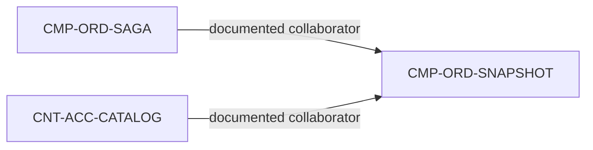

# CMP-ORD-SNAPSHOT — Commercial Snapshot Service

## 1. Identity

| Field | Value |
|---|---|
| **Component ID** | CMP-ORD-SNAPSHOT |
| **Parent Container** | CNT-ACC-ORDERS (Order Management Domain — ACCSystem) |
| **Purpose** | At the moment of order confirmation, writes an immutable record of all commercial terms that defined the transaction — price, description, currency, discount, tax, quantity, seller name, and delivery terms. This snapshot is the authoritative record of what the buyer agreed to pay. |
| **Scope Boundary** | Owns the snapshot record. Never reads through to current product state; never updates a snapshot once written. The snapshot is the commercial truth for a confirmed order. |

---

## 2. Collaborators and Dependencies

| Collaborator | Direction | Role |
|---|---|---|
| CMP-ORD-SAGA | Inbound (called by) | Triggers snapshot write as part of order confirmation (Step 3 of saga) |
| CNT-ACC-CATALOG / Offer Service | Inbound (data source) | Snapshot data is sourced from the offer/price snapshot captured at checkout — NOT re-read at confirmation time |
| Order Record (DB) | Write | Writes Order Line snapshot records linked to `order_id` / `seller_order_id` |
| Audit / Event Bus | Outbound | Publishes `CommercialSnapshotWritten` event |

> [!IMPORTANT]
> The snapshot reads data from the **checkout session** — where prices were already captured — not from the live catalog. By confirmation time, no live product read is performed.

---

## Component Relationship Diagram
> Derived only from the collaborator/interface references in this document; no relationship is added here beyond the source text.

## 3. Behavior, Rules, and State

### 3.1 Snapshot Write Process

1. CMP-ORD-SAGA calls CMP-ORD-SNAPSHOT with `order_id`, `seller_order_id`, and the checkout-captured line data.
2. For each order line, write a snapshot record containing:
   - `listing_id` (reference to market listing at time of purchase)
   - `seller_product_id` (source reference at seller)
   - `product_description` (as displayed at checkout)
   - `unit_price` (confirmed price)
   - `currency`
   - `quantity`
   - `discount_amount` / `discount_reason`
   - `tax_amount` / `tax_rate`
   - `line_total`
   - `seller_name` (as displayed at checkout)
   - `delivery_terms` (delivery commitment at time of purchase)
   - `snapshot_at` (UTC timestamp of confirmation)
   - `snapshot_version` = 1 (always 1 at creation; never updated)
3. Write all line snapshots atomically.
4. Publish `CommercialSnapshotWritten`.

### 3.2 Business Rules (§8.3)

- Snapshots are **append-only**. No `UPDATE` or `DELETE` is ever issued against a snapshot record.
- If a return or cancellation occurs, the snapshot remains intact. Refund records reference the snapshot, not the reverse it.
- The snapshot is used for: dispute resolution, financial reconciliation, customer order history display, and audit.
- **Never** resolve an order's commercial terms by reading the current product listing. Always use the snapshot.

### 3.3 Idempotency

If a snapshot already exists for a given `order_id` + `seller_order_id`, the write is skipped and the existing snapshot is returned. The snapshot records a stable `snapshot_at` from the first write.

---

## 4. Data and Side Effects

| Data Item | Owned By | Description |
|---|---|---|
| Order Line Snapshot records | CMP-ORD-SNAPSHOT | Immutable; one record per order line per seller order |
| `CommercialSnapshotWritten` event | Outbox → Event Bus | Published on snapshot creation |

- **Transaction boundary:** All order line snapshots for a `seller_order_id` are written in a single DB transaction together with the saga's state write (or as a subtransaction coordinated by the saga).
- **Storage:** Append-only table. No soft-delete; no update path in schema.

---

## 5. Failure, Security, and Operations

### 5.1 Failure Modes

| Failure | Response |
|---|---|
| Snapshot write fails | Transaction rolls back; CMP-ORD-SAGA retries; idempotency prevents double-write |
| Partial write (some lines written, DB fails) | Full rollback; all-or-nothing per seller order |
| Snapshot called with incomplete data | Validation error returned to CMP-ORD-SAGA; saga does not confirm order |

### 5.2 Security

- Internal service only. Not accessible via any external API.
- Write path: authorized internal services only (CMP-ORD-SAGA).
- Read path: Order history queries (via Order Management read APIs) may return snapshot data; `institution_id` isolation enforced — a buyer can read their own order snapshot; a seller can read the snapshot for their seller order.
- Snapshot records are **immutable at the DB level** (enforced by no-update schema constraint or audit-logged guard).

### 5.3 Audit Events

| Event | Trigger |
|---|---|
| `CommercialSnapshotWritten` | Each snapshot creation |

---

## 6. Verification and Tests

| Scenario | Expected Outcome |
|---|---|
| Happy path: snapshot written at confirmation | All line fields stored accurately; `CommercialSnapshotWritten` published |
| Idempotent re-call | Existing snapshot returned; no duplicate records |
| Product price changes after snapshot written | Snapshot unchanged; order history shows snapshot price |
| Snapshot write fails mid-transaction | Full rollback; no partial snapshot |
| Caller passes incomplete line data | Validation error; order not confirmed |

---

## 7. Unknowns, Traceability, and ADR References

| Item | Status |
|---|---|
| Which fields are required vs optional in snapshot schema? | Needs data modeling session; at minimum: price, currency, quantity, description, seller_name |
| How long are snapshots retained? | Retention policy needed (legal / financial requirement) — OWNER_UNASSIGNED |
| Are snapshots exposed to ACCore seller for their local sales record? | Business decision: does OrderConfirmed event carry full snapshot or just reference? |

**ADR References:** ADR-004, ADR-005

**Requirement References:** §8.3 (commercial snapshot), §8.1 (cart/checkout/order separation), §5.1 (data ownership), §9 (audit trail)
