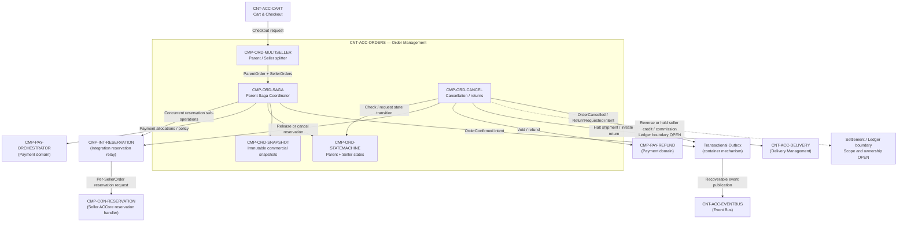

# CNT-ACC-ORDERS — Component Diagram

The orders container owns the ParentOrder and SellerOrder orchestration; payment and delivery execution remain with their respective domains. `CNT-ACC-DELIVERY` has a documented `OrderConfirmed` container-level trigger, but the sources do not establish a C3 `CNT-ACC-EVENTBUS → CNT-ACC-DELIVERY` relationship, so no such edge is asserted here. The settlement/ledger collaborator is shown only as an OPEN boundary, not as an implemented component.

The Parent Saga Coordinator persists one parent workflow and seller-scoped sub-operation state. It waits for every required reservation, compensates confirmed holds after definitive rejection, preserves UNKNOWN outcomes, and blocks payment until safe resolution.
