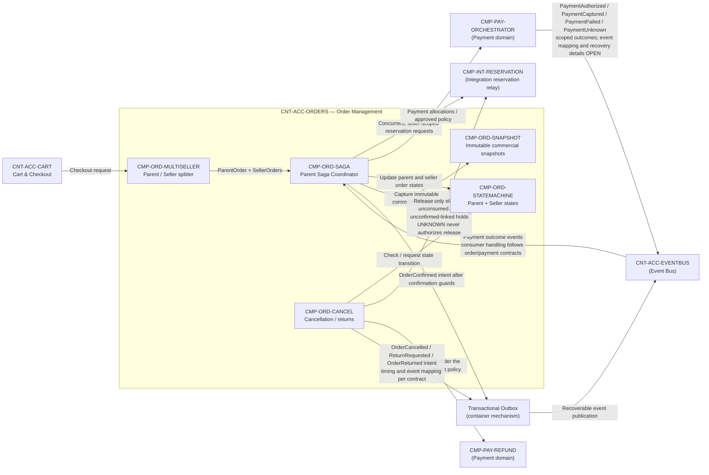

# CNT-ACC-ORDERS — Component Diagram

**Container:** CNT-ACC-ORDERS
**System:** SYS-ACCSYSTEM
**Status:** DRAFT | C3 relations are limited to component/interface evidence; container-level consumers are noted separately.

Orders owns ParentOrder/SellerOrder orchestration; payment and delivery execution remain with their respective domains. **CNT-ACC-DELIVERY** has a documented container-level `OrderConfirmed` trigger, but the reviewed sources do not establish a direct C3 component edge or a finalized cancellation-to-delivery interface. This view therefore does not draw a direct Delivery edge. Likewise, the Settlement/Ledger boundary remains future/proposed with unassigned ownership and is not represented as an implemented component.

The Event Bus carries scoped payment outcomes back to Orders; exact event mapping and contract details remain open. At C2, the `OrderConfirmed` consumer inventory includes Delivery, License and Notifications. That container-level consumer statement does not identify a C3 handler in those domains and is not expanded here into unsupported component routes. `OrderCancelled` is emitted on final cancellation; `ReturnRequested` is a validated initiation event, while `OrderReturned` marks final completion. Their schemas and consumer/channel mappings remain contract gates.

Cancellation and return are post-confirmation workflows. A consumed or confirmed-order-linked reservation is not released as an ordinary hold. Every possibly dispatched operation with `UNKNOWN` outcome remains pending for authoritative reconciliation; timeout or elapsed time alone does not authorize a release, refund, shipment action, or final closure.

The Parent Saga Coordinator persists one parent workflow and seller-scoped sub-operation state. It waits for every required reservation, compensates confirmed holds only after definitive outcomes, preserves `UNKNOWN`, and blocks payment until safe resolution.

---
## Relationship and Scope Notes

| Concern | Treatment |
|---|---|
| Payment result path | Payment publishes domain outcomes to Event Bus; Orders consumes them. The event/result wire mapping remains open. |
| Reservation requests and compensation | Saga calls the Integration reservation relay; cancellation release is guarded by authoritative state and ADR-018. |
| Delivery | Container-level confirmation/coordination only; direct C3 collaborator and interface not established by the reviewed evidence. |
| License / Notifications | C2 EventBus consumer relationships exist; no C3 handlers are inferred in this view. |
| Settlement / ledger | Future proposed boundary; ownership, correction authority and command path OPEN. |
| Return lifecycle | `ReturnRequested` and final `OrderReturned` are distinct; consumer schema/channel and policy timing OPEN. |

---

*Updated: 2026-11-21 | Not stakeholder-approved | Not production-ready*
