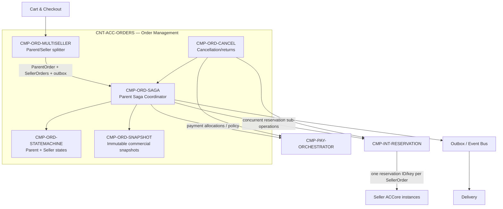

# CNT-ACC-ORDERS — Component Diagram

The Parent Saga Coordinator persists one parent workflow and seller-scoped sub-operation state. It waits for every required reservation, compensates confirmed holds after definitive rejection, preserves UNKNOWN outcomes, and blocks payment until safe resolution.
