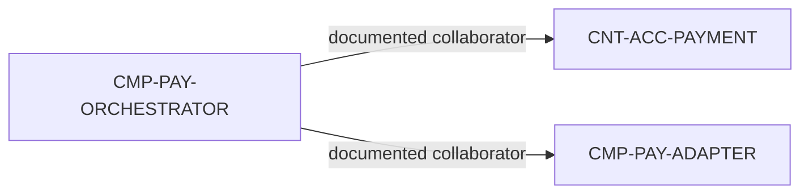

# CMP-PAY-ORCHESTRATOR — Payment Orchestrator

**Status:** PROPOSED MVP BASELINE — provider capabilities and commercial values require external gates.

## Component Relationship Diagram
> Derived only from the collaborator/interface references in this document; no relationship is added here beyond the source text.

## Payment policy and records
For every SellerOrder, create a payment allocation linked to seller, order, amount, transaction currency, tax/delivery basis, capture-policy ID, correlation ID, and idempotency key. The safe baseline is one payment record per SellerOrder. A single aggregated buyer-facing provider transaction is allowed only when all seller/agreement policies are compatible and the provider supports seller allocations; otherwise use separate attempts. An authorization is a reversible hold, capture is collection, seller credit/transfer is a separate state, and settlement is a later reconciliation event.

## Distinct executable paths
- **Authorize-then-capture:** `PENDING_AUTHORIZATION → AUTHORIZED → CAPTURE_REQUESTED → CAPTURED`; `CAPTURE_REQUESTED` is the canonical state while the later capture operation is pending. Capture occurs at the configured seller/agreement trigger and is not implied by authorization.
- **Immediate/contract-defined capture:** `PENDING_AUTHORIZATION → CAPTURE_REQUESTED → CAPTURED` when the approved policy and provider support immediate capture. If multiple SellerOrders use one transaction, incompatible policies force separate attempts or block checkout.

Seller configuration is constrained by platform, risk, legal, and provider policy. A timeout or missing response is `UNKNOWN`; reconciliation queries status before retrying or compensating. Capture failure after confirmation leaves the order confirmed with an explicit payment exception and reconciliation workflow. Capture success does not by itself prove seller credit or settlement.

## Provider adapter contract
The adapter exposes authorize, capture, void, refund, payment-code lookup, seller-credit/transfer status, and webhook/reconciliation normalization where supported. Unsupported capabilities are explicit errors or deferred states; no provider feature is assumed. Raw card data is never stored.

## Idempotency and audit
Every operation is keyed by payment allocation/SellerOrder and operation-specific idempotency key. Ledger and reconciliation link provider reference, order, seller, currency, amount, commission, and reversal/duplicate relationships. Outbox/Inbox supports at-least-once delivery, but the exact payment-event set and wire mapping remain OPEN. Do not assign `SellerCredit*` or settlement-event publication to this orchestrator: those belong to the future Settlement/Ledger boundary only if approved. Reconciliation records evidence/discrepancies and raises alerts; it is not asserted as an Event Bus publisher or corrective-command owner.

**References:** ADR-016, ADR-017, financial-ledger-and-settlement.md, FN-PAY-AUTHORIZE.

## Identity, parent, and scope
The orchestrator is `CMP-PAY-ORCHESTRATOR` under `CNT-ACC-PAYMENT`. Its payment allocation identity is scoped to SellerOrder and operation-specific idempotency key; it does not own order state, inventory, accounting policy, or settlement finality.

## Verification references
Existing payment authorization, UNKNOWN reconciliation, capture exception, and idempotency scenarios are documented in `FN-PAY-AUTHORIZE`, `CMP-PAY-ADAPTER`, and `validation/acceptance-test-plan.md`. No execution result is claimed.
