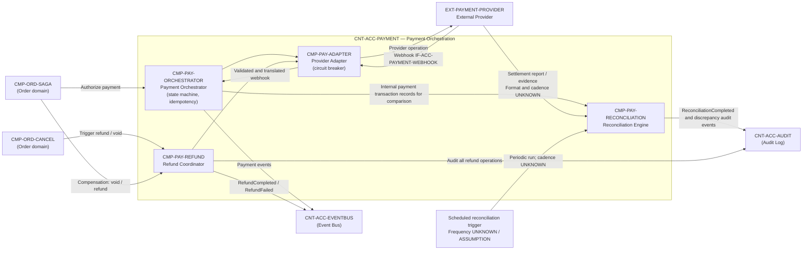

# CNT-ACC-PAYMENT — Component Diagram

`EXT-PAYMENT-PROVIDER` is the source of settlement-report evidence received by **CMP-PAY-RECONCILIATION**; report format, transfer mechanism and cadence remain UNKNOWN. Reconciliation records results and discrepancies through **CNT-ACC-AUDIT**. No `CMP-PAY-RECONCILIATION → CNT-ACC-EVENTBUS` relationship is established, so none is shown. Provider identity and Event Bus technology remain undecided.
