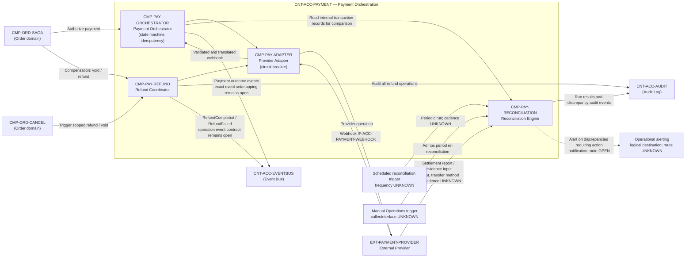

# CNT-ACC-PAYMENT — Component Diagram

**Container:** CNT-ACC-PAYMENT
**System:** SYS-ACCSYSTEM
**Status:** DRAFT | Provider capabilities, settlement evidence contract and corrective-command route remain open.

`CMP-PAY-RECONCILIATION` supports both scheduled runs and manual ad hoc re-reconciliation. The manual trigger is shown as a control input, not as a newly registered service; its caller/interface is unspecified. The provider report is a logical evidence input. The source of the report is known, but its delivery or pull mechanism, format and cadence are not.

Reconciliation owns run/discrepancy records and raises alerts; it does not post a ledger entry or mutate payment state directly. A discrepancy may lead to an approved corrective command by the owning payment or future settlement component, but the command authority and route are open. No direct `CMP-PAY-RECONCILIATION → CMP-PAY-ORCHESTRATOR` or `→ CMP-PAY-REFUND` command edge is asserted. The dotted alert target is a logical operational destination, not a new C3 component. No reconciliation-to-EventBus relationship is established.

---

## Component Summary

| Component | ID | Responsibility |
|---|---|---|
| Payment Orchestrator | CMP-PAY-ORCHESTRATOR | Owns scoped payment attempts/allocations and provider-operation state |
| Provider Adapter | CMP-PAY-ADAPTER | Translates provider requests, responses and validated webhooks |
| Reconciliation Engine | CMP-PAY-RECONCILIATION | Matches internal records to provider evidence and raises discrepancies/alerts |
| Refund Coordinator | CMP-PAY-REFUND | Executes and tracks eligible scoped void/refund operations |

---

## Open Decisions

| Concern | Status |
|---|---|
| Provider identity, API and seller allocation capabilities | UNKNOWN / provider-selection gate |
| Settlement report schema, transfer/pull method and cadence | UNKNOWN / provider contract gate |
| Scheduled reconciliation frequency | UNKNOWN / operational policy |
| Manual reconciliation caller/interface | UNKNOWN |
| Corrective action authority and command route | OPEN; no ad hoc mutation or retry is implied |
| Settlement/Ledger ownership and finality | PROPOSED future boundary; owner unassigned |
| Payment event schema and delivery semantics | OPEN; no wire contract asserted |

---

*Updated: 2026-11-21 | Not stakeholder-approved | Not production-ready*
