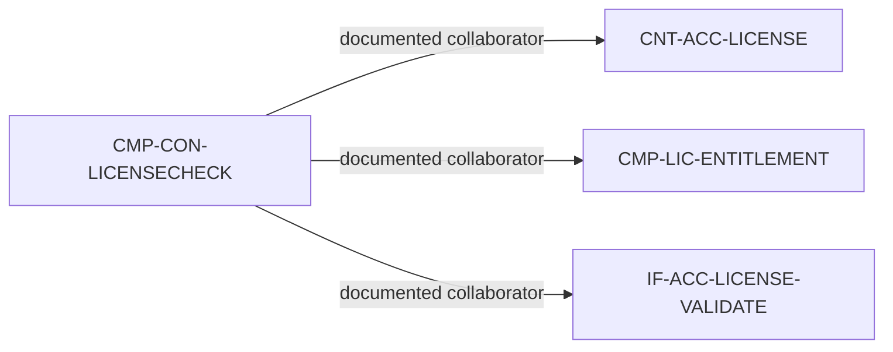

# CMP-CON-LICENSECHECK — License Validator

**Component ID:** CMP-CON-LICENSECHECK  
**Container:** CNT-ACR-CONNECTOR  
**System:** SYS-ACCORE (per-institution instance)  
**C4 Level:** C3 — Component  
**Status:** DRAFT | Evidence: idea.md §7, §14 → ADR-014

---

## 1. Identity

| Field | Value |
|---|---|
| **ID** | CMP-CON-LICENSECHECK |
| **Name** | License Validator |
| **Container** | CNT-ACR-CONNECTOR |
| **Responsibility** | Validates software entitlement tokens locally without requiring a network call to ACCSystem. Uses platform public key (ADR-014). Falls back to online validation via IF-ACC-LICENSE-VALIDATE when the offline token is expired and network is available. |

---

## 2. Collaborators

| Collaborator | Direction | Interface / Event | Purpose |
|---|---|---|---|
| ACCore application layer | Inbound | Internal call (library or service) | Requests validation in institutional or marketplace workflow-specific identity context |
| Platform Public Key Store | Read | Config file or certificate store | Verifies token signature (public key) |
| CNT-ACC-LICENSE (CMP-LIC-ENTITLEMENT) | Outbound (conditional) | IF-ACC-LICENSE-VALIDATE | Online fallback when offline token expired |
| Token Cache | Read/Write | Local cache | Caches last validated token and result |

---

## Component Relationship Diagram
> Derived only from the collaborator/interface references in this document; no relationship is added here beyond the source text.

## 3. Data Owned

**Token Cache Entry (local, ephemeral):**
```
cache_key           string (workflow-scoped identity)
token               string (JWT or signed blob — ADR-014)
token_expiry        timestamp
last_validated_at   timestamp
last_result         enum {VALID, INVALID, EXPIRED}
```

**Platform Public Key (config, not operational data):**
```
key_id              string (key rotation ID)
public_key_pem      string
valid_from          timestamp
valid_until         timestamp (nullable)
```

---

## 4. Behavior / Rules / State

### Validation Logic (ADR-014)

```
function validate(workflow_context, token):
  if token is null or not present:
    return INVALID (no entitlement token)
  
  parse workflow-appropriate token claims: institutional `{institution_id, product_code, ...}` or marketplace `{buyer_id, product_id, ...}`, plus issued/expires/signature
  
  step 1 — signature check:
    verify signature using platform public key
    if invalid → return INVALID (tampered or wrong key)
  
  step 2 — identity and grant evidence:
    verify workflow, license reference and expected authenticated scope; institutional uses `institution_id + product_code`; marketplace uses `buyer_id + product_id`
    if mismatch → return INVALID; invalid signature, missing key or wrong scope never enters token-derived grace
    verify authenticated grant bounds or equivalent local evidence under approved policy
    if required authenticated grant evidence is absent or unverifiable → restrict; it cannot grant token-derived access. If evidence is present but a time bound is not satisfied, apply only a specifically approved applicable grace policy; otherwise restrict

  step 3 — known negative status and credential expiry:
    if locally observed suspension or revocation applies → return INVALID/RESTRICTED; do not return VALID

    step 3 — credential expiry:
    if expires_at < now:
      if network available:
        → online fallback (IF-ACC-LICENSE-VALIDATE), using independently authenticated and authorized request context
        → return the online result for that scope, not a claim that the expired token is valid; request token refresh separately if supported
      else:
        → return EXPIRED_OFFLINE; restrict unless an applicable grace policy is explicitly approved

  → return VALID only when signature, identity, grant and credential checks pass
```

### Token Refresh
- Online validation is read-only; requesting a fresh signed token is a separate retriable license-owned operation. Its delivery/availability contract remains OPEN.
- If a separately issued token is delivered, store it in Token Cache for subsequent offline use.
- ASSUMPTION: token TTL is configured by platform (UNKNOWN — exact TTL; idea.md §12)

### Grace Period (UNKNOWN)
- After token expiry, offline behavior during grace period: UNKNOWN — policy not specified
- OWNER_UNASSIGNED; revisit trigger: License model specification

---

## 5. Failure Modes

| Failure | Detection | Mitigation |
|---|---|---|
| Token signature invalid | Crypto verification fails | Return INVALID immediately; log anomaly |
| Token expired, no network | Expiry + network check | Return EXPIRED_OFFLINE; restrict licensed functions unless applicable grace is approved. Preserve independently permitted local ERP operation. |
| Public key unavailable | Key store read fails | FAIL-CLOSED: return INVALID; alert operations |
| Public key expired (rotation) | valid_until < now | Load next valid key; ASSUMPTION: multiple keys supported for rotation overlap |
| Online fallback unavailable | Connection timeout | Return EXPIRED_OFFLINE; restrict licensed features unless applicable grace is approved, preserving separately permitted local ERP operation |
| Tampered token | Signature mismatch | Return INVALID; log with token metadata for security audit |

---

## 6. Security

| Concern | Control |
|---|---|
| Public key integrity | Public key distributed at ACCore instance provisioning; signed by platform (ASSUMPTION) |
| Key rotation | Platform rotates key pair periodically; ACCSystem signs new tokens with new key; both keys valid during overlap |
| No private key at ACCore | ACCore NEVER receives or stores the platform private key — offline validation uses public key only (ADR-014 core constraint) |
| Token replay | Verify institutional institution/product or marketplace buyer/product scope; a different authorized context must not reuse the token |
| Audit | All INVALID results logged with token metadata (without full token) |

---

## 7. Operational Concerns

| Concern | Note |
|---|---|
| Key distribution | Platform must have operational procedure for distributing updated public keys to all ACCore instances |
| Token TTL tuning | Short TTL = more online calls (connectivity requirement); long TTL = slower revocation propagation. Currently UNKNOWN. |
| Offline duration | Subject to credential and grant validity, observed revocation, and any approved applicable grace; must be decided by Business/Security. |

---

## 8. Traceability

| Claim | Evidence |
|---|---|
| Offline validation via signed token | CONFIRMED (idea.md §14 → ADR-014) |
| Public key at ACCore, private key at ACCSystem | CONFIRMED (ADR-014 — offline validation design) |
| Grace period | UNKNOWN (idea.md §12 — open decision on offline license validation strategy) |
| Token TTL | UNKNOWN (idea.md §12 — open decision) |

---

*Generated: 2026-11-15 | Not stakeholder-approved | Not production-ready*
