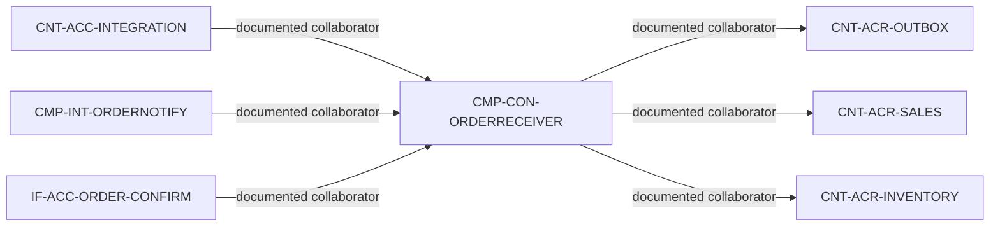

# CMP-CON-ORDERRECEIVER — Order Event Receiver

**Component ID:** CMP-CON-ORDERRECEIVER  
**Container:** CNT-ACR-CONNECTOR  
**System:** SYS-ACCORE (per-institution instance)  
**C4 Level:** C3 — Component  
**Status:** DRAFT | Evidence: idea.md §4.3, §8, ADR-005

---

## 1. Identity

| Field | Value |
|---|---|
| **ID** | CMP-CON-ORDERRECEIVER |
| **Name** | Order Event Receiver |
| **Container** | CNT-ACR-CONNECTOR |
| **Responsibility** | Consumes recipient-scoped `OrderConfirmed` handoffs from ACCSystem Integration. Uses an Inbox and idempotent effects under at-least-once delivery; duplicate deliveries and partial processing remain possible. Seller sale/inventory and B2B buyer purchase-document effects are distinct. |

---

## 2. Collaborators

| Collaborator | Direction | Interface / Event | Purpose |
|---|---|---|---|
| CNT-ACC-INTEGRATION (CMP-INT-ORDERNOTIFY) | Inbound | IF-ACC-ORDER-CONFIRM asynchronous delivery | Receives `OrderConfirmed` event payload |
| ACCore Inbox (CNT-ACR-OUTBOX/Inbox) | Write | Local DB | Persists incoming event before processing (Inbox pattern) |
| CNT-ACR-SALES | Outbound | Internal API | Creates the applicable institution-local seller sale or B2B buyer purchase record, subject to role and policy |
| CNT-ACR-INVENTORY | Outbound | Internal API | Transitions inventory reservation → `CONFIRMED` (committed sale) |
| Idempotency Store | Read/Write | Local DB | Tracks recipient-scoped claims and separate per-effect progress; event identity is retained for tracing |

---

## Component Relationship Diagram
> Derived only from the collaborator/interface references in this document; no relationship is added here beyond the source text.

## 3. Data Owned

**Inbox Record:**
```
inbox_id            UUID (PK)
source_system       string ("ACCSystem")
event_type          string ("OrderConfirmed")
order_id            UUID (from ACCSystem)
payload             JSON (authorized recipient-scoped handoff; schema pending)
status              enum {RECEIVED, PROCESSING, PROCESSED, FAILED}
received_at         timestamp
processed_at        timestamp (nullable)
retry_count         integer
event_id, institution_id, scoped_operation_key, per_effect_progress  (proposed; exact schema open)
```

---

## 4. Behavior / Rules / State

### Processing Flow
1. Validate the recipient institution, authorized role and permitted payload under IF-ACC-ORDER-CONFIRM §2A; the prior `{order_id, buyer_id, items, total, payment_ref}` sketch is abbreviated and not a wire contract.
2. Persist receipt and claim the scoped business operation durably before effects, with concurrency protection and `event_id` for tracing. A duplicate already completed may return the recorded outcome; a received/in-progress duplicate must not be mistaken for completed work.
3. For a seller role, create the applicable local sales record and confirm only its eligible reservation(s). For an authorized B2B buyer role, create or route the local purchase-document outcome; do not commit seller stock. Preserve both roles if authorized for the same institution; exact role/key mapping remains open.
4. Use a local atomic transaction only where supported; otherwise persist each applicable effect's identity, progress and evidence. Resume unfinished work on restart; reconcile an UNKNOWN effect with its authoritative owner before repeating it. Conflicting payloads for the same operation require investigation, not silent suppression.
5. Mark `PROCESSED` only after all applicable effects are evidenced. A transport ACK can mean durable acceptance only if the receiver retains responsibility for recovery after ACK; otherwise intake must remain safely retryable. Exact ACK/status and feedback contracts require owner agreement.

### Error Handling
- Record definite failure separately from an UNKNOWN effect; reconcile possible effects before retry. Preserve per-effect completion when sales succeeds but inventory fails.
- Retry or quarantine recoverable work under configured policy and escalate to Operations; exhaustion is not completion. Transport-specific ACK semantics remain open.

### Idempotency
- Confirmation business scope: `institution_id + order_id`, with additional role/operation/effect protection where needed; exact same-institution multi-role key requires governance. `event_id` traces delivery; dispatch and business keys are not interchangeable.
- Completed duplicates do not repeat effects. In-progress, failed or UNKNOWN work must remain recoverable; do not return a fabricated final outcome.

---

## 5. Failure Modes

| Failure | Detection | Mitigation |
|---|---|---|
| Duplicate `OrderConfirmed` delivery | Scoped claim and event ID | Completed work is not repeated; in-progress or incomplete work remains recoverable |
| CNT-ACR-SALES unavailable | Internal API failure | Preserve retryable progress and alert according to configured policy |
| Inbox write failure | DB error | Do not claim durable acceptance; allow transport-specific safe retry |
| Partial processing (Sales created, Inventory confirm fails or is UNKNOWN) | Per-effect evidence and Inbox progress | Preserve completed work; reconcile uncertain inventory before retry, alert Operations and retain recoverable record |
| ACCSystem sends event for wrong institution | institution_id mismatch | Reject with 403; log anomaly |

---

## 6. Security

| Concern | Control |
|---|---|
| Authentication of incoming event | ADR-015 controlled method set: OAuth 2.0 Client Credentials, mTLS, or another approved method; no arbitrary per-request selection |
| Payload validation | Validate required fields; reject malformed events with 400 |
| Institution scope | `institution_id` in event must match this ACCore instance's institution_id |
| Financial data integrity | Sales order created from ACCSystem event data; amount must match price_snapshot; ASSUMPTION: no repricing in ACCore |

---

## 7. Operational Concerns

| Concern | Note |
|---|---|
| Local record deduplication | Apply scoped operation/effect idempotency to seller sale and buyer purchase without collapsing distinct authorized roles |
| Reconciliation ownership | Integration tracks per-recipient delivery; institutional ACCore owns local sales/purchase and inventory evidence; each domain resolves its own records, with Operations coordinating escalation. Correlate event, institution/role, order/seller order, reservation and local record/effect where applicable. Closure requires recorded authoritative evidence; named contacts, feedback mechanism and thresholds remain OPEN. |
| Event ordering | Multiple items per order → one `OrderConfirmed` event per order (not per item); ASSUMPTION |

---

## 8. Traceability

| Claim | Evidence |
|---|---|
| Inbox pattern for reliable event consumption | CONFIRMED (idea.md §4.3, ADR-005) |
| Sales order creation triggered by order confirmation | CONFIRMED (idea.md §4 — ACCore manages institution's sales records) |
| Scoped confirmation idempotency and event tracing | IF-ACC-ORDER-CONFIRM §2A; role/effect granularity remains a contract gate |
| Financial record commitment point | UNKNOWN (idea.md §12 — open decision; this is one candidate) |

---

*Generated: 2026-11-15 | Not stakeholder-approved | Not production-ready*


---

## 8. Verification and Tests

### 8.1 Acceptance Test Scenarios

| Scenario | Input / Precondition | Expected Verification Outcome |
|---|---|---|
| Seller / B2B buyer receipt | Authorized role-scoped handoff | Correct local sale/inventory or purchase path; no unauthorized data or seller stock action on buyer path |
| Duplicate or crash after receipt | Same event or operation; including in-progress and partial effects | No repeated completed effect; unfinished/UNKNOWN work remains recoverable, with ACK semantics as agreed |
| Local DB unavailable before durable receipt | Database unavailable | No durable-acceptance claim; sender can safely retry under selected channel contract |
