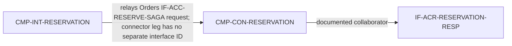

# CMP-CON-RESERVATION — ACCore Reservation Handler

**Status:** PROPOSED MVP BASELINE; institution-owned implementation behind the connector contract.

## Responsibility
Accept reservation and release commands through the approved connectivity mode. Execute the inventory decision inside ACCore; ACCSystem cannot access the ACCore database and is never the inventory source of truth.

## Atomic reservation
Within one local ACCore database transaction, validate the institution/product scope, lock or conditionally update the inventory row, verify available quantity, create the reservation record, and persist the idempotency result. The last-unit race therefore permits at most one successful reservation. A duplicate request returns the same result.

Reservation record states are `REQUESTED`, `ACCEPTED`, `REJECTED`, `UNKNOWN`, `RELEASE_REQUESTED`, `RELEASED`, `EXPIRED`, and `CONSUMED/COMMITTED`. `UNKNOWN` is used when processing or response delivery cannot be established; it is reconciled by reservation ID/idempotency key. A release is idempotent, and a `CONSUMED/COMMITTED` reservation cannot be released. The deprecated legacy token `RESERVED` maps to `ACCEPTED`; it is not a current wire/state token (ADR-018 §3.3).

## Timeout and expiry rules
A timeout does not prove rejection and does not trigger release. A hold expires only under the configured reservation policy after the outcome is known or a safe reconciliation rule permits expiry. The deduplication record remains for the configured period required to cover retries/reconciliation; no fixed duration is assumed.

## Security and operations
Transport and authentication follow ADR-015's controlled policy. The handler is institution-scoped, rejects cross-institution writes, and audits reserve/query/release/commit actions. Latency, retry, hold, and expiry thresholds are configurable operational parameters with workload and recovery gates.

## Tests
Atomic last-unit race; duplicate request; accepted response lost; timeout/unknown; definitive rejection; idempotent release; release of consumed reservation rejected; outbox/inbox replay; credential rotation and revocation.

## Interfaces and collaborators
- Consumes reservation/release commands relayed by `CMP-INT-RESERVATION` after the Orders-to-Integration `IF-ACC-RESERVE-SAGA` request. The connector leg has no separately registered interface ID; its channel and schema remain OPEN.
- Returns `ACCEPTED`, `REJECTED`, `UNKNOWN`, or authoritative `EXPIRED` through `IF-ACR-RESERVATION-RESP`.
- ACCore inventory storage is the local source of truth; ADR-015 governs connectivity/authentication.

## Component Relationship Diagram
> Derived only from the collaborator/interface references in this document; no relationship is added here beyond the source text.

