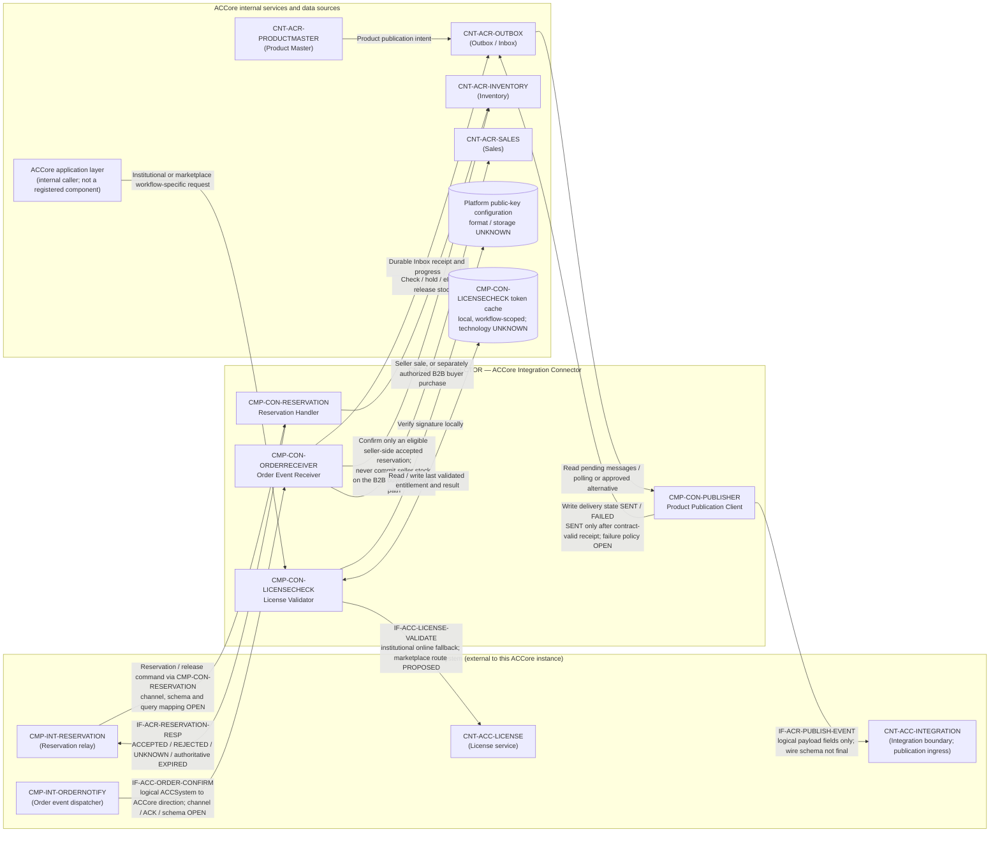

# C3 Component Diagram — CNT-ACR-CONNECTOR (ACCore Integration Connector)

**Container:** CNT-ACR-CONNECTOR  
**System:** SYS-ACCORE (per-institution instance)  
**Status:** DRAFT | Evidence: component records, interface contracts, ADR-005/006/014/015

---

## Component Interaction Diagram

The Product Master is the product source of truth, but publication work reaches the connector through the transactional Outbox; the diagram does not show a direct Product Master-to-ACCSystem call. `CMP-CON-PUBLISHER` reads pending messages and writes delivery state. `SENT` requires a contract-valid receipt; `FAILED` classification and retry-exhaustion behavior remain policy/contract gated. The local OAuth service-access-token cache used by the publisher, if OAuth is selected under ADR-015, is distinct from the license entitlement Token Cache shown above; mTLS remains an alternative.

`IF-ACC-RESERVE-SAGA` is the Orders-to-Integration request interface and is **not** the Integration-to-ACCore connector leg. That relay passes through `CMP-INT-RESERVATION`; its concrete command/channel/schema mapping remains open. Reservation outcomes return through `IF-ACR-RESERVATION-RESP` using the canonical status vocabulary, but response/query/callback modality remains open.

`IF-ACC-ORDER-CONFIRM` is a logical ACCSystem-to-ACCore handoff through `CMP-INT-ORDERNOTIFY`. The channel, ACK meaning, recipient-specific schema and recovery contract are not finalized. The receiver creates the applicable seller-side sale/inventory effect or authorized B2B buyer purchase effect; only an eligible seller-side accepted reservation may be committed. A buyer-side B2B purchase record does not itself authorize seller-stock mutation.

The public key, entitlement token cache, Outbox/Inbox state, and component record field shapes do not establish a selected database, cache technology, DDL, token format, or final wire schema.

---

## Interface Summary

| Interface ID | Registered provider | Registered consumer(s) | Connector-view relationship | Protocol / status |
|---|---|---|---|---|
| IF-ACR-PUBLISH-EVENT | CNT-ACR-CONNECTOR | CNT-ACC-INTEGRATION; CMP-INT-GATEWAY | `CMP-CON-PUBLISHER` sends publication to Integration | HTTPS POST documented baseline; exact versioned schema OPEN |
| IF-ACC-RESERVE-SAGA | CNT-ACC-INTEGRATION | CNT-ACC-ORDERS; CMP-ORD-SAGA | Orders-to-Integration request is relayed through `CMP-INT-RESERVATION` to `CMP-CON-RESERVATION`; this ID is not the connector-leg interface | Synchronous REST saga step in the reference contract; connector-leg channel/schema OPEN under ADR-015 |
| IF-ACR-RESERVATION-RESP | CNT-ACR-CONNECTOR | CNT-ACC-INTEGRATION; CMP-INT-RESERVATION | `CMP-CON-RESERVATION` returns outcomes to the Integration relay | Response / trusted query; optional approved callback remains OPEN |
| IF-ACC-ORDER-CONFIRM | CNT-ACC-INTEGRATION | CNT-ACR-CONNECTOR; CMP-CON-ORDERRECEIVER | Logical inbound handoff through `CMP-INT-ORDERNOTIFY` | PROPOSED / OPEN; channel, ACK meaning and recipient schema not finalized |
| IF-ACC-LICENSE-VALIDATE | CNT-ACC-LICENSE | CNT-ACR-CONNECTOR; CMP-CON-LICENSECHECK; CNT-ACE-MOBILEAPP | Connector validator uses the institutional online path/fallback; marketplace client path is PROPOSED | Institutional route documented; marketplace route PROPOSED |

Provider/consumer columns reproduce the roles in `registry/interfaces.json`; they do not expand a logical interface into unregistered physical hops. In particular, `IF-ACC-RESERVE-SAGA` is the Orders-to-Integration interface only; the Integration-to-ACCore connector leg has no registered interface ID and remains OPEN.

---

## Component Summary

| Component | ID | Responsibility |
|---|---|---|
| Product Publication Client | CMP-CON-PUBLISHER | Reads Outbox and sends publications; updates delivery status under the approved receipt/retry contract |
| Reservation Handler | CMP-CON-RESERVATION | Handles reservation requests, response/query recovery and eligible release |
| Order Event Receiver | CMP-CON-ORDERRECEIVER | Applies recipient-scoped seller-sale/inventory or authorized B2B buyer-purchase effects |
| License Validator | CMP-CON-LICENSECHECK | Validates offline entitlement tokens locally and uses online fallback when applicable |

---

## Key Cross-Cutting Concerns

| Concern | Pattern | Status / ADR |
|---|---|---|
| Reliable publication messaging | Outbox / Inbox | Documented pattern; ADR-005 remains PROPOSED |
| Idempotency | Stable operation keys and recoverable progress | Documented baseline; ADR-005/006 remain PROPOSED |
| Inventory reservation in saga | Response or trusted query; optional approved callback; preserve UNKNOWN/EXPIRED | ADR-006/013/018 remain subject to approval gates |
| Offline license validation | Signed entitlement token + public key + scoped local token cache | ADR-014 remains PROPOSED; token/key/cache technology unresolved |
| Order confirmation | Logical ACCSystem → ACCore handoff | PROPOSED / OPEN; channel, ACK and schema require governance |

---

## Traceability and Open Items

- ACCore's Product Master is the source of truth; Product Master publication reaches the connector via Outbox.
- The publisher writes `SENT` only after a contract-valid receipt; error and retry-exhaustion classification for `FAILED` remains policy gated.
- Reservation requests travel through `CMP-INT-RESERVATION`; the outgoing ACCore channel and exact command schema remain open.
- The exact reservation response mode (synchronous response, trusted query, or optional approved callback) remains open; elapsed time alone does not turn UNKNOWN into rejection or expiry.
- `IF-ACC-ORDER-CONFIRM` remains PROPOSED/OPEN; no transport, ACK or payload schema is asserted as final.
- Inventory confirmation applies only to an eligible seller-side accepted reservation, not the B2B buyer-purchase effect.
- The institutional license fallback is distinct from the proposed marketplace by-ID route.
- Token TTL, grace period, signing/key-management details and institution connectivity policy remain UNKNOWN/OPEN.

---

*Updated: 2026-11-21 | Not stakeholder-approved | Not production-ready*
