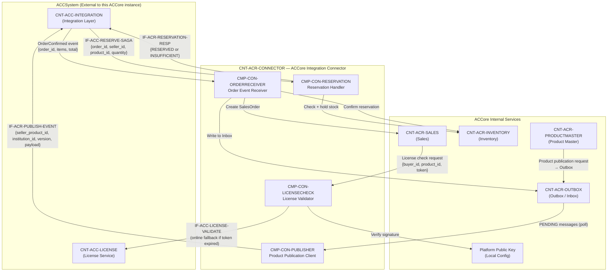

# C3 Component Diagram — CNT-ACR-CONNECTOR (ACCore Integration Connector)

**Container:** CNT-ACR-CONNECTOR  
**System:** SYS-ACCORE (per-institution instance)  
**Status:** DRAFT | Evidence: idea.md §4.3, ADR-005, ADR-006, ADR-014

---

## Component Interaction Diagram

---

## Interface Summary

| Interface ID | Direction | Protocol | Used By |
|---|---|---|---|
| IF-ACR-PUBLISH-EVENT | ACCore → ACCSystem | HTTPS POST | CMP-CON-PUBLISHER |
| IF-ACC-RESERVE-SAGA | ACCSystem → ACCore | HTTPS POST | CMP-CON-RESERVATION |
| IF-ACR-RESERVATION-RESP | ACCore → ACCSystem | HTTPS POST (callback) | CMP-CON-RESERVATION |
| OrderConfirmed delivery | ACCSystem → ACCore | HTTPS POST | CMP-CON-ORDERRECEIVER |
| IF-ACC-LICENSE-VALIDATE | ACCore → ACCSystem | HTTPS GET | CMP-CON-LICENSECHECK (fallback) |

---

## Component Summary

| Component | ID | Responsibility |
|---|---|---|
| Product Publication Client | CMP-CON-PUBLISHER | Reads Outbox, sends product publications to ACCSystem with retry + idempotency |
| Reservation Handler | CMP-CON-RESERVATION | Handles inventory reservation requests from saga; synchronous; compensation-aware |
| Order Event Receiver | CMP-CON-ORDERRECEIVER | Consumes OrderConfirmed; creates ACCore sales order; confirms inventory |
| License Validator | CMP-CON-LICENSECHECK | Offline token validation; public-key signature check; online fallback |

---

## Key Cross-Cutting Concerns

| Concern | Pattern | ADR |
|---|---|---|
| Reliable messaging | Outbox/Inbox | ADR-005 |
| Idempotency | Idempotency keys on all operations | ADR-005, ADR-006 |
| Inventory reservation in saga | Synchronous request-response in saga path | ADR-006, ADR-013 |
| Offline license validation | Signed entitlement token + public key | ADR-014 |

---

## Traceability

| Claim | Evidence |
|---|---|
| ACCore connector as integration boundary | CONFIRMED (idea.md §4.3) |
| Outbox/Inbox pattern | CONFIRMED (idea.md §4.3, ADR-005) |
| Reservation before order confirmation | CONFIRMED (idea.md §8, ADR-006) |
| Offline license validation at ACCore | CONFIRMED (idea.md §7, ADR-014) |

---

*Generated: 2026-11-15 | Not stakeholder-approved | Not production-ready*
