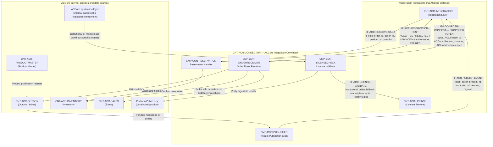

# C3 Component Diagram — CNT-ACR-CONNECTOR (ACCore Integration Connector)

**Container:** CNT-ACR-CONNECTOR  
**System:** SYS-ACCORE (per-institution instance)  
**Status:** DRAFT | Evidence: component records, interface contracts, ADR-005/006/014/015

---

## Component Interaction Diagram

The Product Master is the product source of truth, but the connector receives publication work through the transactional Outbox; the diagram does not show a direct Product Master-to-ACCSystem call. The license-check requester is the ACCore application layer, not CNT-ACR-SALES. That layer label is a documented caller, not a new registered component.

---

## Interface Summary

| Interface ID | Direction | Protocol / status | Used by |
|---|---|---|---|
| IF-ACR-PUBLISH-EVENT | ACCore → ACCSystem | HTTPS POST (documented baseline) | CMP-CON-PUBLISHER |
| IF-ACC-RESERVE-SAGA | ACCSystem → ACCore | Request interface; institution channel details remain governed by ADR-015 | CMP-CON-RESERVATION |
| IF-ACR-RESERVATION-RESP | ACCore → ACCSystem | Response/query; optional approved callback remains OPEN | CMP-CON-RESERVATION |
| IF-ACC-ORDER-CONFIRM | ACCSystem → ACCore logically | PROPOSED / OPEN; channel, ACK meaning and schema not finalized | CMP-CON-ORDERRECEIVER |
| IF-ACC-LICENSE-VALIDATE | ACCore → ACCSystem | Institutional fallback documented; marketplace GET/by-ID path PROPOSED | CMP-CON-LICENSECHECK |

---

## Component Summary

| Component | ID | Responsibility |
|---|---|---|
| Product Publication Client | CMP-CON-PUBLISHER | Reads Outbox and sends product publications with retry and idempotency |
| Reservation Handler | CMP-CON-RESERVATION | Handles reservation requests and response/query recovery; optional callback remains open |
| Order Event Receiver | CMP-CON-ORDERRECEIVER | Applies scoped seller-sale/inventory or authorized B2B buyer-purchase effects |
| License Validator | CMP-CON-LICENSECHECK | Validates offline entitlement tokens locally and uses online fallback when applicable |

---

## Key Cross-Cutting Concerns

| Concern | Pattern | Status / ADR |
|---|---|---|
| Reliable messaging | Outbox / Inbox | Documented pattern; ADR-005 remains PROPOSED |
| Idempotency | Idempotency keys on operations | Documented baseline; ADR-005/006 remain PROPOSED |
| Inventory reservation in saga | Response or trusted query; optional approved callback; preserve UNKNOWN/EXPIRED | ADR-006/013 remain PROPOSED |
| Offline license validation | Signed entitlement token + public key | ADR-014 remains PROPOSED |
| Order confirmation | Logical ACCSystem → ACCore handoff | PROPOSED / OPEN; channel, ACK and schema require governance |

---

## Traceability and Open Items

- ACCore's Product Master is the source of truth; Product Master publication reaches the connector via Outbox.
- The exact reservation response mode (synchronous response, trusted query, or optional approved callback) remains open; elapsed time alone does not turn UNKNOWN into rejection or expiry.
- `IF-ACC-ORDER-CONFIRM` remains PROPOSED/OPEN; no transport, ACK meaning or payload schema is asserted as final.
- The institutional license fallback is distinct from the proposed marketplace by-ID route.
- Token TTL, grace period, signing/key-management details and institution connectivity policy remain UNKNOWN/OPEN.

---

*Generated: 2026-11-21 | Not stakeholder-approved | Not production-ready*
