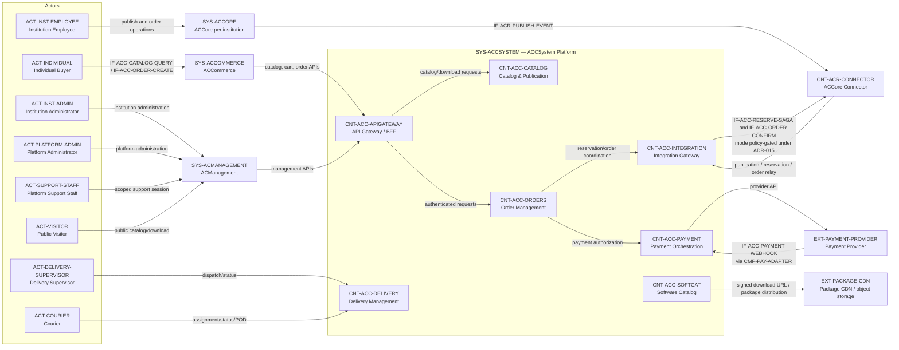

# ACC Ecosystem — Context Relationship and Data-Boundary View
**View type:** C1/C2 supporting relationship view
**Status:** PROPOSED / owner review required
**Sources:** `c1-context/systems/SYS-ACCSYSTEM.md`, `c1-context/systems/SYS-ACCORE.md`, the C2 container collaborator tables, `registry/interfaces.json`, ADR-005, ADR-015, ADR-018, and ADR-019.

## Purpose and scope

This view supplements, rather than replaces, the C1 context views and the internal C2 decompositions. It makes direct actors, external systems, initiator direction, interface IDs, trust boundaries, and data ownership visible without overcrowding any single C4 diagram. An arrow means the source initiates a call, message, event, or connection; a response or callback is shown separately where it changes the contract. Logical arrows do not assert deployment co-location or a selected connectivity mode.

## Direct system and external relationships

## Data ownership and copies

| Data or effect | System/container of record | Derived or temporary copies | Visual evidence |
|---|---|---|---|
| Product master, institutional inventory, reservation hold | `SYS-ACCORE` / `CNT-ACR-PRODUCTMASTER`, `CNT-ACR-INVENTORY` | ACCSystem listing, offer, and search projections | `supporting-views/data-architecture.md`; `c1-context/systems/SYS-ACCORE.md`; `dynamic-purchase-flow.md` |
| Marketplace listing | `CNT-ACC-CATALOG` | Search index in `CNT-ACC-SEARCH`; publication/retry state in integration | `supporting-views/data-architecture.md`; `dynamic-publication-flow.md` |
| ParentOrder/SellerOrder and immutable commercial snapshot | `CNT-ACC-ORDERS` | Payment allocation and delivery projections | `dynamic-purchase-flow.md`; `c3-components/CNT-ACC-ORDERS/component-diagram.md` |
| Payment attempts and provider outcomes | `CNT-ACC-PAYMENT` plus provider-side record | Reconciliation and audit events | `c3-components/CNT-ACC-PAYMENT/component-diagram.md`; `supporting-views/financial-ledger-and-settlement.md` |
| Signed software package bytes | `EXT-PACKAGE-CDN` | Catalog metadata and signed/time-limited URLs | `c1-context/systems/SYS-ACCSYSTEM.md`; `supporting-views/data-architecture.md` |

## Connectivity and unresolved alternatives

- ACCore connectivity is **outbound-initiated by default**; protected inbound is an optional deployment capability under ADR-015. The diagram intentionally shows the connector boundary and labels the command path as policy-gated rather than selecting one network mode.
- A reservation timeout, lost response, or circuit-open result remains `UNKNOWN`; elapsed time alone does not justify release or repeated side effects. Authoritative `EXPIRED` or trusted reconciliation is distinct from `UNKNOWN` (ADR-018, ADR-006, ADR-013).
- `OrderConfirmed`, reservation consumption, SalesOrder creation, and financial journal posting are separate milestones. The financial commitment point remains institution-policy dependent under ADR-019; no single arrow is intended to collapse them.
- Payment webhooks enter through `CMP-PAY-ADAPTER` for signature verification and translation before `CMP-PAY-ORCHESTRATOR`; this is a security boundary, not a direct provider-to-orchestrator shortcut.

## Traceability

| Visual fact | Source | Exact representation |
|---|---|---|
| Direct ACCSystem actors and systems | `c1-context/systems/SYS-ACCSYSTEM.md` §§2–4 | Actor/system nodes and labelled arrows above; focal view in `c4-context-and-container-overlays.md` |
| ACCore connector-only boundary | `c1-context/systems/SYS-ACCORE.md` §§3–4; ADR-015 | `CORE → ACR → INT` path; no direct ACCSystem-to-ERP-module edge |
| Registered interface direction | `registry/interfaces.json`; `supporting-views/interface-contracts.md` | Interface IDs on relationship arrows and the interface contract view |
| Data ownership and derived copies | `supporting-views/data-architecture.md` | Ownership table above and data architecture view |
| UNKNOWN/recovery semantics | ADR-006, ADR-013, ADR-018; purchase flow | Explicit annotations above and dynamic purchase sequence |
| Webhook signature boundary | `CMP-PAY-ADAPTER`, `CMP-PAY-ORCHESTRATOR`, `IF-ACC-PAYMENT-WEBHOOK` | Provider → adapter → orchestrator arrows |

> This view documents architecture. It does not prove deployed connectivity, implementation, tests, owner approval, or production readiness.
