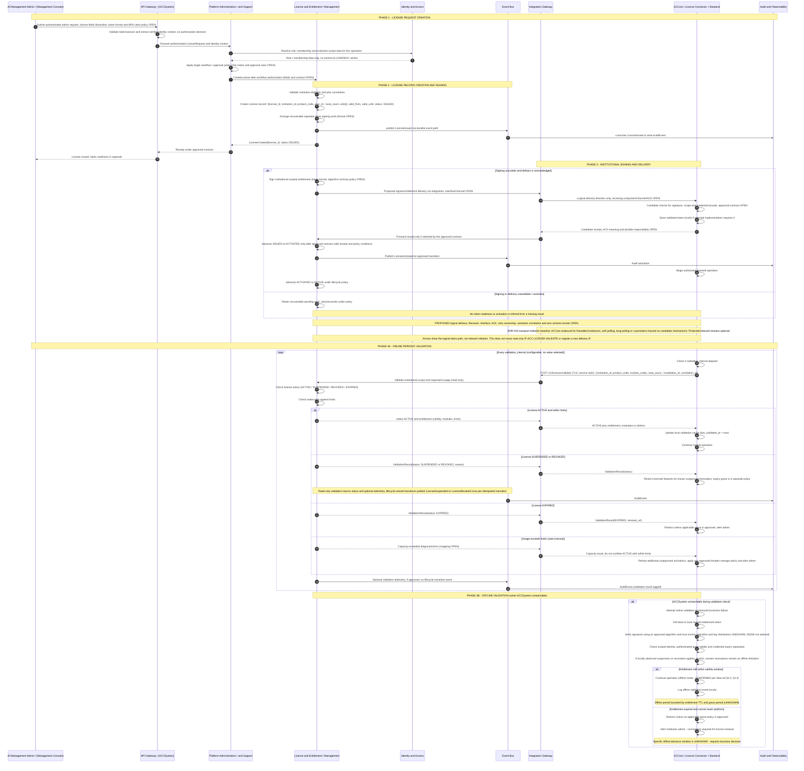

# ACC Ecosystem — Dynamic View: License Activation Flow (Critical Flow #3)

**View type:** Dynamic / Sequence Diagram  
**Stage:** 6 — Supporting Views  
**Status:** PROPOSED  
**Source:** idea.md Sections 7.7, 4.3, 9, 12  
**Parent:** `acc-architecture/`

---

## 1. Purpose and Scope

This view documents the license activation flow for ACCore institutions. It covers:
1. ACManagement admin issuing/renewing a license via the Management Console
2. License & Entitlement Management service generating and signing an entitlement
3. ACCore License Connector receiving the entitlement
4. Online license validation path (periodic check against platform)
5. Offline license validation path (local signed credential check)

**Preconditions:**
- Institution is registered with `platform_institution_id`
- Authorized platform admin or institution-scoped admin acts within approved role, institution scope and issuance/request approval policy; exact role matrix remains OPEN
- Target product and license plan are defined in License & Entitlement catalog
- ACCore backend is operational

**Postconditions (success):**
- Institutional license advances ISSUED → ACTIVATED → ACTIVE when the applicable delivery, acknowledgment and operation conditions are met
- Signed entitlement token reaches ACCore through a separate license-owned issuance/delivery operation; its approved interface, channel, receiver and acknowledgement remain OPEN
- ACCore validates entitlement and enables licensed modules/features
- LicenseIssued + LicenseActivated events on Event Bus (audit trail)

---

## 2. License Activation Sequence Diagram



---

## 3. License State Machine

| State | Transitions From | Transitions To | Trigger |
|---|---|---|---|
| ISSUED | — | ACTIVATED | Entitlement delivered to ACCore + acknowledged |
| ACTIVATED | ISSUED / RENEWED | ACTIVE (operational) | ACCore begins using license |
| ACTIVE | ACTIVATED | SUSPENDED | Admin suspension action |
| ACTIVE | ACTIVATED | REVOKED | Admin revocation action |
| ACTIVE | ACTIVATED | EXPIRED | Status timing relative to validity end and approved grace is OPEN |
| ACTIVE | ACTIVATED | RENEWED | Renewal issued before expiry |
| SUSPENDED | ACTIVE | ACTIVE | Suspension lifted |
| SUSPENDED | ACTIVE | REVOKED | Further action taken |
| EXPIRED | ACTIVE | RENEWED | Renewal issued |
| RENEWED | EXPIRED / ACTIVE | ACTIVE | New entitlement delivered and acknowledged |
| REVOKED | Any | (terminal) | Irrevocable revocation (compliance event) |

---

## 4. Online vs Offline Validation Comparison

| Attribute | Online Path | Offline Path |
|---|---|---|
| Trigger | Periodic validation interval elapsed | ACCSystem unreachable |
| Validation source | License & Entitlement Management service (authoritative) | Local signed entitlement token (cached) |
| Covers revocation? | Yes — real-time status check | No — revocation not reflected until connectivity restored |
| Coverage | Status, seat count, usage and unit list per contract | Signature, workflow/identity, grant validity and credential expiry; current revocation may be unavailable offline |
| Timing | Every `validation_interval` (configurable validation interval — no value selected) | Credential and grant bounds, observed revocation and approved applicable grace constrain offline use |
| Logged where | Platform AuditEvent (server-side) | ACCore local log; synced to platform on reconnect PROPOSED |
| Security risk | Requires connectivity | Revocation may be unseen offline, subject to credential/grant bounds and approved policy |

> [!WARNING]
> The offline tolerance window (entitlement TTL + grace period) is a **BLOCKER — UNKNOWN**. Too short → disrupts legitimate offline ACCore deployments. Too long → revoked licenses operate undetected. Requires business/security decision. See ADR-014.

---

## 5. Signed Entitlement Token Structure (PROPOSED)

```json
{
  "entitlement_id": "ent_uuid",
  "license_id": "lic_uuid",
  "workflow": "institutional",
  "institution_id": "inst_uuid",
  "product_code": "ACCORE",
  "units": ["FINANCE", "INVENTORY", "MARKETPLACE"],
  "seat_count": 50,
  "valid_from": "2026-01-01T00:00:00Z",
  "valid_until": "2027-01-01T00:00:00Z",
  "issued_at": "2026-01-01T00:00:00Z",
  "expires_at": "2026-01-02T00:00:00Z",
  "issuer": "accsystem.license",
  "grace_policy_ref": "policy-controlled"
}
```
*Illustrative claim values only: grant dates differ from credential issue/expiry; TTL, wire mapping, algorithm, key distribution and rotation require approval. Offline verification requires an approved trust anchor; its storage and update path are not selected.*

> [!NOTE]
> Token format (JWT vs custom signed JSON vs signed binary) is **PROPOSED**. JWT (RFC 7519) is recommended for ecosystem compatibility and existing library support.

---

## 6. Open Issues

| ID | Issue | Severity | Owner |
|---|---|---|---|
| LIC-001 | Offline tolerance window — entitlement TTL and grace period duration | HIGH | Business/Security |
| LIC-002 | License revocation propagation — how quickly must ACCore honor a revocation | HIGH | Business/Legal |
| LIC-003 | Seat overuse enforcement — block vs alert vs retroactive billing | MEDIUM | Business |
| LIC-004 | Entitlement token refresh strategy — how ACCore gets renewed token without manual admin action | MEDIUM | Architecture |
| LIC-005 | Key rotation — how platform public key rotation is propagated to ACCore instances | MEDIUM | Architecture/Security |
| LIC-006 | `validation/traceability-24-topics.md` records reported owner direction that ACCommerce is initially free; the original owner prompt is unavailable. Future monetization and access/entitlement model remain OPEN, distinct from purchased software licenses | UNKNOWN | Business |
| LIC-007 | Multi-unit license — partial unit revocation behavior | UNKNOWN | Business |

---

## 7. License Identity and Ownership Glossary

> [!IMPORTANT]
> This glossary is **authoritative** for all license-related documents. Use these definitions consistently across components, functions, interface contracts, and events.

| Term | Definition | Identifier(s) |
|---|---|---|
| **Licensee / Beneficiary** | Party entitled to use the software. Institutional flow is institution-scoped; marketplace record is buyer-scoped, but B2B beneficiary/delegation may differ and is OPEN. | `institution_id` (institutional); `buyer_id` identifies marketplace buyer, not an approved delegated-beneficiary mapping |
| **Buyer** | The party who transacted the purchase. May differ from beneficiary in B2B scenarios. For marketplace flow: `buyer_id`. | `buyer_id` |
| **Publisher / Seller** | The institution that publishes the product to the marketplace and receives payment. This is **not** the license beneficiary. | `publisher_institution_id` (= `item.seller_id` in order context) |
| **Institution operating the installation** | The ACCore instance that runs the licensed software. For institutional licenses = Licensee. For marketplace licenses, the institution operating on behalf of a buyer is a separate concept (OPEN — not yet modelled). | `institution_id` |
| **Product** | The software product being licensed. | `product_id` (marketplace), `product_code` (institutional catalog) |
| **Installation** | A specific running instance of licensed software at an institution. | Not yet modelled — OPEN |
| **License** | The record of an entitlement grant. Contains: license_id, licensee identifier, product identifier, status, validity period. | `license_id` |
| **Entitlement** | The right to use a specific set of features/units/seats, bound to a license. May be represented as a signed token for offline use. | `entitlement_id`, signed token |

### Two Distinct License Workflows

| Dimension | Institutional License (this flow) | Marketplace Software License (FN-LIC-ACTIVATE) |
|---|---|---|
| **Trigger** | Admin action via ACManagement | Automatic — triggered by `OrderConfirmed` event |
| **Licensee identifier** | `institution_id` | `buyer_id` |
| **Product identifier** | `product_code` + `plan_id` | `product_id`; mapping to listing, seller product and software catalog identifiers is OPEN |
| **Publisher/Seller** | Platform itself (ACCSystem as publisher) | An institution's published product |
| **Initial state** | ISSUED → ACTIVATED → ACTIVE | Directly ACTIVE |
| **Seat/unit model** | Yes — `seat_count`, `units[]` | UNKNOWN (idea.md §12 — open decision) |
| **Offline token** | Policy-controlled credential TTL UNKNOWN; grant validity is separate | Policy-controlled credential TTL UNKNOWN; grant validity is separate |
| **Validation query** | `institution_id + product_code` | `buyer_id + product_id` or `license_id` |

> [!NOTE]
> These are **separate, explicitly identified workflows** — not variations of the same lifecycle. The identifier sets (`institution_id + product_code` vs `buyer_id + product_id`) must not be conflated. If a future requirement needs a unified query across both flows, it must be explicitly designed, not assumed.
