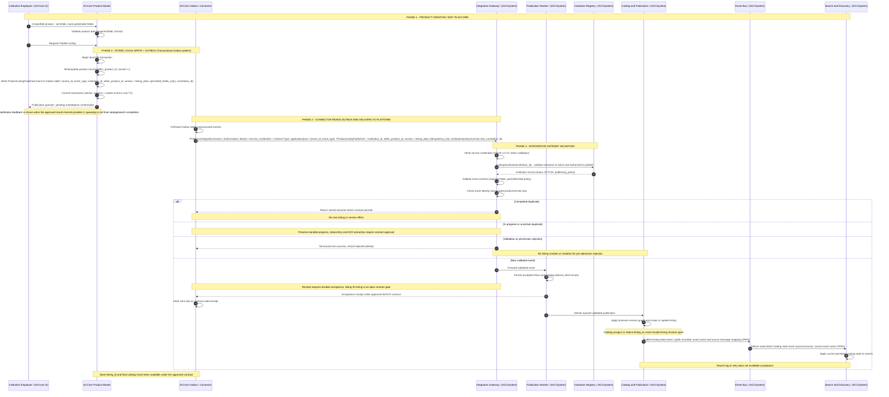
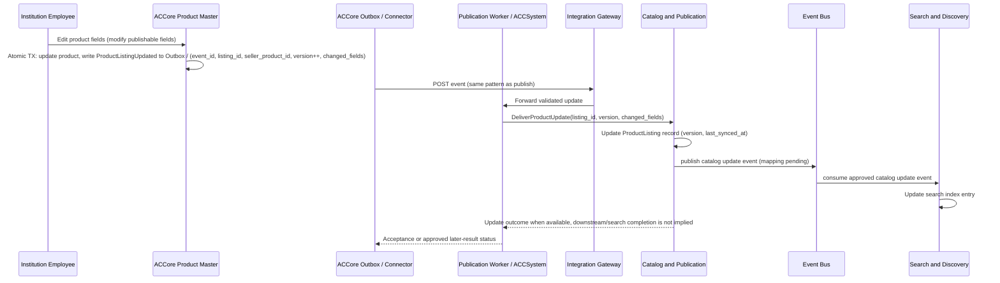
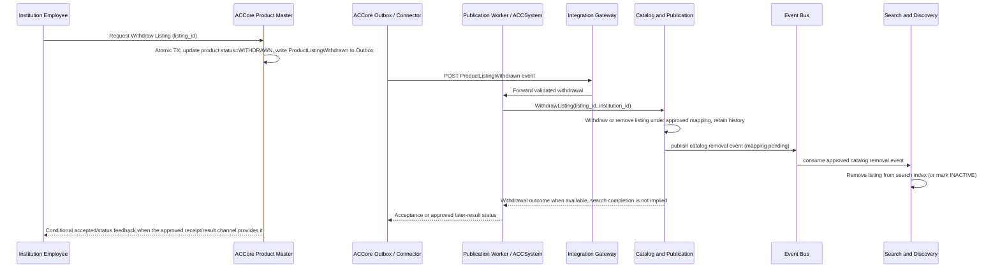

# ACC Ecosystem — Dynamic View: Product Publication Flow (Critical Flow #2)

**View type:** Dynamic / Sequence Diagram  
**Stage:** 6 — Supporting Views  
**Status:** PROPOSED  
**Source:** idea.md Section 7.1  
**Parent:** `acc-architecture/`

---

## 1. Purpose and Scope

This view documents the product publication flow from ACCore's Product Master to the ACC marketplace catalog and search index. It covers the outbox-based async publication, Integration Gateway validation, Catalog domain processing, search indexing, and the result returned to ACCore.

**Preconditions:**
- ACCore institution is registered (`platform_institution_id` exists in Institution Registry)
- ACCore service credentials/certificates are valid under the OAuth 2.0 Client Credentials or mTLS policy selected by ADR-015
- Product exists in ACCore Product Master with internal `seller_product_id`

**Postconditions (after successful catalog processing, not merely receipt):**
- Product Listing exists in Catalog with assigned `listing_id`
- Publication event is durable; search synchronization is asynchronous and may lag
- ACCore holds `listing_id` as marketplace reference
- Catalog publishes listing-state events through the Event Bus to Search and Discovery; exact event names/schemas and mapping from ACCore `ProductListing*` messages remain OPEN

**Acknowledgment semantics and open contract gate:** the existing interface requires an acceptance receipt with an assigned or retained `listing_id`, not proof that search or other observers finished. The worker queues Catalog processing, but the documents do not establish how the Catalog-owned ID is available at receipt time. API Governance, Integration and Catalog must resolve the allocation/receipt or later-result mechanism with compatibility for the existing ID requirement before implementation. Do not treat a queued request or an in-progress duplicate as a completed catalog effect. Final processing is evidenced separately by catalog state and the event trail.

> **Event boundary:** `ProductListingPublished`, `ProductListingUpdated`, and `ProductListingWithdrawn` are source-side ACCore Outbox messages delivered through `IF-ACR-PUBLISH-EVENT`; they are not asserted as internal Event Bus events. Integration processing/audit events and Catalog state events are separate event families. The Catalog→Event Bus→Search Sync path is recorded in C3; exact Catalog event names/schemas and mapping from ACCore source messages remain OPEN until Catalog/API Governance approval.

---

## 2. Product Publication Sequence Diagram

---

## 3. Update and Withdrawal Sub-flows

### 3.1 Product Update (ProductListingUpdated)

### 3.2 Product Withdrawal (ProductListingWithdrawn)

---

## 4. Failure Handling

| Failure Scenario | Response | Recovery |
|---|---|---|
| Integration Gateway unreachable | ACCore Outbox retains event; Connector retries with exponential backoff | Idempotent retry on reconnect — same `event_id` |
| Institution not found or not ACTIVE | Gateway returns 403; Outbox marks event as rejected with reason | Institution must be activated before publishing |
| Schema validation failure | Gateway returns 422 with field errors; Outbox marks event as rejected | ACCore employee corrects data and re-publishes |
| Catalog service unavailable | Gateway queues or returns 503; Connector retries | Outbox retries on next poll cycle |
| Search index update fails | Catalog retains its authoritative state; retry/reconcile the derived index | Rebuild procedure and sync-state handling require Operations/Architecture approval; see CMP-CAT-SEARCHSYNC |
| Duplicate event (Connector retries) | Completed duplicate returns an available stored outcome; in-progress/unknown cases use the approved status or safe retry/recovery contract | No repeated listing/version effect; do not fabricate a final result |
| ACCore Connector restart mid-delivery | Outbox retains unprocessed events (not marked delivered); Connector re-reads and retries | At-least-once delivery with idempotent processing |

---

## 5. Publication Contract Semantics

| Topic | Decision | Notes |
|---|---|---|
| Owning party | ACCore owns the source product and decides publish intent; ACCSystem owns the marketplace listing and derived search record | Source-of-truth remains ACCore; ACCSystem stores a published projection |
| Direction | ACCore → ACCSystem | Outbox-driven async event delivery |
| Interaction pattern | Event/message with idempotency key and retry | Not a synchronous guarantee of final processing |
| Acknowledgment semantics | Existing contract describes acceptance, not search completion | HTTP 200/202 and assigned/retained `listing_id` requirement coexist with queued Catalog work; allocation/receipt timing and in-progress behavior need API/Integration/Catalog resolution |
| Rejection outcomes | Validation error, permission error, or duplicate event is acknowledged idempotently (no new listing/effect); validation and permission errors are rejected | Rejected events remain visible to operations; ACCore may correct and retry |
| Duplicate delivery | Stable `event_id` identifies redelivery; scoped institution/product/version key guards the business operation | Duplicate attempts may occur; no duplicate listing or version effect. Different keys are not synonyms |
| Version below current | No listing-state mutation; `FN-INT-PUBLISH` §3 P4 specifies silent ignore | This is distinct from a higher version arriving while an intermediate update may be missing; that forward-gap case remains `PUB-001` because payload completeness and recovery semantics are unresolved |
| `listing_id` lifecycle | Existing interface requires an ID on first accepted publication and stability across updates | Catalog ownership, timing of receipt vs queued allocation, and withdrawal state/event mapping remain open; preserve historical ID |
| Final processing result | Final state is the catalog record plus event-bus publication trail | Search/indexing lag does not invalidate the accepted publication |

## 6. Data Consistency Notes

- **Product Master → Listing:** Eventual consistency. Search may lag publication; its target is policy-controlled and not established here.
- **Version tracking:** A version lower than current has no listing-state effect (`FN-INT-PUBLISH` §3 P4; `REQ-PH02-LISTING-INGESTION` / `SREQ-PH02-ING-008`). A newer message arriving while an intermediate update may be missing is a different case: `FN-INT-PUBLISH` §4 and `interface-contracts.md` §8.3 show `listing_data`, while this view's §3.1 models `changed_fields`. If an event contract guarantees a complete permitted listing projection, that projection can supersede missing intermediate messages; a partial update cannot safely skip unknown changes unless ordering or reconciliation establishes the correct base. The event/schema must identify payload completeness and its recovery mode; no global mode is selected. `PUB-001` remains open.
- **Listing_id stability:** Once assigned, `listing_id` does not change across updates. Withdrawal retains history; `WITHDRAWN` versus `REMOVED` and the corresponding event mapping require Catalog/API approval.
- **Field isolation:** Only fields marked as permitted by institution policy are included in `listing_data`. ACCSystem must reject any fields not in the permitted schema.

---

## 7. Open Issues

| ID | Issue | Severity | Owner |
|---|---|---|---|
| PUB-001 | Safe handling of a forward version gap (e.g. current v1 receives v3 while v2 may be missing); the sources differ between `listing_data` and `changed_fields` and do not establish snapshot completeness or recovery. | MEDIUM | Architecture / API Governance |
| PUB-002 | Image/media publication — where are marketplace images stored and how are CDN URLs managed | UNKNOWN | Architecture/Product |
| PUB-003 | Conflict resolution policy if institution publishes same `seller_product_id` from multiple ACCore instances | UNKNOWN | Business |
| PUB-004 | Maximum listing fields schema — which fields are permitted for publication not defined in idea.md | UNKNOWN | Product/Business |
| PUB-005 | Receipt vs queued Catalog-owned ID, duplicate in-progress response and durable rejected-attempt representation | HIGH | API Governance / Integration / Catalog |
| PUB-006 | Map publication/update/withdrawal source events to Catalog listing events and states; define rejected-update visibility and search effect | HIGH | Product / Catalog / Integration / API |
