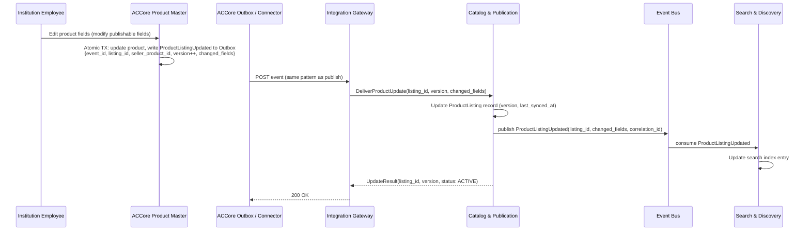
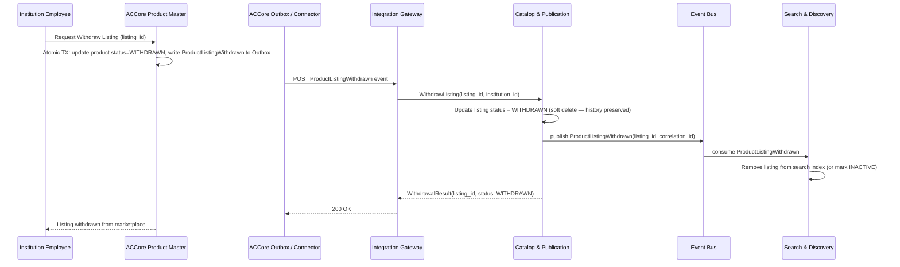

# ACC Ecosystem — Dynamic View: Product Publication Flow (Critical Flow #2)

**View type:** Dynamic / Sequence Diagram  
**Stage:** 6 — Supporting Views  
**Status:** PROPOSED  
**Source:** idea.md Section 7.1  
**Parent:** `acc-architecture/`

---

## 1. Purpose and Scope

This view documents the product publication flow from ACCore's Product Master to the ACC marketplace catalog and search index. It covers the outbox-based async publication, Integration Gateway validation, Catalog domain processing, search indexing, and the result returned to ACCore.

**Preconditions:**
- ACCore institution is registered (`platform_institution_id` exists in Institution Registry)
- ACCore service credentials are valid (OAuth 2.0 Client Credentials issued)
- Product exists in ACCore Product Master with internal `seller_product_id`

**Postconditions (success):**
- Product Listing exists in Catalog with assigned `listing_id`
- Search index includes new listing
- ACCore holds `listing_id` as marketplace reference
- `ProductListingPublished` event is on the Event Bus

**Acknowledgment semantics:** the platform response is an acceptance receipt for the publication request; it confirms that the event was accepted and the catalog assigned or retained the `listing_id`, not that downstream search indexing and all external observers have finished processing. Final processing status is the catalog state plus the event bus publication trail.

---

## 2. Product Publication Sequence Diagram

```mermaid
sequenceDiagram
    autonumber
    participant EMP as Institution Employee<br/>(ACCore UI)
    participant ACM as ACCore Product Master
    participant OBX as ACCore Outbox / Connector
    participant IGW as Integration Gateway<br/>(ACCSystem)
    participant IR as Institution Registry<br/>(ACCSystem)
    participant CAT as Catalog & Publication<br/>(ACCSystem)
    participant BUS as Event Bus<br/>(ACCSystem)
    participant SRC as Search & Discovery<br/>(ACCSystem)

    Note over EMP,SRC: PHASE 1 — PRODUCT CREATION / EDIT IN ACCORE

    EMP->>ACM: Create/Edit product — set fields, mark publishable fields
    ACM->>ACM: Validate product data (required fields, format)
    EMP->>ACM: Request Publish Listing

    Note over ACM,OBX: PHASE 2 — ATOMIC LOCAL WRITE + OUTBOX (Transactional Outbox pattern)

    ACM->>ACM: Begin local DB transaction
    ACM->>ACM: Write/update product record (seller_product_id, version++)
    ACM->>ACM: Write ProductListingPublished event to Outbox table<br/>{event_id, event_type, institution_id, seller_product_id, version,<br/>listing_data: {permitted_fields_only}, correlation_id}
    ACM->>ACM: Commit transaction (atomic: product + outbox event in one TX)
    ACM-->>EMP: Publication queued — pending marketplace confirmation

    Note over OBX,IGW: PHASE 3 — CONNECTOR READS OUTBOX AND DELIVERS TO PLATFORM

    OBX->>OBX: Poll/read Outbox table (unprocessed events)
    OBX->>IGW: POST /v1/integration/events<br/>Authorization: Bearer <service_credential><br/>Content-Type: application/json<br/>{event_id, event_type: "ProductListingPublished",<br/>institution_id, seller_product_id, version,<br/>listing_data, idempotency_key: event_id, correlation_id}
    
    Note over IGW,IR: PHASE 4 — INTEGRATION GATEWAY VALIDATION

    IGW->>IGW: Verify service credentials (OAuth 2.0 CC token validation)
    IGW->>IR: LookupInstitution(institution_id) — validate institution is active and authorized to publish
    IR-->>IGW: Institution record (status: ACTIVE, publishing_policy)
    IGW->>IGW: Validate event schema (required fields, permitted field policy)
    IGW->>IGW: Check idempotency — event_id already processed?

    alt Event already processed (duplicate delivery)
        IGW-->>OBX: 200 OK (idempotent response — already delivered)
        OBX->>OBX: Mark outbox event as delivered
        Note over OBX,IGW: Duplicate suppressed. No downstream side effects.
    else New event
        IGW->>CAT: DeliverProductPublication(institution_id, seller_product_id,<br/>version, listing_data, event_id, correlation_id)
    end

    Note over CAT,SRC: PHASE 5 — CATALOG PROCESSING

    CAT->>CAT: Check if listing exists for (institution_id, seller_product_id)
    
    alt New listing
        CAT->>CAT: Assign listing_id (new UUID)
        CAT->>CAT: Create ProductListing record<br/>{listing_id, institution_id, seller_product_id, version,<br/>listing_data, status: ACTIVE, published_at, last_synced_at}
    else Existing listing (update/re-publish)
        CAT->>CAT: Update ProductListing record (version++, last_synced_at)
        CAT->>CAT: Keep listing_id unchanged
    end

    CAT->>BUS: publish ProductListingPublished<br/>{event_id: new_uuid, listing_id, institution_id,<br/>seller_product_id, version, correlation_id, causation_id: original_event_id}

    Note over BUS,SRC: PHASE 6 — SEARCH INDEX UPDATE

    BUS->>SRC: consume ProductListingPublished (async)
    SRC->>SRC: Index/update listing in search index<br/>{listing_id, searchable fields, filters, institution_id, status: ACTIVE}
    SRC->>SRC: Confirm index update

    Note over IGW,ACM: PHASE 7 — RESULT RETURNED TO ACCORE

    CAT-->>IGW: PublicationResult(listing_id, version, status: PUBLISHED)
    IGW-->>OBX: 200 OK with PublicationResult<br/>{listing_id, version, status, published_at}
    OBX->>OBX: Mark outbox event as delivered
    OBX->>ACM: Update product record with listing_id and marketplace_status: PUBLISHED
    ACM-->>EMP: Publication accepted — listing_id stored; marketplace visibility is confirmed once catalog and search indexing complete

    Note over EMP,SRC: FLOW COMPLETE — Product visible in catalog and search; ack is an accepted receipt, not a final downstream processing guarantee
```

---

## 3. Update and Withdrawal Sub-flows

### 3.1 Product Update (ProductListingUpdated)



### 3.2 Product Withdrawal (ProductListingWithdrawn)



---

## 4. Failure Handling

| Failure Scenario | Response | Recovery |
|---|---|---|
| Integration Gateway unreachable | ACCore Outbox retains event; Connector retries with exponential backoff | Idempotent retry on reconnect — same `event_id` |
| Institution not found or not ACTIVE | Gateway returns 403; Outbox marks event as rejected with reason | Institution must be activated before publishing |
| Schema validation failure | Gateway returns 422 with field errors; Outbox marks event as rejected | ACCore employee corrects data and re-publishes |
| Catalog service unavailable | Gateway queues or returns 503; Connector retries | Outbox retries on next poll cycle |
| Search index update fails | Catalog has authoritative listing; search re-indexes from event replay | Search index is a derived projection — always rebuildable |
| Duplicate event (Connector retries) | Gateway checks `event_id` idempotency store; returns 200 without re-processing | No duplicate listing created |
| ACCore Connector restart mid-delivery | Outbox retains unprocessed events (not marked delivered); Connector re-reads and retries | At-least-once delivery with idempotent processing |

---

## 5. Publication Contract Semantics

| Topic | Decision | Notes |
|---|---|---|
| Owning party | ACCore owns the source product and decides publish intent; ACCSystem owns the marketplace listing and derived search record | Source-of-truth remains ACCore; ACCSystem stores a published projection |
| Direction | ACCore → ACCSystem | Outbox-driven async event delivery |
| Interaction pattern | Event/message with idempotency key and retry | Not a synchronous guarantee of final processing |
| Acknowledgment semantics | Acceptance receipt only | `200 OK` means the publication command was accepted and `listing_id` was assigned/retained. It does not guarantee search indexing or downstream processing has finished |
| Rejection outcomes | Validation error, permission error, or duplicate event is rejected without creating a new listing | Rejected events remain visible to operations; ACCore may correct and retry |
| Duplicate delivery | Same `event_id`/`idempotency_key` must be processed once only | No duplicate listing, no duplicate version increment |
| Out-of-order updates | Stale versions are not applied if they are older than the current stored version | `version` is used for ordering; later updates can be replayed or reconciled as needed |
| `listing_id` lifecycle | `listing_id` is assigned on first accepted publication and retained across subsequent updates | Withdrawn listings keep the historical `listing_id` for traceability while their status becomes `WITHDRAWN` |
| Final processing result | Final state is the catalog record plus event-bus publication trail | Search/indexing lag does not invalidate the accepted publication |

## 6. Data Consistency Notes

- **Product Master → Listing:** Eventual consistency. The search index may lag publication by seconds to minutes.
- **Version tracking:** ACCSystem stores `version` from ACCore to detect stale updates (if an older version arrives, it should be rejected or handled per conflict policy — PROPOSED).
- **Listing_id stability:** Once assigned, `listing_id` does not change across updates. Withdrawal does not delete the record — it sets status=WITHDRAWN.
- **Field isolation:** Only fields marked as permitted by institution policy are included in `listing_data`. ACCSystem must reject any fields not in the permitted schema.

---

## 7. Open Issues

| ID | Issue | Severity | Owner |
|---|---|---|---|
| PUB-001 | Out-of-order update handling — if v3 arrives before v2 | MEDIUM | Architecture |
| PUB-002 | Image/media publication — where are marketplace images stored and how are CDN URLs managed | UNKNOWN | Architecture/Product |
| PUB-003 | Conflict resolution policy if institution publishes same `seller_product_id` from multiple ACCore instances | UNKNOWN | Business |
| PUB-004 | Maximum listing fields schema — which fields are permitted for publication not defined in idea.md | UNKNOWN | Product/Business |
