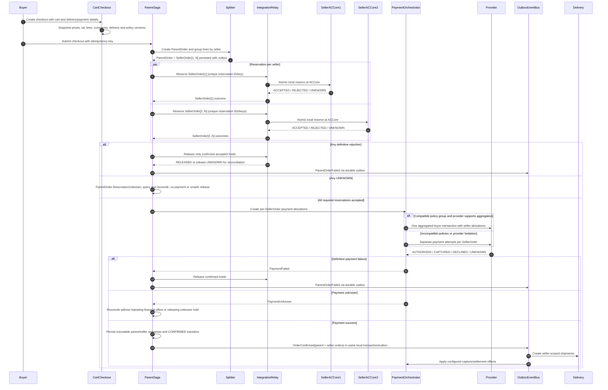

# ACC Ecosystem — Dynamic View: Multi-Seller Purchase Flow

**Status:** PROPOSED MVP BASELINE — multi-seller and multi-category carts are required.

## Rules
A cart is grouped by seller/institution into one ParentOrder and one SellerOrder per seller. ACCore owns inventory. Reservation requests run concurrently where safe and each has a unique reservation ID/idempotency key. Payment is blocked until every required reservation has a known definitive result. `UNKNOWN` never means rejection and never authorizes an unsafe release.

## Sequence

## State and accounting rules

| Level | Required record |
|---|---|
| ParentOrder | aggregated product/tax/delivery totals by currency, policy snapshot IDs, seller-order references, overall state |
| SellerOrder | seller lines, price/tax/delivery/commission allocations, transaction currency, exchange source/time if converted, reservation/payment references, seller policy |
| Payment | per SellerOrder allocation and idempotency key; aggregated buyer transaction only with compatible policy support |
| Ledger | separate capture/collection, seller credit/transfer, commission payable, settlement, and manual-payment postings |

`OrderConfirmed` is committed with the order snapshot and outbox entry atomically in ACCSystem. If the relay is unavailable, the outbox retries; the committed order is not silently undone. Delivery-provider collection of funds is separate from delivery-charge collection and is not included in core payment unless explicitly configured.
