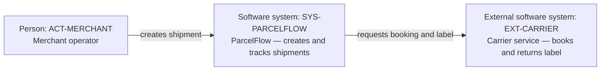

# System Context (C1) — ParcelFlow

Scope: one software system and directly connected people/external systems. Audience: business and technical stakeholders. Relationship labels show business intent, not protocol details.

## Diagram key

- Person = a human role interacting with the in-scope software system.
- Software system = ParcelFlow, the system of interest.
- External software system = a dependency outside ParcelFlow ownership.
- Arrow = one-way business interaction in the arrow direction.
