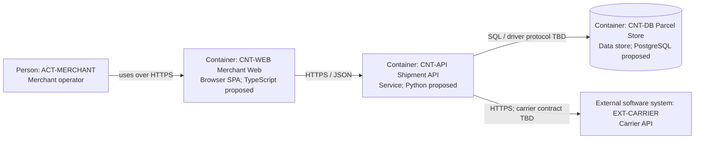

# Container Diagram (C2) — ParcelFlow

Scope: ParcelFlow software system. Technology labels are proposals from sample ADRs, not accepted production decisions. Audience: developers and operations.

## Diagram key

- Rectangle = application/service container; cylinder = data-store container; external system and person are supporting elements.
- Arrow = one-way interaction; the label names protocol/technology where known. “Proposed” and “TBD” are not confirmed facts.
