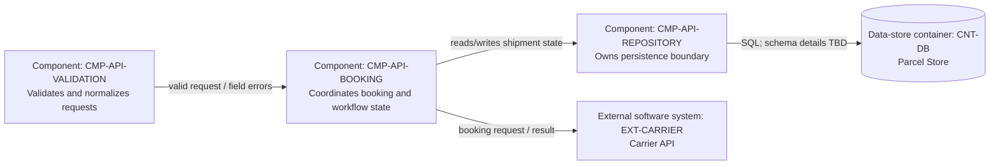

# Component Diagram (C3) — CNT-API Shipment API

Scope: components inside the API container; connected data store and external carrier are supporting elements. Technology: API runtime is proposed Python; component-level implementation choices are unresolved. Audience: architects and developers.

## Diagram key

- Component = logical responsibility inside CNT-API; technology is unspecified at this detail level.
- External software system and data-store container are supporting elements outside the component scope.
- Arrows represent one-way calls/data flow as labeled; protocol details not evidenced remain TBD.
