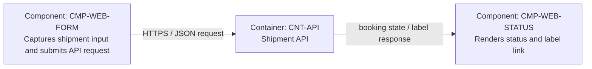

# Component Diagram (C3) — CNT-WEB Merchant Web

Scope: components inside the browser application; CNT-API is a supporting container. Technology: TypeScript SPA is proposed; framework and component-level implementation are unresolved. Audience: architects and developers.

## Diagram key

- Component = logical responsibility inside CNT-WEB; proposed technology is TypeScript SPA.
- Container = supporting separately running application/service.
- Arrows are one-way interactions; the HTTP contract's exact paths/status codes remain unresolved.
